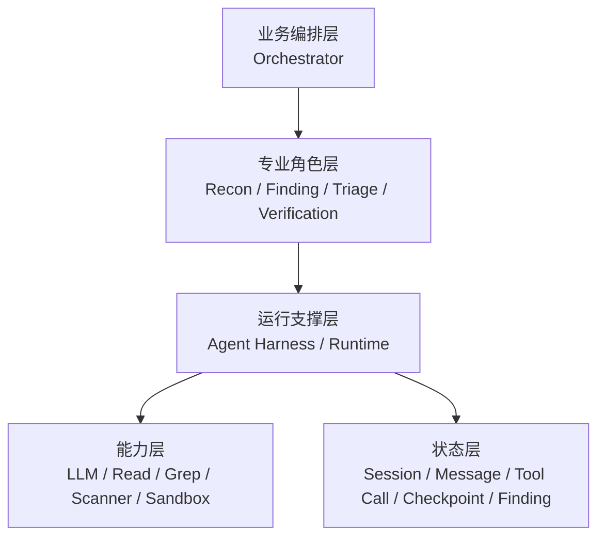
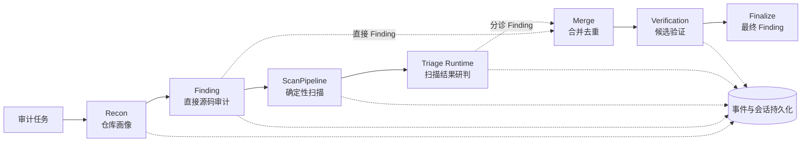
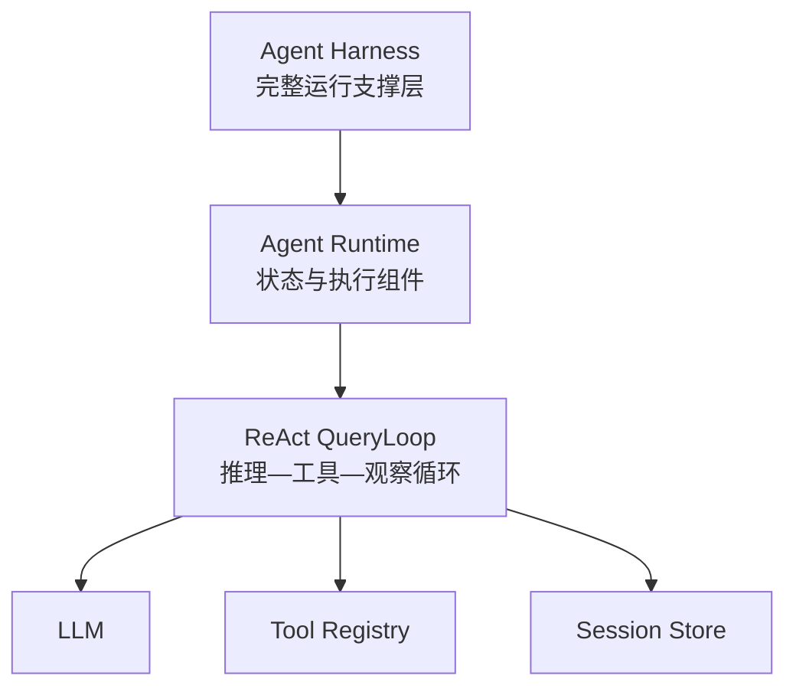
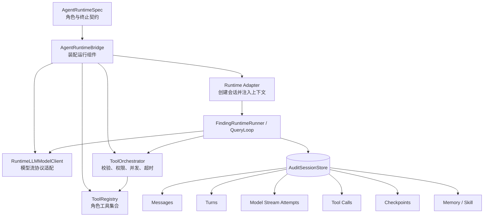
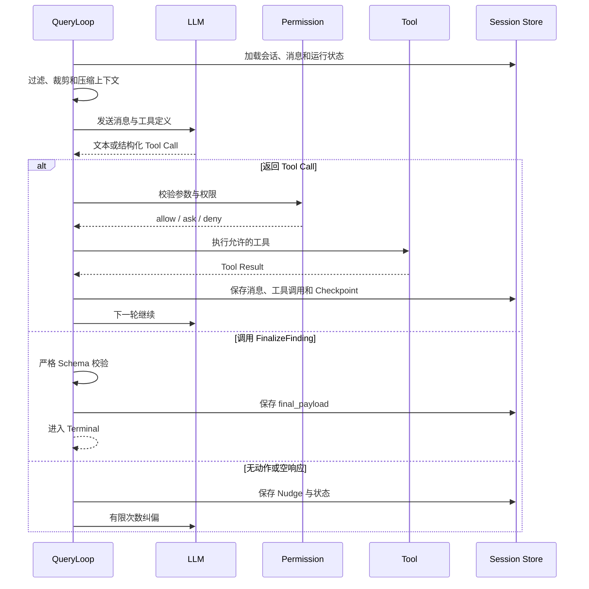
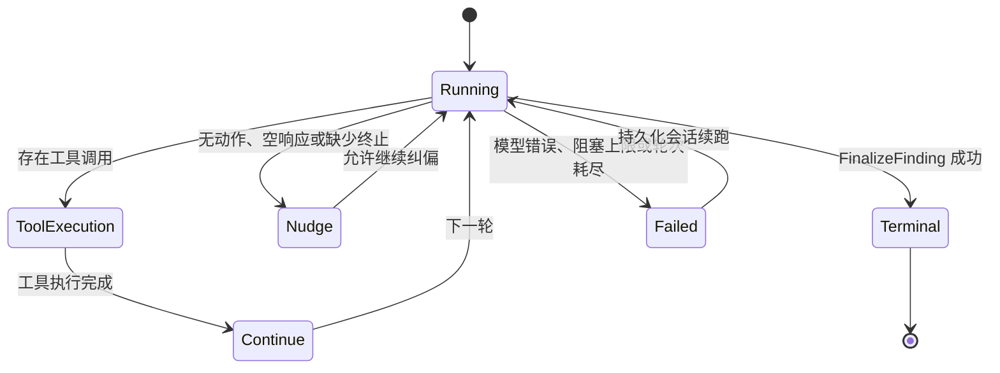

# AutoCVE Agent 与后端面试深挖手册

> 主题：Python 多角色 Agent 审计链路与自研 Agent Harness  
> 面向岗位：AI Agent 工程师、Java/Python 后端工程师、LLM 应用工程师  
> 代码核验日期：2026-07-27  
> 写作原则：把“业务目标”“代码已经实现的事实”“设计取舍”“当前限制”和“后续改进”分开说明。

## 阅读导航

这份文档不要求从头背到尾，可以按准备时间使用：

- 只有 5 分钟：阅读“第二部分：项目口语化介绍”和“第二十二部分：最后速记”；
- 准备项目开场：重点阅读“第一部分”和“第二部分”；
- 准备第一条简历深挖：阅读“第三、第四部分”；
- 准备 Agent Harness 深挖：阅读“第五至第十六部分”；
- 准备后端追问：阅读“第十四、第十七部分”；
- 面试前查漏补缺：阅读“第十九部分：面试中不要这样说”；
- 需要对照实现：使用“第二十一部分：关键代码索引”回到源码。

文档中的表述分为三类：

- “当前实现”：可以直接作为项目事实回答；
- “设计取舍”：可以说明为什么这样做以及付出的代价；
- “改进方向”：只能作为后续规划，不能说成已经上线的能力。

---

## 一、简历中的两条技术表述

### 第一条：多角色 Agent 审计主链路

> 构建 Python 多角色 Agent 源码审计链路，由确定性 Orchestrator 编排 Recon、Finding、ScanPipeline、Triage 与 Verification，汇合 Agent 直接审计和扫描分诊结果，并持久化消息、工具调用、Checkpoint 与结构化 Finding。

### 第二条：Agent Harness

> 自研面向 Finding/Triage 的 Agent Harness（Agent Runtime），统一模型流、角色级 Tool Registry、权限与会话状态；在 Finding ReAct 中引入可配置轮次及字符级上下文预算、Nudge、上下文压缩、流式重试和 FinalizeFinding 结构化终止。

这两条的关系不是两个互不相关的功能：

```text
第一条回答：整个源码审计业务如何分阶段完成？

第二条回答：其中需要长时间调用模型和工具的 Agent，
           如何稳定、可控、可恢复地运行？
```

---

# 第一部分：业务背景与项目价值

## 1. 为什么要做这个项目？

源码安全审计通常面临两类互补的问题。

第一类是传统扫描器擅长的问题：

- 已知危险 API；
- 明确的代码模式；
- 硬编码密钥；
- 已知漏洞依赖；
- 可以通过规则稳定匹配的问题。

传统 Scanner 的优点是确定、快速、容易回归；缺点是难以理解：

- 跨文件的数据流；
- 业务权限缺失；
- 多租户隔离错误；
- 只有结合上下文才能判断的逻辑漏洞；
- 某个输入最终是否真的到达危险操作。

第二类是大模型 Agent 擅长的问题：

- 根据仓库结构决定先看什么；
- 主动搜索入口和调用链；
- 跨文件跟踪 Source 到 Sink；
- 根据新证据动态改变调查方向；
- 补充规则扫描器难以覆盖的业务语义。

但是，直接把大模型接到代码仓库上也会产生新问题：

- 模型可能反复搜索同一内容；
- 工具结果不断进入上下文；
- 模型只描述“下一步要做什么”，却没有真正调用工具；
- 模型用自然语言说“完成”，但没有提交后端能消费的结构化结果；
- 长任务中途遇到模型流中断、工具超时或服务重启；
- 如果工具权限过大，模型可能执行不应执行的动作；
- 如果只保存最终结果，出了问题无法定位过程。

因此，这个项目不是简单的“LLM 调用封装”，而是在解决两个核心业务问题：

> 第一，如何把规则扫描的确定性与 Agent 的语义理解能力组合起来。

> 第二，如何把不稳定的多轮模型调用变成后端可管理的长任务。

## 2. 面向什么使用场景？

一个典型使用流程是：

1. 用户提交一个待审计项目；
2. 系统识别仓库技术栈、入口和高风险区域；
3. Agent 主动阅读和搜索源码；
4. Scanner 执行确定性安全扫描；
5. Triage 对扫描结果进行研判；
6. 系统汇合不同来源的 Finding；
7. Verification 对高价值候选继续验证；
8. 最终输出结构化漏洞结果和可追踪的运行记录。

业务上希望得到的不是一段聊天回答，而是：

- 可以持久化的 Finding；
- 可以进入后续验证的标准字段；
- 可以定位失败阶段的事件；
- 可以回看模型和工具轨迹的会话；
- 可以显式区分成功、失败和未完整收口的状态。

## 3. 项目解决问题的总体思路

项目采用了三层设计：



各层职责如下：

| 层次 | 解决的问题 |
|---|---|
| Orchestrator | 业务阶段按什么顺序执行、阶段结果如何传递 |
| 专业角色 Agent | 每个阶段具体要完成什么任务 |
| Agent Harness | 模型、工具、权限、状态、预算、重试和终止如何统一管理 |
| 工具与模型 | 真正执行代码读取、搜索、扫描和模型推理 |
| 持久化 | 如何追踪、恢复和复盘长任务 |

---

# 第二部分：项目口语化介绍

## 1. 一句话版本

> AutoCVE 是一个把确定性安全扫描器和多角色 LLM Agent 组合起来的源码审计系统：上层用固定 Orchestrator 控制业务流程，下层用自研 Agent Harness 管理模型、工具、上下文、状态和结构化收口。

## 2. 30 秒版本

> 传统扫描器比较稳定，但对跨文件数据流和业务逻辑漏洞理解不足；大模型 Agent 能主动调查源码，但容易出现循环、上下文膨胀和结果不收口。因此我把审计流程拆成 Recon、Finding、ScanPipeline、Triage 和 Verification，由确定性 Orchestrator 串行编排，再汇合 Agent 直接审计与扫描分诊两路结果。对于 Finding 和 Triage 这种长程 Agent，我又抽象了一层 Agent Harness，统一模型流、工具权限、会话状态、上下文控制、重试和结构化终止。

## 3. 90 秒版本

> 这个项目的业务目标是提高源码安全审计的覆盖能力，同时让 Agent 的运行过程可控。Recon 先生成仓库画像，Finding Agent 主动搜索和阅读源码，ScanPipeline 执行确定性规则扫描，Triage Runtime 研判扫描结果，最后把直接审计与扫描分诊两路 Finding 合并，再选择候选进入 Verification。
>
> 这里的主流程不是让 LLM 自由规划，而是由代码固定阶段顺序。这样做的原因是安全审计属于长任务，需要明确的失败语义、成本边界和审计轨迹。每个阶段可以使用独立提示词、工具、上下文和模型配置，即使底层使用同一个模型，也能实现职责与权限隔离。
>
> Finding 内部使用 ReAct 循环。模型根据现有证据调用 Read、Grep、Glob 等工具，Runtime 校验权限并执行工具，再把结果带回下一轮。为了避免失控，我实现了可配置轮次、字符级上下文预算、Nudge、分层压缩、模型流重试和 FinalizeFinding 结构化终止。消息、轮次、模型流尝试、工具调用和 Checkpoint 会持久化，因此可以定位错误，并从最近完整状态继续。

## 4. 3 分钟版本

> 我做这个项目时，先把问题分成“审计覆盖”和“Agent 工程化”两部分。
>
> 审计覆盖方面，Scanner 和 Agent 各有长短。Scanner 对已知模式稳定、便宜、可回归，但业务逻辑理解不足；Agent 能跨文件追踪 Source 到 Sink，却有不确定性。所以我没有用 Agent 替代 Scanner，而是保留两路结果来源：Finding Agent 直接审计源码，ScanPipeline 产生候选后交给 Triage 研判，最后通过确定性规则合并，再进入 Verification。
>
> 流程控制方面，我没有让一个总控 Agent 自由决定所有阶段，而是使用固定 Orchestrator。当前执行顺序是 Recon、Finding、ScanPipeline、Triage、Merge、Verification、Finalize。它是串行执行，“两路”指两种 Finding 来源，不是两个并行线程。这样做牺牲了一部分延迟，但换来了清晰的状态转换、失败处理和可测试性。
>
> Agent 工程化方面，我把 Finding 和 Triage 的公共能力抽象为 Agent Harness。它不负责漏洞推理本身，而是负责模型流适配、角色级 Tool Registry、权限检查、会话状态、工具参数校验、并发安全分组、工具超时、模型流整轮重试、Checkpoint 和终止协议。
>
> Finding 使用 ReAct QueryLoop。每一轮先构造上下文，再让模型选择工具或 FinalizeFinding。上下文处理不是单一摘要算法，而是固定管线：边界过滤、工具结果预算、历史裁剪、微压缩、上下文折叠、可配置 LLM 摘要，最后做阻塞上限检查。如果模型只说继续但没有调用工具，或者没有提交最终结果，Runtime 会插入有限次数的 Nudge。只有 FinalizeFinding 通过严格 Schema 校验，才算正常完成；否则最终会标记为 incomplete，而不是伪装成成功。
>
> 后端上，Runtime 会保存 Session、Message、Turn、Model Stream Attempt、Tool Call 和 Checkpoint。恢复粒度是最近已持久化的完整回合，不是从某个中断 Token 继续。这个设计让模型的不确定性被包在一个可观察、可约束的执行框架里。

---

# 第三部分：第一条简历内容深挖

## 1. 第一条到底表达了什么？

这条简历包含四层信息：

1. 项目不是单 Agent，而是多角色协作；
2. 主业务流程由确定性 Orchestrator 控制；
3. Agent 直接审计和 Scanner 分诊结果形成互补；
4. 整个过程有持久化运行轨迹。

可以把它拆成下面这张图：



## 2. 为什么先做 Recon？

Recon 可以翻译为：

> Reconnaissance，侦察；在本项目中更准确地说是“仓库画像”。

它解决的是“Agent 在不知道项目结构时盲目搜索”的问题。

Recon 输出的信息包括：

- 项目技术栈；
- 主要入口；
- 高风险目录；
- 值得优先查看的文件；
- 推荐扫描器；
- 后续 Agent 所需的项目上下文。

业务上的思考是：

> 先用一次轻量探索建立共享地图，再让后续阶段基于同一份仓库认知工作。

如果没有 Recon，Finding、Scanner 配置和 Verification 可能各自重复探索：

- 增加模型与工具成本；
- 不同阶段对项目范围理解不一致；
- 更难解释为什么某些目录被优先审计。

### 面试口语表达

> 我把 Recon 看作整个审计任务的共享前置上下文。它不负责直接下漏洞结论，而是识别技术栈、入口和高风险区域，减少后续 Agent 的盲目搜索，并让 Finding、Scanner 和 Verification 对审计范围有一致认识。

## 3. 为什么同时保留 Finding 和 Scanner？

### Scanner 路径

Scanner 更像确定性程序：

```text
规则或安全工具
→ 扫描源码
→ 产生原始候选
→ Triage 研判
```

它擅长：

- 已知规则；
- 明确危险函数；
- Secret；
- 依赖漏洞；
- 可稳定回归的安全模式。

### Finding 路径

Finding Agent 更像主动调查者：

```text
搜索入口
→ 读取相关代码
→ 跟踪调用关系
→ 补充上下文
→ 构造 Source 到 Sink 证据
→ 提交结构化 Finding
```

它擅长：

- 跨文件数据流；
- 业务鉴权；
- 多租户边界；
- 组合条件才能成立的问题；
- Scanner 没有现成规则的漏洞。

### 两者为什么不是替代关系？

| 方法 | 优势 | 短板 |
|---|---|---|
| Scanner-only | 快、确定、便宜、容易回归 | 业务语义和跨文件推理弱 |
| Agent-only | 调查灵活、能理解上下文 | 成本高、不确定、容易循环 |
| Scanner + Agent | 兼顾确定性覆盖和语义补充 | 编排、去重、状态管理更复杂 |

### 面试口语表达

> 我没有把大模型当成传统扫描器的替代品。Scanner 提供稳定的规则覆盖，Agent 补充跨文件和业务语义。两者分别形成 Finding 来源，最后在 Merge 阶段汇合，这样既能保留确定性基线，也能扩大复杂漏洞的覆盖面。

## 4. 实际执行是串行还是并行？

当前代码明确记录：

```python
"execution_mode": "finding_first_sequential"
```

中文是：

> Finding 优先的串行执行。

实际时间顺序如下：

```text
Recon
→ Finding
→ ScanPipeline
→ Triage Runtime
→ Merge
→ Verification
→ Finalize
```

代码位置：

- `backend/app/services/agent/agents/orchestrator.py:683-890`
- 串行模式元数据：`orchestrator.py:748`

这里最容易说错的是：

> “两路 Finding”描述结果来源，不代表两条线程并行执行。

而且当前 Finding 失败会提前返回，后续 ScanPipeline 不会继续，因此它们也不是互相独立的容错分支。

### 为什么当前选择串行？

合理的工程收益包括：

- 控制流简单；
- 阶段失败语义明确；
- 日志与事件顺序容易理解；
- 不需要处理两路同时更新共享状态；
- 更容易调试和回归；
- Finding 优先策略可以先得到直接审计结论。

代价包括：

- 总耗时更长；
- Finding 失败会阻断 Scanner；
- 没有充分利用 Scanner 与 Agent 可并行的特点。

### 如果面试官问为什么不并行

推荐回答：

> 当前版本优先保证流程正确性和可观察性，所以采用串行编排。它的缺点是端到端延迟更高，而且 Finding 失败会阻断扫描。后续并行化时，我会让两路共享只读 Recon 结果，分别设置超时与失败降级，再使用 `asyncio.gather(return_exceptions=True)` 汇合，避免一个分支失败导致另一路结果丢失。这个是改进方案，不是当前已经实现的能力。

## 5. 为什么使用确定性 Orchestrator？

确定性 Orchestrator 的意思不是“不使用模型”，而是：

> 主阶段的顺序和状态转换由代码决定，而不是让 LLM 每次自由规划。

### 与 LLM 自由编排对比

| 维度 | 确定性 Orchestrator | LLM 自由编排 |
|---|---|---|
| 阶段顺序 | 代码固定 | 模型动态决定 |
| 可测试性 | 高 | 较低 |
| 成本上限 | 容易控制 | 更难预测 |
| 失败语义 | 明确 | 容易出现模糊状态 |
| 灵活性 | 相对较低 | 高 |
| 审计性 | 强 | 需要额外约束 |

### 为什么安全审计更适合固定主流程？

- Scanner 是必须执行的确定性能力；
- Verification 应只接收经过选择的候选；
- 最终结果必须有固定数据契约；
- 长任务需要明确阶段状态；
- 安全任务不适合完全依赖模型自行决定是否跳过关键步骤。

### 面试口语表达

> 我把 LLM 的自主性限制在阶段内部，把阶段之间的业务流程交给代码。模型可以决定下一步读哪个文件，但不能自由跳过 Scanner、Merge 或终止协议。这相当于用确定性外壳包住不确定推理，既保留 Agent 的灵活性，又让后端能够管理任务状态。

## 6. 每个阶段到底是不是 Agent？

不能简单说“项目有五个完全相同的 Agent”。

| 阶段 | 当前身份 | 主要职责 |
|---|---|---|
| Orchestrator | 固定编排器 | 构建计划、传递结果、合并和选择候选 |
| Recon | 专业 Agent | 仓库画像 |
| Finding | 专业 Agent，可进入 Runtime 路径 | 直接源码调查 |
| ScanPipeline | 确定性扫描流水线 | 运行 Scanner 并生成候选 |
| Triage | 专业 Runtime 角色 | 分批研判扫描结果 |
| Verification | 专业 Agent | 验证候选 |
| Merge | 普通 Python 方法 | 字段规则合并 |
| Finalize | 普通 Python 方法 | 合入验证状态、形成最终结果 |

代码位置：

- Orchestrator：`backend/app/services/agent/agents/orchestrator.py`
- ScanPipeline：`backend/app/services/scan_runtime/pipeline.py`
- Agent Runtime Spec：`backend/app/services/agent_runtime/specs.py`

### 面试口语表达

> 更准确的说法是“多角色 Agent 与确定性流水线混合编排”。Recon、Finding 和 Verification 是专业 Agent，ScanPipeline 是确定性程序，Triage 走专门 Runtime，Merge 和 Finalize 是普通后端方法。

## 7. 两路 Finding 怎么合并？

第一路：

```python
direct_findings = finding_result.data.get("findings", [])
```

第二路：

```python
triage_findings = triage_result.data.get("findings", [])
```

汇合位置：

```python
merged_findings = self._merge_findings([
    triage_findings,
    direct_findings,
])
```

当前去重键是：

```text
file_path + line_start + vulnerability_type
文件路径 + 起始行号 + 漏洞类型
```

命中相同键后会：

- 保留更高置信度；
- 保留更高严重级别；
- 优先使用更完整的描述和代码片段；
- 补全 Source、Sink、PoC、Impact、验证说明等字段；
- 合并结果来源；
- 重新计算报告状态。

代码位置：

`backend/app/services/agent/agents/orchestrator.py:520-571`

### 为什么不用 LLM 再做语义去重？

当前方法的优点：

- 快；
- 确定；
- 不增加模型成本；
- 容易写回归测试。

不足：

- 同一漏洞如果定位到相邻行，可能无法去重；
- 同一根因被标成不同漏洞类型，可能留下多条；
- 不具备语义相似度能力。

### 面试口语表达

> 当前 Merge 使用确定性字段键，不是向量相似度，也没有再调用 LLM。它优先保证性能和可测试性。后续如果误重复问题明显，我会先做文件路径归一化和行号窗口，再考虑规则加语义的两阶段去重，而不是直接让模型判断所有结果。

## 8. 多个 Agent 是否调用同一个模型？

代码为不同角色分别创建 `LLMService`：

- Orchestrator；
- Recon；
- Analysis；
- Scan；
- Triage；
- Finding；
- Verification。

默认可以继承相同的模型配置，也支持通过 `agentConfigs` 按角色覆盖：

- Provider；
- Model；
- API Key；
- Base URL；
- Temperature；
- Max Tokens；
- 其他模型参数。

代码位置：

`backend/app/api/v1/endpoints/agent_tasks.py:1252-1337`

所以准确回答是：

> 多个角色可以调用同一个底层模型，也可以按角色使用不同模型。Multi-Agent 与底层是否同模是两个维度。

### 同一个模型为什么还要拆 Agent？

一个 Agent 不只等于模型：

```text
Agent
= 模型
+ 角色提示词
+ 工具集合
+ 权限
+ 私有上下文
+ 状态
+ 预算
+ 输出契约
```

拆分的价值包括：

- 职责隔离；
- 上下文隔离；
- 工具与权限隔离；
- 提示词专门化；
- 阶段级观测；
- 独立评测；
- 后续按角色选择不同成本模型。

代价包括：

- 调用次数增加；
- 总延迟和成本增加；
- 阶段数据契约更复杂；
- 上游错误可能传递给下游。

### 面试口语表达

> Multi-Agent 的价值不只是把 Context Window 分开。即使底层是同一个模型，不同角色仍拥有独立提示词、工具、权限、状态和终止协议。这样 Recon 不会随意提交漏洞，Verification 也不需要携带 Finding 的全部探索历史。

## 9. “g

项目有两层持久化。

### 外层任务级记录

主要保存：

- `AgentTask`：任务状态和阶段；
- `AgentEvent`：阶段事件和运行消息；
- `AgentFinding`：结构化漏洞结果；
- `AgentCheckpoint`：旧 Agent 运行状态检查点。

代码位置：

- `backend/app/models/agent_task.py`
- `backend/app/services/agent/event_manager.py`

### Runtime 会话级记录

主要保存：

- `AuditSession`：会话与 Runtime 状态；
- `AuditSessionMessage`：用户、助手和工具消息；
- `AuditSessionTurn`：模型轮次；
- `AuditModelStreamAttempt`：每次模型流尝试；
- `AuditToolCall`：工具输入、输出、状态和耗时；
- `AuditCheckpoint`：回合状态检查点；
- Skill 和 Memory 等运行信息。

代码位置：

- `backend/app/models/audit_session.py:38-230`
- `backend/app/services/finding_runtime/session_store.py`

### 这些数据能回答什么问题？

- 任务停在哪个阶段；
- 模型在哪一轮失败；
- 哪个工具被调用；
- 工具参数是否通过校验；
- 工具被拒绝、超时还是正常完成；
- 模型流重试了几次；
- 最后是否调用 FinalizeFinding；
- Finding 来源是直接审计还是扫描分诊。

## 10. 可追踪、可复盘和可重放有什么区别？

三个词不能混用。

| 概念 | 含义 | 当前支持情况 |
|---|---|---|
| Traceability | 可追踪 | 支持阶段、消息、工具和状态追踪 |
| Historical Review | 历史复盘 | 支持回看历史轨迹 |
| Deterministic Replay | 确定性重放 | 不保证 |

不能保证确定性重放的原因：

- 模型版本可能变化；
- Temperature 和模型随机性；
- 工具结果可能变化；
- 仓库内容可能变化；
- 沙箱或依赖环境可能变化。

### 面试口语表达

> 我说的“复盘”是可以查看历史消息、工具调用、错误和 Finding 形成过程，不是保证再次执行得到逐 Token 相同结果。真正的确定性重放需要冻结模型、输入、工具环境和依赖，这个项目当前没有做这样的承诺。

## 11. 全量消息写数据库会不会撑爆？

这是后端面试官很可能追问的问题。

当前 Runtime 的消息正文、元数据和 Payload 会写入数据库，而且多种写操作采用单条提交。

潜在风险包括：

- 表和索引持续增长；
- WAL、备份和磁盘增长；
- 逐条提交造成较多 I/O；
- 全会话加载带来应用内存压力；
- 同一会话高并发写入的序号竞争；
- Runtime State 与消息正文可能产生重复存储。

当前已有的控制：

- 高频 `thinking_token` 不写 PostgreSQL；
- 实时事件队列有大小上限；
- 队列满时优先丢低价值事件；
- 部分流式事件会聚合；
- 外层 AgentEvent 支持按序号分页；
- 工具结果进入模型前可以裁剪。

当前仍缺少或不完整的能力：

- 消息批量写入；
- 统一正文大小上限；
- 完整游标分页；
- TTL 和冷热归档；
- 表分区；
- 大型工具结果对象存储外置；
- 同会话 Sequence 的更强并发分配机制。

特别注意：

> 上下文压缩只减少下一次发给模型的内容，不等于删除数据库中的原始历史。

### 面试口语表达

> 当前实现先解决审计可追踪的基础能力，并对最高频的 Token 事件做了降频。但我不会声称已经完成海量会话存储。生产化时会把大工具结果放对象存储，数据库只保留引用和摘要，同时增加批量写、游标分页、归档和按时间分区。

## 12. 第一条的核心业务收益

这套设计带来的价值不是“Agent 数量更多”，而是：

- Scanner 与 Agent 形成互补覆盖；
- 关键业务阶段不会被模型随意跳过；
- 不同角色拥有清晰职责；
- Finding 有统一结构；
- 失败位置可以定位；
- 运行轨迹可以复盘；
- 后续可以单独替换某个角色的模型或工具。

---

# 第四部分：第一条高频面试追问

## Q1：为什么不用一个 Agent 从头做到尾？

> 一个 Agent 同时承担仓库理解、漏洞发现、扫描研判和验证时，提示词目标、工具和上下文会混在一起。拆角色可以隔离职责、上下文和权限，也便于分别评估。主阶段仍由固定 Orchestrator 控制，避免多 Agent 变成无约束的模型互聊。

## Q2：多个 Agent 使用同一个模型，不就是多调用几次吗？

> 底层模型相同不代表 Agent 相同。Agent 还包含角色提示词、工具、权限、上下文、状态和输出协议。拆分后可以限制 Recon 只做画像、Finding 才提交漏洞、Verification 只验证候选，并且未来可以按角色切换不同模型。

## Q3：你们到底有几个 Agent？

> 我不会简单说五个同构 Agent。Recon、Finding、Verification 是专业 Agent，Triage 使用专门 Runtime，ScanPipeline 是确定性扫描流程，Merge 和 Finalize 是普通后端方法。准确说法是多角色 Agent 与确定性流水线混合编排。

## Q4：两路结果是不是并行执行？

> 不是。当前是 Finding 优先的串行流程。“两路”指结果来源：Finding 直接审计结果，以及 Scanner 经 Triage 处理后的结果。两路在 Merge 阶段汇合。

## Q5：为什么不直接让 LLM 做 Orchestrator？

> 安全审计需要必经阶段、明确失败状态和稳定成本边界。我把自主性放在阶段内部，例如让 Finding 决定读哪个文件；阶段之间由代码控制，避免模型跳过扫描、验证或终止协议。

## Q6：Finding 和 Scanner 结果如何去重？

> 当前以文件路径、起始行号和漏洞类型组成确定性键。命中同一键后合并更高置信度、严重级别和更完整证据。优点是快、稳定、可测试；不足是相邻行和语义重复识别有限。

## Q7：为什么不使用向量去重？

> 当前数据量和需求更适合先用确定性规则。向量方案会增加模型或 Embedding 成本，也需要阈值调优。后续如果相邻行和同根因重复明显，我会使用规则预聚类，再对小范围候选做语义判断。

## Q8：可复盘是不是等于可以重新播放？

> 不是。当前是历史轨迹复盘，可以查看消息、工具、错误和 Finding；不保证模型再次运行得到相同结果。确定性重放需要冻结模型版本、参数、仓库和工具环境。

## Q9：为什么不只保存最终 Finding？

> 只保存最终结果无法解释漏洞是怎么形成的，也无法定位模型、工具还是权限层出了问题。保存 Turn、Tool Call 和 Checkpoint 后，可以区分模型失败、工具超时、权限拒绝和未调用终止工具。

## Q10：串行流程最大的缺点是什么？

> 最大缺点是延迟，以及 Finding 失败会阻断后续扫描。改进方向是 Recon 后让 Finding 和 Scanner/Triage 独立执行，分别设置超时和降级，再合并成功结果。

## Q11：如何防止上游错误传递到下游？

> 当前通过结构化结果、字段归一化、路径校验和 Verification 降低风险，但无法完全消除。更完善的方案是为每个阶段建立契约校验和质量门槛，例如 Recon 覆盖度、Finding 证据完整度和 Verification 候选准入规则。

## Q12：这个设计最重要的取舍是什么？

> 用一部分灵活性和并行度换取流程确定性、可追踪性和可测试性。对于安全审计这种高成本长任务，我认为这是合理的第一阶段取舍。

---

# 第五部分：第二条 Agent Harness 深挖

## 1. Agent Harness 到底是什么？

`Harness` 原意是“控制和连接一套复杂系统的支撑装置”。

在 Agent 工程中，可以把它理解为：

> 位于模型与业务之间，负责把模型调用、工具执行、状态管理、权限、预算、恢复和终止组织起来的运行支撑层。

它不负责替模型判断“这里是不是 SQL 注入”，而是负责：

- 把当前上下文交给模型；
- 向模型描述当前可用工具；
- 接收结构化 Tool Call；
- 校验工具参数与权限；
- 决定工具并发还是串行；
- 执行工具并记录结果；
- 管理下一轮上下文；
- 处理模型流中断和工具超时；
- 判断任务应该继续、失败还是正常结束；
- 把运行状态持久化。

## 2. Harness、Runtime 和 ReAct 有什么区别？

这三个词经常被混在一起。

| 概念 | 中文理解 | 在项目中的职责 |
|---|---|---|
| Agent Harness | Agent 运行支撑框架 | 模型、工具、权限、状态、预算、重试、终止的整体外壳 |
| Agent Runtime | Agent 运行时 | Harness 在代码中的具体运行组件 |
| ReAct | 推理与行动交替 | Runtime 内部的一种多轮执行方式 |

关系如下：



### 面试口语表达

> Harness 是范围最大的概念，它是模型之外的运行外壳；Runtime 是这套外壳的代码实现；ReAct 是 Runtime 中模型与工具交替执行的循环。也就是说，ReAct 解决“怎么调查”，Harness 解决“怎么让调查稳定运行”。

## 3. 为什么要自研 Harness？

如果直接调用模型 SDK，通常只能得到：

```text
messages + tools
→ 模型响应
```

但长程 Agent 还需要处理：

- 多轮会话状态；
- 工具权限；
- 参数校验；
- 并发与冲突；
- 工具超时；
- 模型流失败；
- 上下文溢出；
- 终止动作；
- Checkpoint；
- 失败续跑；
- 审计轨迹。

因此项目不是简单写一个无限 `while` 循环，而是把公共能力拆成：

- `AgentRuntimeSpec`；
- `AgentRuntimeBridge`；
- `RuntimeLLMModelClient`；
- `ToolRegistry`；
- `RuntimePermissionRuntime`；
- `ToolOrchestrator`；
- `QueryLoop`；
- `FindingRuntimeRunner`；
- `AuditSessionStore`；
- `RuntimeMemoryManager`。

## 4. Harness 当前覆盖哪些角色？

当前通用 `AgentRuntimeSpec` 明确覆盖：

- Finding；
- Triage。

代码位置：

`backend/app/services/agent_runtime/specs.py:15-97`

其中：

- Finding 使用 `FinalizeFinding` 作为终止工具；
- Triage 使用批处理与分诊终止工具；
- 两者都要求显式终止动作；
- 两者的终止 Nudge 上限默认配置为 2。

必须如实说明：

> Harness 当前不是 Recon、Verification 等全部旧 Agent 的统一替代层。

另外，主任务对 Finding Runtime Stack 仍支持选择：

```text
legacy
runtime
```

标准任务创建流程在未配置时仍可能使用 `legacy`。

因此简历写的是：

> “实现并落地 Agent Harness 能力”

而不是：

> “所有任务默认都完全运行在新版 Harness 上”。

## 5. Harness 总体架构



### 组件职责

| 组件 | 主要职责 |
|---|---|
| AgentRuntimeSpec | 定义角色名、默认模型名、终止要求、Finalizer 等差异 |
| AgentRuntimeBridge | 装配模型客户端、工具、Runner、Adapter，并处理最终 Payload |
| RuntimeLLMModelClient | 把底层 LLMService 适配成 Runtime 使用的统一流式协议 |
| ToolRegistry | 保存当前角色可以发现的工具 |
| Permission Runtime | 运行时权限判断 |
| ToolOrchestrator | 参数校验、执行、超时、并发和结果记录 |
| QueryLoop | 每一轮模型与工具之间的状态转换 |
| Session Store | 持久化会话、消息、工具和 Checkpoint |

## 6. 为什么使用 Spec 驱动，而不是复制两套 Runtime？

Finding 与 Triage 共享：

- 模型流；
- 会话；
- 工具执行；
- 权限；
- 重试；
- Checkpoint；
- 终止状态。

但它们不同的部分包括：

- Agent 类型；
- 默认提示；
- 专用工具；
- Finalizer；
- 最终 Payload 提取方式；
- 失败时的兜底数据。

`AgentRuntimeSpec` 把差异收敛成配置与工厂函数。

### 好处

- 避免复制 QueryLoop；
- 不同角色复用相同运行语义；
- 新增 Runtime 角色时有明确扩展点；
- 终止工具和 Payload 解析可以按角色替换；
- 更容易对公共行为统一测试。

### 面试口语表达

> Finding 和 Triage 的业务不同，但运行问题高度相同，所以我没有复制两套循环，而是用 AgentRuntimeSpec 描述角色差异，再由 Bridge 装配公共 Runtime。这样新增角色时主要替换工具和终止契约，不需要重写模型流、权限和持久化。

---

# 第六部分：Finding ReAct Runtime 执行逻辑

## 1. ReAct 是什么？

`ReAct = Reasoning and Acting`

准确中文：

> 推理与行动交替。

在项目中，它的运行方式是：



## 2. ReAct 与 Function Calling 有什么区别？

`Function Calling / Tool Calling` 解决：

> 模型怎样使用结构化参数请求某个工具。

`ReAct Runtime` 解决：

> 多次工具调用之间如何管理上下文、状态、权限、异常和终止。

二者不是竞争关系：

> 项目使用原生 Tool Calling 实现 ReAct 的 Action。

### 面试口语表达

> Function Calling 是单次工具调用协议，ReAct 是多轮推理和行动模式。我的 Runtime 使用 Function Calling 承载每次 Action，再负责整个循环的状态、预算、重试和终止。

## 3. QueryLoop 的状态转换

一轮模型响应后，大致有三种方向：



这个状态机的重要意义是：

> “模型停止输出”不等于“业务任务成功完成”。

业务成功必须满足 Runtime 的终止协议。

---

# 第七部分：Tool Registry 与权限设计

## 1. 什么是角色级 Tool Registry？

Tool Registry 可以翻译为：

> 工具注册表。

它保存当前角色可以向模型描述和执行的工具。

Runtime 根据 `agent_type` 装配工具：

Finding 可能包括：

- `Read`；
- `Glob`；
- `Grep`；
- `Write`；
- `Bash`；
- `PowerShell`；
- `Skill`；
- `FinalizeFinding`；
- Todo、AskUser、Plan Mode 等系统工具。

Triage 额外包括：

- `GetTriageBatch`；
- `GetScanFinding`；
- `FinalizeTriageBatch`；
- `FinalizeTriage`。

代码位置：

`backend/app/services/runtime_core/runtime_tool_registry.py:586-673`

必须注意：

> 当前 Finding Runtime 在环境满足时可能注册 Bash、PowerShell 和 Write，不能对面试官说它绝对只有只读工具。

安全性来自多层控制，而不只是“注册表中没有危险工具”。

## 2. 工具权限有几层？

### 第一层：工具是否注册

没有进入当前 Tool Registry 的工具，模型看不到，也无法通过正常流程执行。

### 第二层：会话 Permission Rules

会话可以针对角色或工具配置：

- `allow`：允许；
- `ask`：需要审批；
- `deny`：拒绝。

### 第三层：Plan Mode

计划模式下只允许：

- Read；
- Glob；
- Grep；
- Skill。

其他工具会被拒绝。

### 第四层：Skill `allowed_tools`

活动 Skill 可以声明允许工具。

需要注意：

> 当前没有任何 `allowed_tools` 时表示“不额外限制”，不是“默认全部拒绝”。

### 第五层：工具自身权限

即使 Runtime 层允许，工具内部仍可以检查：

- 路径；
- 沙箱；
- 覆盖文件审批；
- 参数范围；
- 是否尝试关闭沙箱等。

### 面试口语表达

> 工具控制不是只在 Prompt 里提醒模型。第一步是按角色注册工具，第二步是会话规则和 Plan Mode，第三步是 Skill allowed-tools，最后工具自身还会校验路径和动作。模型即使生成了某个 Tool Call，也必须经过执行层检查。

## 3. 为什么不能只依赖 Prompt？

Prompt 属于软约束：

```text
“请不要执行危险命令。”
```

Runtime 权限属于硬约束：

```text
模型生成调用
→ 执行前校验
→ 不允许则拒绝
```

| 方案 | 优点 | 风险 |
|---|---|---|
| 只靠 Prompt | 实现简单 | 模型可能不遵守 |
| 只靠工具白名单 | 硬限制明确 | 无法表达审批和运行模式 |
| Registry + Permission + 工具校验 | 多层防御、可记录 | 实现复杂度更高 |

## 4. 工具参数如何校验？

每个 Runtime Tool 使用 Pydantic Input Model。

执行前调用：

```text
model_validate(tool_call.input)
```

校验失败时：

- 工具不会执行；
- Tool Call 标记为 `invalid`；
- 记录 Validation Error；
- 错误结果可以反馈给模型修正。

代码位置：

`backend/app/services/runtime_core/tool_runtime.py:489-577`

### 面试口语表达

> 我不会直接把模型生成的 JSON 传给底层工具。每个工具先经过 Pydantic Schema 校验，类型、枚举和范围不合法就记录为 invalid，并把结构化错误反馈给模型。

## 5. 工具并发如何控制？

工具可以声明：

- `is_concurrency_safe`；
- `concurrency_key`。

Runtime 的策略是：

- 并发安全且 Key 不冲突的工具可以同批执行；
- 相同 Key 的工具分开执行；
- 非并发安全工具串行执行；
- 遇到非安全工具时形成批次边界。

代码位置：

`backend/app/services/runtime_core/tool_runtime.py:489-533`

这不等于：

- 全局 Semaphore 限流；
- 集群级并发配额；
- 每用户统一最大并发数。

准确说法是：

> 并发安全分组与冲突键串行化。

### 面试口语表达

> 我没有简单地把同一轮所有 Tool Call 都 gather。每个工具声明是否支持并发，还可以提供冲突 Key。只有安全且 Key 不冲突的调用才并行，写操作或冲突操作保持串行。

## 6. 工具超时怎么处理？

Tool Orchestrator 会解析：

- 工具自定义超时；
- Runtime 默认超时。

执行时使用：

```python
await asyncio.wait_for(execute_coro, timeout=timeout_seconds)
```

超时后：

- 工具状态标记为失败；
- 输出 `timeout_error`；
- 保存超时信息；
- 模型可以根据失败结果决定下一步。

代码位置：

`backend/app/services/runtime_core/tool_runtime.py:707-736`

这里不能夸大为：

> Runtime 已经统一控制系统中所有外部调用超时。

更准确的是：

> 新 Runtime 对单工具执行提供统一超时包装，模型 Provider 自身还有独立超时配置。

---

# 第八部分：会话、状态与 Memory

## 1. 会话状态保存什么？

`AuditSession` 保存：

- Project 与 Task 关联；
- Runtime Stack；
- Session State；
- System Prompt；
- Recon Payload；
- Runtime State JSON；
- 创建和更新时间。

关联数据保存：

- Messages；
- Turns；
- Model Stream Attempts；
- Tool Calls；
- Checkpoints；
- Skills；
- Skill Invocations；
- Memories。

这使 Runtime 不依赖单个 Python 进程内存才能理解会话。

## 2. Runtime State 与消息历史有什么区别？

消息历史记录“发生过什么”：

- 用户说了什么；
- 模型返回什么；
- 工具结果是什么。

Runtime State 记录“现在处于什么状态”：

- 当前 Agent State；
- QueryLoop 计数；
- 权限模式；
- 已激活 Skill；
- 压缩跟踪；
- Nudge 次数；
- 恢复元数据。

可以理解为：

```text
Message = 事件历史
Runtime State = 当前控制状态
```

## 3. Memory 是不是向量数据库长期记忆？

不是。

当前 Memory 更准确地说是：

> 规则、项目文档和 Skill Reference 的预加载与提示词注入。

Memory Manager 可以加载：

- 系统规则；
- 项目中的记忆文档；
- Skill 相关 Recall；
- 指令型 Memory。

然后：

- 保存到 `AuditMemory`；
- 注入 System Prompt；
- 记录来源与类型。

它不是：

- 自动从所有对话中学习；
- 基于向量数据库的无限长期记忆；
- 自动更新的用户画像；
- 跨项目无边界共享知识。

### 面试口语表达

> 项目里的 Memory 是可追踪的上下文预加载，不是自主学习系统。它把项目规则、文档和 Skill Reference 按来源保存并注入 Prompt，优点是可解释；如果要做真正长期记忆，还需要向量检索、更新策略、过期和权限隔离。

---

# 第九部分：轮次与字符级上下文预算

## 1. 为什么同时需要轮次预算和上下文预算？

两类风险不同。

### 大量小工具调用

每次结果不大，但反复调用很多轮。

主要风险：

- 延迟；
- API 调用次数；
- Agent 无限循环。

适合使用：

> 最大轮次。

### 少量超大工具结果

只调用几次，但读取了很大的文件或扫描结果。

主要风险：

- Context Window；
- Prompt Too Long；
- 输入成本。

适合使用：

> 上下文与工具结果预算。

## 2. 最大轮次如何实现？

`FindingRuntimeRunner` 的循环条件：

```python
while self._max_turns is None or turns_executed < self._max_turns:
```

达到上限后：

- Session 标记为 failed；
- Stop Reason 为 `max_turns`；
- Completion Mode 为 `incomplete`。

代码位置：

`backend/app/services/finding_runtime/runner.py:18-76`

重要边界：

> `max_turns` 是可配置项；如果没有配置，可以是 `None`。

因此不要说：

> 所有 Finding 任务默认固定最多 N 轮。

## 3. 为什么简历写“字符级预算”，不写 Token 预算？

当前预算代码使用：

```python
len(message.content)
```

即字符数。

代码位置：

`backend/app/services/finding_runtime/query_token_budget.py:9-45`

它没有使用：

- 模型 Tokenizer；
- Provider 返回的 `input_tokens`；
- 完整的输入与输出 Token 账本。

### 字符估算的优点

- 简单；
- 计算快；
- 不绑定模型厂商；
- 无额外依赖。

### 字符估算的缺点

- 中文、英文、代码和 JSON 的 Token 比例不同；
- 没有精确计入 Tool Schema 等额外内容；
- 不能作为精确费用统计；
- 与模型 Context Window 的 Token 单位存在量纲差异。

### 面试口语表达

> 当前为了保持模型无关，先用字符数作为轻量近似，所以简历明确写字符级预算。它适合做保护阈值，不适合做精确计费。生产化时我会在模型适配层接入真实 usage 或对应 Tokenizer，并统一 System Prompt、Tool Schema、附件和输出预留的计量单位。

## 4. 有没有独立的工具调用次数预算？

新版 Python QueryLoop 当前没有统一的：

```text
max_total_tool_calls
```

所以不能说：

> 已经通过工具调用硬预算检测和终止所有重复调用。

当前主要依赖：

- 最大轮次；
- 工具结果上下文预算；
- Nudge；
- 终止协议；
- 超时。

如果要进一步处理重复工具调用，可以增加：

```text
tool_name
+ normalized_arguments
+ target_resource
→ call fingerprint
```

再基于窗口次数做：

- 警告；
- Nudge；
- 冷却；
- 硬终止。

这是改进方向，不是当前已经实现的功能。

---

# 第十部分：Nudge 运行时纠偏

## 1. Nudge 是什么？

`Nudge` 可以翻译为：

- 纠偏提醒；
- 运行时引导；
- 轻量催促。

它是在模型偏离执行协议时，由 Runtime 插入的一条合成用户消息。

## 2. 为什么 Prompt 里写清楚还需要 Nudge？

系统提示词是静态规则。

Nudge 是根据当前行为动态触发：

```text
模型真的偏离
→ Runtime 检测
→ 插入针对性提醒
```

这样可以避免：

- 每次都在 System Prompt 中堆大量异常说明；
- 模型偶发忘记工具协议时直接失败；
- 模型用自然语言假装完成。

## 3. 当前主要有哪些 Nudge？

### Legacy Tool Syntax Nudge

模型输出类似：

```text
Tool Call: Grep ...
Action: Read ...
```

这只是文本，不会执行。

Runtime 提醒模型改用原生结构化 Tool Call。

该类提醒最多一次。

### Continue Intent Nudge

模型说：

```text
“我接下来继续检查 UserService。”
```

但没有真正调用工具。

Runtime 要求它：

- 要继续就立即调用工具；
- 已完成就调用终止工具。

### Empty Response Nudge

模型流结束但没有：

- 正文；
- Reasoning；
- Tool Call。

Runtime 不会把它当作成功，而是要求继续或终止。

### Terminal Action Nudge

模型自然语言宣布完成，却没有调用 `FinalizeFinding`。

Runtime 要求模型提交结构化终止动作。

Finding 与 Triage Spec 中的终止 Nudge 上限为 2。

### Budget Continuation Nudge

如果可选字符预算仍有空间，模型又过早结束，Runtime 可以提醒继续调查。

该能力依赖预算元数据配置，不是所有任务默认触发。

## 4. 为什么 Nudge 不能无限使用？

无限 Nudge 自身也会形成循环：

- 增加模型调用；
- 占用上下文；
- 模型可能一直不服从；
- 成本失控。

所以项目采用：

> 有限次数软纠偏，超过上限后显式 incomplete。

### 面试口语表达

> Nudge 不是替模型做推理，而是在模型偏离协议时给一次有限纠正。例如模型只说下一步但没有 Tool Call，Runtime 会要求它真正执行；如果多次仍不收口，任务会失败或 incomplete，不会无限提醒。

---

# 第十一部分：上下文压缩

## 1. 为什么需要上下文压缩？

ReAct 每一轮都会增加：

- 模型消息；
- 工具输入；
- 工具输出；
- 搜索结果；
- 读取的源码；
- Runtime 合成消息。

如果一直携带完整历史：

- 输入越来越大；
- 成本上升；
- 模型注意力被旧内容稀释；
- 最终超过 Context Window。

## 2. 项目使用哪一种压缩算法？

答案不是某一种，而是：

> 固定顺序的混合上下文处理管线。

每轮调用模型前，代码顺序是：


代码位置：

`backend/app/services/finding_runtime/query_loop.py:109-160`

这不是：

> 模型先分析历史，再智能选择某一种压缩算法。

而是：

> 固定流水线，每层根据自己的配置和阈值决定是否生效。

## 3. 为什么按这个顺序？

总体原则：

> 先做便宜、确定、低风险的处理，再做可能损失语义或需要额外模型调用的处理。

| 层次 | 成本 | 信息损失 | 作用 |
|---|---:|---:|---|
| Boundary Filter | 低 | 理论上低 | 移除已经被摘要替代的旧区间 |
| Tool Result Budget | 低 | 中 | 控制工具结果总字符数 |
| History Snip | 低 | 高 | 只保留最近 N 条 |
| Microcompact | 低 | 中 | 裁剪单条超长工具结果 |
| Context Collapse | 低 | 较高 | 用确定性片段摘要替换旧历史 |
| Auto Compact | 高 | 中 | 用 LLM 做语义摘要 |
| Reactive Compact | 高 | 中 | Prompt Too Long 后恢复 |

## 4. Compact Boundary 怎么产生？

它不是根据消息语义判断出来的，也不是一开始就存在。

自动压缩成功后，压缩器创建合成消息：

```python
content = "Auto compact boundary."
name = "auto_compact_boundary"
metadata.kind = "compact_boundary"
```

中文意思：

> 这里之前的内容已经进入一次压缩处理。

下一轮的边界过滤只检查：

- 消息 `name`；
- `metadata.kind`。

它不会理解两段文字是否重复。

触发关系是：

```text
达到压缩条件
→ 执行压缩
→ 压缩成功
→ 程序生成 Boundary
```

不是：

```text
先遇到一条叫 Boundary 的业务消息
→ 再触发压缩
```

## 5. Tool Result Budget

它会：

1. 找出所有 Tool Result；
2. 计算总字符数；
3. 超过配置上限后；
4. 从较早的工具结果开始裁剪；
5. 尽量保留最近结果。

优点：

- 不调用模型；
- 行为确定；
- 重点处理最容易膨胀的工具输出。

缺点：

- 不理解证据重要度；
- 默认保留前缀，可能丢失尾部关键信息；
- 没有配置时不生效。

## 6. History Snip

配置：

```text
keep_last_messages = N
```

只保留最近 N 条，并插入：

```text
History snip removed X earlier messages.
```

它最便宜，但信息损失较大。

## 7. Microcompact

如果单条 Tool Result 超过：

```text
tool_result_max_chars
```

则保留固定长度前缀并加：

```text
...[microcompact]
```

它与 Tool Result Budget 的区别：

```text
Tool Result Budget：控制所有工具结果总量
Microcompact：控制单条工具结果大小
```

## 8. Context Collapse

当总字符数超过配置时：

- 保留最近若干消息；
- 选择较早消息；
- 使用少量消息前缀生成确定性摘要；
- 在模型输入投影视图中替换旧区间。

它不是 LLM 摘要。

优点：

- 不增加模型成本；
- 快；
- 可以作为溢出前的低成本缓冲。

缺点：

- 语义保真度有限；
- 可能丢失 Source 到 Sink 证据；
- 更适合兜底，而不是高质量长期摘要。

## 9. Auto Compact

自动语义压缩会：

1. 按 `preserve_tail_messages` 保留最近消息；
2. 对更早消息调用模型总结；
3. 去掉旧附件，避免重复总结；
4. 创建 Boundary；
5. 创建 Summary；
6. 重新注入仍需要的 Skill、Plan、工具等附件。

安全审计摘要提示词要求保留：

- 已确认漏洞；
- Source 和 Sink；
- PoC 状态；
- 尚未闭合的候选；
- 已覆盖攻击面；
- 未覆盖的高风险方向；
- 当前待办。

它不是：

- MapReduce 摘要；
- 向量聚类；
- RAG 检索；
- 按漏洞分数选择消息。

准确名称是：

> 保留尾部消息的 LLM 语义摘要。

## 10. Reactive Compact

模型已经返回以下错误时：

- `prompt_too_long`；
- `image_error`；
- `media_size`；

Runtime 会尝试响应式部分压缩，再进行下一轮。

如果压缩请求本身仍然过长，压缩器最多执行 3 次头部截断重试。

## 11. 自动压缩什么时候触发？

代码中的命名公式：

```text
effective_context_window
= context_window
- min(max_output_tokens, 20,000)

auto_compact_threshold
= effective_context_window
- 13,000
```

例如：

```text
context_window = 128,000
max_output_tokens = 20,000

effective_context_window = 108,000
threshold = 95,000
```

但是当前实际比较量是：

```python
sum(len(message.content) for message in messages)
```

也就是字符数。

因此不能说：

> 精确达到 95,000 Token 时触发。

准确说法：

> Controller 根据模型窗口计算数值阈值，当前使用字符数近似与其比较，存在量纲不一致。

## 12. 为什么预留 13,000？

它是固定常量：

```python
AUTOCOMPACT_BUFFER_TOKENS = 13_000
```

当前代码没有给出：

- 基准测试；
- P95/P99 分布；
- 不同语言 Token 比例；
- 不同模型动态公式。

因此面试中只能说：

> 这是当前实现的硬编码工程余量，用于避免逼近硬上限后才开始压缩；生产化时应基于真实 Tokenizer 和线上分布配置化。

## 13. 自动压缩默认始终启用吗？

不能这样说。

自动压缩需要：

- `autocompact_controller`；
- Context Window；
- Max Output Tokens；
- 其他 Pipeline 配置。

标准 Finding 创建路径没有证据表明每次都默认注入完整压缩配置。

所以简历使用：

> “实现可配置上下文压缩”

而不是：

> “所有 Finding 任务默认自动压缩”。

## 14. 多次压缩会压什么？

理想的滚动压缩是：

```text
第一次：
旧消息 → 摘要 1 + 最近消息

第二次：
摘要 1 + 新消息 → 摘要 2 + 最近消息
```

但当前默认边界集合同时包含：

- `auto_compact_boundary`；
- `auto_compact_summary`；
- `context_collapse_summary`。

过滤函数会找到最后一个匹配项，并返回它后面的消息。

对于：

```text
[boundary, summary, tail]
```

最后一个匹配项可能是 `summary`，导致 Summary 本身被排除。

因此当前不能声称：

> 多轮滚动摘要已经完全正确且绝对不会丢旧摘要。

改进方向：

- 只把真正的 Boundary 当切片点；
- 明确保留 Boundary 后紧随的 Summary；
- 增加跨两轮的 Boundary + Summary + Tail 回归测试。

### 面试口语表达

> 压缩框架已经实现，但我在代码核验中也发现边界默认集合把 Summary 当成切片边界的风险。面试中我不会把它说成完全无损或多轮绝对正确；更合理的生产方案是修正边界语义，并用关键证据结构化存储降低摘要丢失风险。

---

# 第十二部分：模型流式重试

## 1. 为什么流式调用更容易出问题？

模型流可能因为以下原因中断：

- 网络抖动；
- Provider 超时；
- 连接提前关闭；
- 流式解析异常；
- 限流；
- 服务端临时错误。

如果没有 Attempt 级状态，一次中断可能留下：

- 半条 Assistant Message；
- 重复的工具调用；
- 无法判断是否已提交的响应。

## 2. 当前重试策略

QueryLoop 配置：

```python
MODEL_STREAM_MAX_RETRIES = 5
```

即：

- 第一次尝试；
- 最多再重试 5 次；
- 总计最多 6 个 Attempt。

每次 Attempt 会保存：

- Attempt Number；
- Status；
- Error Kind；
- Error Message；
- Started/Completed Time。

失败 Attempt 会标记为：

- `superseded`：将被后续尝试替代；
- `tombstone`：失败终态记录。

重试间隔采用有上限的指数退避。

代码位置：

`backend/app/services/finding_runtime/query_loop.py:165-257`

## 3. “流式重试”是不是从中断 Token 接着生成？

不是。

准确语义是：

> 从上一个完整回合重新发起整轮模型请求。

原因是：

- Provider 通常不能保证从任意 Token 位置续传；
- 半条响应可能已经包含不完整 Tool Call；
- 重新执行完整回合更容易保持状态一致。

### 面试口语表达

> 我把每次模型流作为独立 Attempt 持久化。可重试错误发生后，不从半个 Token 流继续，而是从上一个完整会话状态整轮重试，失败 Attempt 标记为 superseded 或 tombstone，避免把半条响应当成有效历史。

## 4. 所有错误都会重试吗？

不会。

应区分：

- 网络和临时流错误：适合有界重试；
- 鉴权失败：重试通常无效；
- 配额耗尽：需要等待或人工处理；
- Prompt Too Long：应该进入压缩恢复；
- 持久化失败：不能盲目继续模型调用。

这种分类比“所有异常统一重试”更安全。

---

# 第十三部分：FinalizeFinding 结构化终止

## 1. 为什么不能直接使用自然语言最终答案？

自由文本可能：

- 字段名不固定；
- 缺少文件和行号；
- 没有 Source 或 Sink；
- PoC 不完整；
- 下游无法稳定解析；
- 模型说完成，但实际没有提交结果。

因此 Runtime 把业务完成条件定义为：

> 必须调用 `FinalizeFinding`，并通过严格 Schema 校验。

## 2. FinalizeFinding 校验什么？

结构化 Finding 包括：

- 漏洞类型；
- 严重级别；
- 标题和描述；
- 文件与行号；
- 代码片段；
- Source；
- Sink；
- 修复建议；
- 置信度；
- Verdict；
- Exploit Chain；
- PoC；
- Impact；
- CVE Justification；
- Verification Notes。

Pydantic 使用：

```python
ConfigDict(extra="forbid")
```

未定义字段也会被拒绝。

允许合法的空结果：

```json
{
  "findings": [],
  "summary": "已完成审计，未发现满足报告要求的漏洞。"
}
```

结构化终止不要求伪造漏洞。

## 3. 校验失败会怎样？

- 返回 `finalization_rejected`；
- 返回 Validation Errors；
- 不生成 `final_payload`；
- QueryLoop 不终止；
- 模型可以补齐后再次提交。

## 4. 校验成功会怎样？

工具输出：

```text
final_payload
completion_mode = finalize_tool
terminal_action = finalize_finding
```

QueryLoop 发现 `final_payload` 后进入 Terminal。

## 5. 模型始终不调用 FinalizeFinding 怎么办？

流程是：

1. 触发有限次数 Terminal Action Nudge；
2. 仍未提交则进入自然结束但缺少终止动作；
3. Bridge 可以进入只暴露 Finalizer 的恢复轮次；
4. 仍失败则返回：

```text
completion_mode = incomplete
is_final = false
requires_retry = true
```

所以“结构化终止”的准确含义是：

> 只有符合协议的 Payload 才被当作成功；不保证模型一定成功提交。

## 6. FinalizeFinding 能防止幻觉吗？

不能。

它保证：

- 格式；
- 必填字段；
- 终止状态；
- 下游可消费性。

它不保证：

- 漏洞一定真实；
- Source 到 Sink 证据一定正确；
- PoC 一定可复现。

真实性仍依赖：

- Scanner；
- Verification；
- 沙箱；
- 人工复核；
- 更严格的证据校验。

### 面试口语表达

> FinalizeFinding 解决的是结构化收口，不是事实正确性。只有通过 Schema 的 Payload 才算正常完成；内容真实性还要依赖 Source-to-Sink 证据、验证阶段和必要的人工复核。

---

# 第十四部分：Checkpoint 与会话续跑

## 1. Checkpoint 保存什么？

Runtime 会在关键状态点保存：

- 当前 Turn；
- Stop Reason；
- Transition；
- Assistant Message；
- Tool Call IDs；
- 错误类型；
- 是否可恢复；
- 压缩和 Hook 等额外状态。

## 2. 失败会话如何恢复？

系统提供：

- 失败 Session 可恢复判断；
- 原子 Claim；
- Resume Token；
- Durable Resume Job；
- 后台 Worker；
- 恢复超时；
- 恢复过程取消；
- 再次失败时保留可恢复状态。

代码位置：

- `backend/app/api/v1/endpoints/audit_sessions.py:460-751`
- `backend/app/services/finding_runtime/resume_job.py`
- `backend/app/services/finding_runtime/resume_queue.py`

## 3. “断点续跑”的准确粒度

它不是：

- 从中断 Token 继续；
- 从工具函数内部某一行继续；
- 恢复所有内存对象的精确指令位置。

它是：

> 加载已经持久化的会话、消息、Runtime State 和 Checkpoint，从最近完整回合继续执行。

### 面试口语表达

> 我这里的续跑是会话级、完整回合级恢复。模型流中断后，系统保留失败 Attempt 和最近完整状态，通过 Durable Resume Job 重新加载会话继续；不会声称能从某个 Token 或工具函数内部恢复。

---

# 第十五部分：技术选型对比

## 1. 自研 Harness 与直接调用模型 SDK

| 维度 | 直接 SDK | 自研 Harness |
|---|---|---|
| 上手成本 | 低 | 高 |
| 多轮状态 | 手工拼接 | 统一管理 |
| 工具权限 | 通常自行实现 | Registry + Permission + Tool Check |
| 重试 | Provider 层为主 | Attempt 级整轮重试 |
| 持久化 | 通常无 | Session、Turn、Tool、Checkpoint |
| 终止 | 自由文本或简单 JSON | Finalizer 终止协议 |
| 可恢复 | 弱 | 持久化会话续跑 |

选择自研的原因：

- 安全审计是长任务；
- 工具权限要求高；
- 需要完整审计轨迹；
- 需要自定义终止和恢复语义；
- Finding 与 Triage 有共享 Runtime 需求。

代价：

- 开发和测试成本高；
- 自己承担状态一致性；
- 需要持续维护 Provider 适配；
- 容易出现上下文边界等自研缺陷。

## 2. 自研 Harness 与通用图编排框架

通用图框架通常擅长：

- 节点与边；
- 状态图；
- Checkpoint；
- 人工介入；
- 可视化工作流。

自研 Runtime 的优势：

- 可以精确适配现有 Agent、Scanner 和数据库模型；
- 工具权限、Nudge 和 Finalizer 语义更贴近安全审计；
- 不需要大规模迁移旧链路；
- 对模型流 Attempt 和工具调用有细粒度控制。

不足：

- 需要自己维护状态机；
- 缺少成熟生态；
- 边界情况更多；
- 可视化和分布式执行能力需要自行建设。

### 面试时避免说

不要说：

> “通用框架做不到，所以只能自研。”

推荐说：

> 当前项目已有较多自定义 Agent、工具和持久化模型，为了渐进式接入并精确控制终止、权限和模型流，我选择先抽象内部 Harness。如果后续工作流数量和分布式需求显著增加，我会重新评估图框架或工作流引擎。

## 3. Nudge 与硬终止

| 方法 | 优点 | 缺点 |
|---|---|---|
| 立即硬终止 | 成本可控 | 一次偶发偏离就丢失已有证据 |
| 无限 Nudge | 容错强 | 可能形成新循环 |
| 有限 Nudge + incomplete | 兼顾纠偏和上限 | 仍需额外模型调用 |

## 4. 字符预算与精确 Tokenizer

| 方法 | 优点 | 缺点 |
|---|---|---|
| 字符预算 | 简单、模型无关 | 不精确、量纲不一致 |
| 模型 Tokenizer | 较准确 | 与模型绑定、工具 Schema 统计复杂 |
| Provider Usage | 最接近实际计费 | 通常在调用后才能得到 |

更完善的方案是：

- 调用前使用模型 Tokenizer 估算；
- 调用后使用 Provider Usage 校准；
- 将 System Prompt、Tool Schema、附件和输出预留统一计入；
- 按模型维护安全余量。

## 5. 全量历史与分层压缩

| 方法 | 优点 | 缺点 |
|---|---|---|
| 始终携带全量历史 | 信息最完整 | 成本和窗口不可控 |
| 只保留最近 N 条 | 简单便宜 | 旧证据直接丢失 |
| 每轮都做 LLM 摘要 | 语义保留较好 | 成本高、摘要也可能失真 |
| 分层压缩 | 成本与效果平衡 | 配置和边界逻辑复杂 |

项目选择分层管线的思路是：

> 优先使用确定性、低成本处理，只有必要时才调用摘要模型。

---

# 第十六部分：Agent Harness 高频面试追问

## Q1：Agent Harness 和普通 Agent 循环有什么区别？

> 普通循环通常只是模型调用、工具执行和下一轮。Harness 还统一管理角色工具、权限、会话状态、参数校验、并发、超时、模型流 Attempt、上下文、Checkpoint 和终止协议。

## Q2：为什么只说面向 Finding/Triage？

> 因为当前通用 AgentRuntimeSpec 明确接入的是 Finding 和 Triage，其他 Recon、Verification 等仍有旧 Agent 路径。这样说能准确表达已经完成的范围，避免把局部 Runtime 夸大成全项目统一。

## Q3：为什么不直接使用 LangGraph？

> 当前项目已有自定义 Agent、Scanner、数据库模型和权限工具，核心需求是精确控制模型流、Tool Call、Nudge 和 Finalizer，所以先做内部 Runtime 更容易渐进接入。代价是要自己维护状态一致性；如果未来需要大量动态图、分布式节点和可视化编排，我会重新评估通用框架。

## Q4：Tool Registry 就是工具白名单吗？

> 它是第一层可见工具集合，但完整权限不止一层。调用还要经过 Session Permission Rules、Plan Mode、Skill allowed-tools 和工具自身校验。

## Q5：Finding Agent 能执行 Shell 吗？

> 在环境满足时，Runtime 可能注册 Bash 或 PowerShell，所以不能说绝对没有 Shell。执行还受到权限规则、项目根路径、沙箱后端、超时和工具自身 Guardrail 约束。

## Q6：如何避免模型传入恶意参数？

> Tool Call 先经过 Pydantic Input Model 校验，再经过 Runtime 和工具自身权限检查。校验失败不会进入底层执行，而是记录 invalid 并把错误反馈给模型。

## Q7：工具为什么要区分并发安全？

> 同一轮可能有多个读取工具，也可能有写入或 Shell。全部串行浪费时间，全部并行又可能产生冲突。因此工具声明并发安全和冲突 Key，安全且无冲突的并行，其余串行。

## Q8：有没有全局并发限流？

> 当前主要是单轮工具的并发安全分组，没有完整的集群级 Semaphore、租户配额或全局并发治理。生产化需要在 Worker、用户和 Provider 层增加限流。

## Q9：你们的 Token 预算准确吗？

> 当前不是精确 Token，而是字符数近似，所以简历写字符级预算。它用于保护上下文，不用于精确计费。改进时会接入模型 Tokenizer 和 Provider Usage。

## Q10：最大轮次默认是多少？

> 新 Runtime 的 `max_turns` 是可配置项，未配置时可以是 None。旧 Finding Agent 的迭代配置属于另一套 Legacy 逻辑，不能混成一个固定默认数字。

## Q11：如何检测 Agent 重复调用工具？

> 当前没有独立的工具调用指纹硬预算，主要通过轮次、上下文预算和 Nudge 间接控制。因此我不会声称已经完整解决重复调用。更进一步可以基于工具名、规范化参数和目标资源生成指纹，做窗口计数和熔断。

## Q12：上下文压缩是模型智能选择算法吗？

> 不是。它是固定管线，每层根据自己的配置和阈值决定是否生效。先做边界过滤和字符裁剪，再在需要时做规则折叠或 LLM 摘要。

## Q13：压缩会不会丢漏洞证据？

> 会有风险。项目通过保留最近消息、安全审计摘要提示词和附件重注入降低风险，但不可能绝对无损。关键证据应该尽早进入结构化 Finding 或独立状态，而不是只存在聊天历史。

## Q14：13,000 安全余量怎么来的？

> 当前是硬编码工程余量，代码没有严格实验依据，而且实际比较使用字符数。生产化应按模型 Tokenizer、输出预留和线上溢出分布配置化。

## Q15：多次压缩会不会重复压旧摘要？

> 设计目标是摘要加新消息的滚动压缩，但当前默认边界集合存在把 Summary 本身过滤掉的风险。因此我不会宣称多轮压缩已经完全正确，应该修正边界语义并增加跨轮测试。

## Q16：Nudge 和 Prompt 有什么区别？

> Prompt 是静态约束，Nudge 是 Runtime 在检测到具体偏离后动态插入的有限提醒。Nudge 次数有上限，超过后任务会 incomplete。

## Q17：流式重试会不会重复执行工具？

> 模型流 Attempt 在进入有效 Tool Call 执行前会被单独记录，失败 Attempt 标记为 superseded 或 tombstone。重试从上一个完整回合重新请求，不是拼接半条响应。对于已经开始的外部副作用，还需要工具自身幂等设计，这是生产化必须继续加强的部分。

## Q18：为什么模型流最多重试 5 次？

> 这是当前 Runtime 的固定有界策略，用于处理临时流错误并避免无限重试。它不代表经过所有 Provider 的最优调参；更完善的方案应按错误类型、Provider SLA 和总任务预算动态配置。

## Q19：FinalizeFinding 和 JSON Mode 有什么区别？

> JSON Mode 主要约束输出格式；FinalizeFinding 是一个业务终止动作。只有工具输入通过严格 Schema 并返回 final_payload，Runtime 才进入成功终点，否则继续或标记 incomplete。

## Q20：FinalizeFinding 能保证漏洞真实吗？

> 不能。它保证字段和状态，不保证事实。真实性依赖证据链、Scanner、Verification、沙箱和人工复核。

## Q21：断点续跑的粒度是什么？

> 是持久化会话和完整回合级，不是 Token 级，也不是工具函数内部指令级。Resume Job 加载消息、Runtime State 和 Checkpoint 后继续。

## Q22：数据库写入会不会成为瓶颈？

> 会。当前逐条持久化有利于审计和恢复，但会增加 I/O。生产化会进行事件分级、批量写、大对象外置、游标分页、归档和分区，同时保证关键终止与 Checkpoint 仍同步落盘。

## Q23：为什么保存失败的 Model Attempt？

> 如果只保存最后成功结果，就无法区分网络中断、Provider 错误和解析失败。Attempt 记录可以支持重试审计、错误分类和恢复判断，也能避免半条流被误认为正式消息。

## Q24：Harness 最大的技术风险是什么？

> 第一是状态一致性，例如消息、工具结果和 Checkpoint 的提交顺序；第二是上下文压缩丢证据；第三是有副作用工具的幂等；第四是数据库写放大。这些都需要通过事务边界、幂等键、结构化证据和故障注入测试继续加强。

---

# 第十七部分：后端面试官会重点看的问题

## 1. 数据一致性

后端面试官可能追问：

- Assistant Message 保存成功、Tool Call 保存失败怎么办？
- 工具已经执行成功，但数据库写失败怎么办？
- Resume 是否会重复执行有副作用工具？
- Message Sequence 如何保证并发唯一？

推荐回答思路：

> 当前 Runtime 已把 Message、Turn、Attempt、Tool Call 和 Checkpoint 分开建模，并记录各自状态，但部分操作仍是多次独立提交。生产化需要把关键状态转换放到同一事务，或者使用 Outbox/状态机保证最终一致；有副作用工具还需要业务幂等键和执行结果去重。

## 2. Checkpoint 粒度

粒度太粗：

- 恢复时重复工作多。

粒度太细：

- 数据库写入多；
- 状态模型复杂；
- 恢复兼容性差。

当前选择：

> 回合和关键转换级 Checkpoint。

这是稳定性与写入成本之间的折中。

## 3. 高频事件治理

不能把每个流式 Token 都同步写数据库。

当前思路：

- `thinking_token` 跳过数据库；
- 队列有最大长度；
- 队列满时丢低价值事件；
- 关键 Tool、Checkpoint 和 Final Payload 持久化。

可以概括为：

> 控制面数据强持久化，展示型高频流弱持久化。

## 4. 恢复任务的并发 Claim

Resume API 使用 Resume Token 和持久化元数据 Claim 失败 Session，再入 Durable Queue。

后端关注点：

- 防止同一 Session 重复恢复；
- Worker 重试；
- Resume 超时；
- 用户取消；
- 旧 Resume Token 不能覆盖新任务。

## 5. 可观测性

当前更准确的说法是：

> 可审计运行轨迹。

它包括：

- Turn；
- Attempt；
- Tool Call；
- Duration；
- Error Kind；
- Checkpoint；
- Terminal Action。

它不是完整的：

- OpenTelemetry Trace；
- 跨服务 Span；
- 统一 Trace ID 拓扑。

后续可以把 Session ID、Turn ID、Tool Call ID 映射成 Span 结构。

---

# 第十八部分：面试回答的方法论

## 1. 回答任何技术点都使用六步结构

```text
业务问题
→ 约束
→ 方案
→ 代码机制
→ 取舍
→ 改进
```

例如回答“为什么需要 FinalizeFinding”：

1. 业务问题：自然语言结果无法稳定消费；
2. 约束：Finding 必须进入数据库和 Verification；
3. 方案：专用终止工具；
4. 机制：Pydantic Strict Schema + final_payload；
5. 取舍：字段多，模型可能校验失败；
6. 改进：错误反馈、Finalizer-only 恢复和证据校验。

## 2. 不要只报技术名词

不好的回答：

> 我用了 Multi-Agent、ReAct、Nudge、Compaction 和 Checkpoint。

更好的回答：

> Scanner 与 Agent 的能力互补，所以我用固定 Orchestrator 管理阶段；Finding 内部需要多轮工具调查，因此用 ReAct；为了防止无动作续查和自然语言假收口，再由 Runtime 加入有限 Nudge 和 Finalizer。

## 3. 主动说出边界会更可信

专业面试官不怕项目有不足，怕候选人不知道不足。

建议主动说明：

- 流程当前串行；
- Token Budget 实际是字符估算；
- 自动压缩需要配置；
- 新 Harness 主要覆盖 Finding/Triage；
- Resume 是完整回合级；
- Finalizer 不保证漏洞真实；
- 多轮压缩边界仍有待修正；
- 消息持久化尚未完成海量场景优化。

## 4. 白板讲解顺序

面试官让画架构时，建议按以下顺序：

1. 画 Orchestrator 主链；
2. 标注 Finding 和 Scanner/Triage 两种结果来源；
3. 在 Finding 下方展开 Harness；
4. 画 LLM、Tool Registry、Session Store 三个依赖；
5. 画 ReAct 循环；
6. 最后补充数据库与恢复。

---

# 第十九部分：面试中不要这样说

- 不要说“五个 Agent 并行执行”。
- 不要说“ScanPipeline 是大模型 Agent”。
- 不要说“两路 Finding 是两个并行线程”。
- 不要说“Orchestrator 由 LLM 自由决定所有阶段”。
- 不要说“所有角色强制使用同一个模型”。
- 不要说“Harness 已经统一替换所有旧 Agent”。
- 不要说“Finding 绝对没有 Shell 能力”。
- 不要说“所有工具调用都有总次数硬预算”。
- 不要说“Python Runtime 精确统计 Token”。
- 不要说“所有 Finding 任务默认自动压缩”。
- 不要说“13,000 是严格实验得到的最优值”。
- 不要说“上下文压缩绝对无损”。
- 不要说“多次压缩已经可靠保留所有旧摘要”。
- 不要说“流式重试从中断 Token 继续”。
- 不要说“Checkpoint 可以从工具函数内部任意位置恢复”。
- 不要说“FinalizeFinding 能保证漏洞真实”。
- 不要说“保存历史就等于确定性重放”。
- 不要说“数据库已经支撑海量高并发会话”。

---

# 第二十部分：中英文术语对照

| 英文 | 中文 | 项目中的准确含义 |
|---|---|---|
| Multi-Agent | 多智能体、多角色 Agent | 不同职责、工具、上下文和契约的运行角色 |
| Orchestrator | 编排器 | 通过代码控制主阶段顺序 |
| Reconnaissance / Recon | 侦察、仓库画像 | 识别技术栈、入口和高风险区域 |
| Finding | 漏洞发现项 | 结构化安全问题 |
| ScanPipeline | 扫描流水线 | 确定性 Scanner 执行流程 |
| Triage | 分诊、研判 | 判断扫描候选真假和优先级 |
| Verification | 验证 | 对候选漏洞进一步确认 |
| Agent Harness | Agent 运行支撑框架 | 管理模型、工具、权限、状态、恢复和终止 |
| Agent Runtime | Agent 运行时 | Harness 的具体执行组件 |
| ReAct | 推理与行动交替 | 模型分析、调用工具、观察结果并继续 |
| Tool Calling | 工具调用 | 模型用结构化参数请求工具 |
| Tool Registry | 工具注册表 | 当前角色可发现的工具集合 |
| Permission Rule | 权限规则 | allow、ask、deny |
| Plan Mode | 计划模式 | 只允许只读工具的受限模式 |
| Deferred Tool | 延迟工具 | 需要时才暴露给模型 |
| Context Window | 上下文窗口 | 单次模型请求可容纳的信息范围 |
| Turn Budget | 轮次预算 | Runtime 最大执行轮数 |
| Character Budget | 字符预算 | 当前用于近似控制上下文的字符数 |
| Nudge | 纠偏提醒 | 偏离协议时由 Runtime 插入的有限提示 |
| Compaction | 上下文压缩 | 过滤、裁剪或总结历史 |
| Compact Boundary | 压缩边界 | 压缩成功后生成的结构化切片标记 |
| History Snip | 历史截尾 | 只保留最近若干消息 |
| Microcompact | 微压缩 | 裁剪单条超长工具结果 |
| Context Collapse | 上下文折叠 | 用规则摘要替换旧消息投影 |
| Auto Compact | 自动压缩 | 达到阈值后用模型总结旧历史 |
| Reactive Compact | 响应式压缩 | Prompt Too Long 等错误后的恢复压缩 |
| Model Stream Attempt | 模型流尝试 | 一次独立的流式模型请求记录 |
| Tombstone | 失败墓碑记录 | 保留失败 Attempt，但不作为有效响应 |
| Checkpoint | 检查点 | 可恢复的关键状态快照 |
| Resume | 续跑、恢复 | 从最近持久化完整状态继续 |
| FinalizeFinding | Finding 终止工具 | 提交严格结构化结果并结束阶段 |
| Terminal Action | 终止动作 | Runtime 接受的业务结束操作 |
| Incomplete | 未完整收口 | 没有满足终止协议 |
| Traceability | 可追踪性 | 可以定位阶段、消息、工具和错误 |
| Historical Review | 历史复盘 | 回看历史执行轨迹 |
| Deterministic Replay | 确定性重放 | 再次运行并保证相同结果，当前不保证 |

---

# 第二十一部分：关键代码索引

## Multi-Agent 主链路

1. Orchestrator 主流程  
   `backend/app/services/agent/agents/orchestrator.py:683-890`

2. 串行模式  
   `backend/app/services/agent/agents/orchestrator.py:748`

3. Finding 两路汇合  
   `backend/app/services/agent/agents/orchestrator.py:827-829`

4. Finding 合并规则  
   `backend/app/services/agent/agents/orchestrator.py:520-571`

5. ScanPipeline  
   `backend/app/services/scan_runtime/pipeline.py`

6. 各角色 LLMService  
   `backend/app/api/v1/endpoints/agent_tasks.py:1252-1337`

7. 外层任务、事件、Finding 与 Checkpoint  
   `backend/app/models/agent_task.py`

## Agent Harness

1. AgentRuntimeSpec  
   `backend/app/services/agent_runtime/specs.py:15-97`

2. AgentRuntimeBridge  
   `backend/app/services/agent_runtime/bridge.py`

3. Runtime 模型流适配  
   `backend/app/services/finding_runtime/bridge.py:69-272`

4. Tool Registry  
   `backend/app/services/runtime_core/runtime_tool_registry.py:586-673`

5. Permission Runtime  
   `backend/app/services/runtime_core/permission_runtime.py:20-101`

6. 工具参数、并发与超时  
   `backend/app/services/runtime_core/tool_runtime.py:489-736`

7. QueryLoop  
   `backend/app/services/finding_runtime/query_loop.py`

8. Runner 与轮次上限  
   `backend/app/services/finding_runtime/runner.py:18-76`

9. 字符级预算  
   `backend/app/services/finding_runtime/query_token_budget.py:9-45`

10. 上下文处理管线  
    `backend/app/services/finding_runtime/query_context.py`

11. 自动压缩触发  
    `backend/app/services/finding_runtime/compaction/auto_compact.py`

12. 自动与部分压缩  
    `backend/app/services/finding_runtime/compaction/compact.py`

13. Prompt Too Long 恢复  
    `backend/app/services/finding_runtime/query_degradation.py`

14. FinalizeFinding  
    `backend/app/services/finding_runtime/tools/finalize_finding.py`

15. Final Finding Schema  
    `backend/app/services/finding_runtime/final_finding_contract.py`

16. Runtime 数据模型  
    `backend/app/models/audit_session.py`

17. Session Store  
    `backend/app/services/finding_runtime/session_store.py`

18. Resume API 与 Durable Job  
    `backend/app/api/v1/endpoints/audit_sessions.py`  
    `backend/app/services/finding_runtime/resume_job.py`

19. Memory  
    `backend/app/services/runtime_core/memory_runtime.py`

---

# 第二十二部分：最后速记

面试前至少记住下面十句话：

1. Multi-Agent 的价值是职责、工具、上下文、状态和契约隔离，不只是扩大 Context Window。
2. 当前主流程是 Finding 优先串行，不是五个 Agent 并行。
3. 两路 Finding 指直接审计与扫描分诊两种结果来源。
4. 主阶段由确定性 Orchestrator 控制，自主性留在阶段内部。
5. Harness 是模型之外的运行支撑层，ReAct 是其中一种执行循环。
6. Tool Registry 只是第一层，后面还有会话、Plan Mode、Skill 和工具自身权限。
7. 当前预算主要按字符数近似，不是精确 Token。
8. 上下文压缩是固定分层管线，而且需要配置，不保证绝对无损。
9. 流式重试从上一完整回合整轮重试，Resume 也是完整回合级。
10. FinalizeFinding 保证结构化终止，不保证漏洞事实一定正确。

## 最终收口回答

如果面试官最后问“这个项目你最核心的工作是什么”，可以回答：

> 我最核心的工作不是简单增加几个 Agent，而是把安全审计拆成可管理的业务阶段，并为其中的长程 Agent 建立运行支撑层。上层用确定性 Orchestrator 组合 Scanner 与 Agent 的能力，下层用 Harness 管理模型流、工具权限、上下文、状态、重试和终止。这个设计的核心是用确定性后端机制约束不确定模型行为，使审计结果不仅能生成，还能被追踪、恢复和继续验证。
