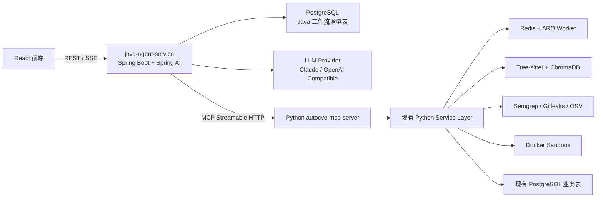
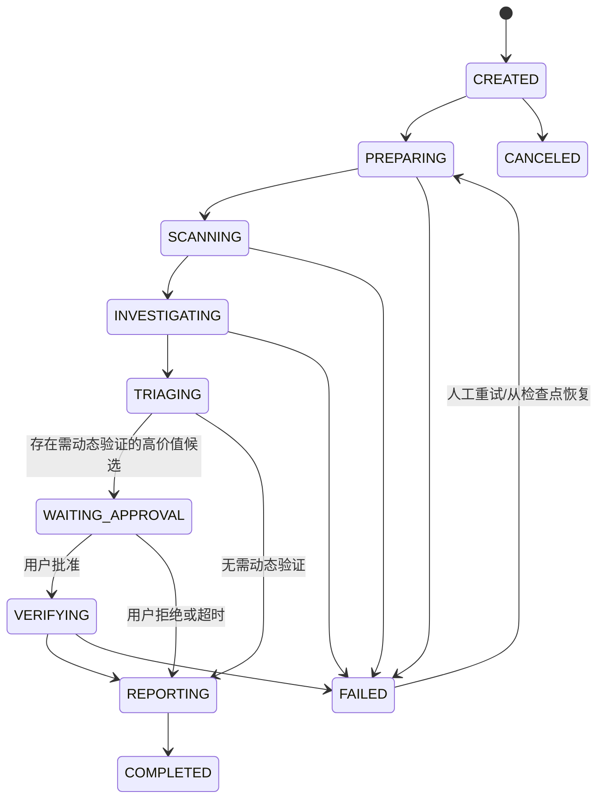

# AutoCVE Java + MCP Agent 渐进式改造技术方案

> 文档状态：已确定（Baseline v1）  
> 制定日期：2026-07-18  
> 实施周期：7 天 MVP  
> 目标读者：项目开发者、评审者、面试准备者
> 范围锁定：2026-07-18 起冻结第一周范围；新增需求必须替换同等工作量事项，不得叠加到 MVP。

## 1. 结论先行

本次改造采用以下确定方案：

1. 新增 `java-agent-service`，使用 Java 21、Spring Boot 4.x、Spring AI 2.0.x，负责任务入口、确定性工作流、Agent 调用、MCP Client、人工审批、运行记录和 SSE 事件。
2. 保留现有 Python FastAPI、RAG、扫描器、ARQ Worker 和 Docker Sandbox，不做全量 Java 重写。
3. 将 Python 中可复用的安全能力封装为独立 MCP Server，通过 Streamable HTTP 暴露粗粒度安全工具。
4. 工作流只保留两个真正需要自主推理的 Agent：`Audit Investigator Agent` 和 `Verification Agent`。
5. 项目分析、索引、扫描、状态流转、去重、报告落库采用确定性代码，不包装成 Agent。
6. 第一周不引入 Google ADK、A2A、动态多 Agent、MCP 工具市场和全量数据库迁移。
7. 以“扫描器基线 vs 扫描器 + Agent”的评测结果证明 Agent 必要性，不以 Agent 数量作为项目亮点。

目标架构不是“用 Java 重写 AutoCVE”，而是形成：

```text
Java 业务与 Agent 控制面
        ↓ MCP Streamable HTTP
Python 安全工具与计算面
        ↓
RAG / Scanner / Sandbox
```

## 2. 改造背景

当前 AutoCVE 已具备以下可复用资产：

- React 审计界面和实时事件展示；
- FastAPI 项目、任务、模型和漏洞管理接口；
- PostgreSQL、Redis、ARQ Worker；
- Tree-sitter + ChromaDB 代码索引与检索；
- Semgrep、Gitleaks、TruffleHog、OSV 等扫描器；
- Docker Sandbox 和多语言漏洞验证工具；
- Finding QueryLoop、工具编排、权限、Checkpoint、Skills 和 Hooks；
- AuditSession、Turn、Checkpoint、ToolCall、Artifact 等运行时数据模型。

当前主要问题：

- Recon、Scan、Triage 等确定性阶段被包装成多个 Agent，增加复杂度但没有带来足够的动态决策价值；
- Python 内部工具协议与 Agent Runtime 强耦合，难以被 Java 或其他 Agent Framework 复用；
- 尚未真正实现 MCP Client/Server；
- 缺少能够证明 Agent 提升漏洞发现效果的评测闭环；
- Agent Runtime、业务接口和安全执行层集中在同一 Python 后端中，职责边界较重。

## 3. 目标与非目标

### 3.1 一周 MVP 目标

- Java 服务可以创建、查询、取消一次 Agent 审计任务；
- Java MCP Client 能发现并调用 Python MCP Server 的工具；
- Python MCP Server 至少暴露项目画像、代码检索、启动扫描、查询扫描结果和漏洞验证能力；
- Investigator Agent 可以根据中间证据多轮选择只读工具；
- Verification Agent 只能在用户批准后调用受控验证工具；
- 工作流状态、步骤、审批和工具调用能够持久化；
- 前端或浏览器可以通过 SSE 看到工作流阶段和工具调用事件；
- 至少完成一组扫描器基线与 Agent 增强对比评测；
- 保持现有 AutoCVE Python 审计入口可用，可随时回退。

### 3.2 非目标

第一周明确不做：

- 不把现有 Python 后端、RAG、扫描器和沙箱重写成 Java；
- 不迁移现有全部用户、项目、任务和漏洞接口；
- 不同时引入 Spring AI 与 Google ADK；
- 不实现 A2A；
- 不实现五到六个独立 Agent；
- 不让 LLM 直接获得宿主机任意 Bash 权限；
- 不实现通用 MCP Marketplace；
- 不追求生产级多租户、计费、高可用和 Kubernetes 部署；
- 不删除现有 Python Agent Runtime。

### 3.3 范围锁定规则

- 第 1～7 天的任务、验收标准和第 14 节交付清单共同构成 `Baseline v1`，第一周不再增加框架、协议、Agent 数量或业务入口；
- 需求变更只能以“替换”方式进入：必须同时写明被移除事项、风险和验收变化，不允许只追加需求；
- Java 与 Python 的 MCP 工具契约以 `contracts/mcp/security-tools.schema.json` 为唯一事实来源，两端代码不得复制维护第二份 Schema；
- 新 Java 表只进入 `agent_java` Schema，现有 Python 表、API 和 Agent Runtime 保持原所有权与回退能力；
- Day 1 的 MCP Compose 服务仅验证 Python 模块和契约边界，不以普通 REST 冒充 MCP；真实 FastMCP Streamable HTTP 从 Day 2 开始实现；
- 第一周若进度不足，只能按照第 14 节既定顺序降级，不得删除 MCP 真调用、工具权限、HITL 或对照评测。

## 4. 技术选型

| 层次 | 选择 | 用途 |
|---|---|---|
| Java 运行时 | Java 21 | LTS、适合秋招 Java 技术栈 |
| Java 框架 | Spring Boot 4.x | REST、配置、校验、持久化、Actuator |
| AI 框架 | Spring AI 2.0.x | ChatClient、Structured Output、Tool Calling、MCP Client |
| MCP Transport | Streamable HTTP | Java/Python 独立服务通信 |
| Java 持久化 | Spring Data JPA + PostgreSQL + Flyway | 独立 Schema 中保存工作流、步骤、审批、评测记录 |
| Web 与事件 | Spring MVC + `SseEmitter` | 避免一周 MVP 混用响应式链路与阻塞式 JPA |
| 重试与容错 | Resilience4j | MCP 调用超时、重试、熔断 |
| Python MCP | 官方 Python MCP SDK / FastMCP | 封装现有安全能力 |
| Python 异步执行 | 复用 ARQ + Redis | 长时间扫描任务 |
| 代码检索 | 复用 Tree-sitter + ChromaDB | 语义代码搜索 |
| 安全扫描 | 复用 Semgrep/Gitleaks/OSV 等 | 确定性安全检测 |
| 动态验证 | 复用 Docker Sandbox | 隔离执行测试或 PoC |
| 可观测性 | Actuator + Micrometer + 结构化日志 | 延迟、成功率、Token、Trace |
| 测试 | JUnit 5、Testcontainers、pytest | Java 集成测试与 Python MCP 契约测试 |

### 4.1 为什么选择 Spring AI

- 与 Spring Boot 业务系统整合自然，能体现 Java 后端能力；
- 支持结构化输出、模型可移植性、工具调用和 MCP Client；
- 适合通过代码实现 Chain、Parallel、Routing、Orchestrator-Workers、Evaluator-Optimizer 等确定性工作流；
- 对当前项目来说，比额外引入完整 Agent Runtime 更容易在一周内落地。

### 4.2 为什么本期不选择 Google ADK Java

Google ADK Java 适合后续做 Graph Workflow、Agent Team、A2A 和完整 Agent Runtime，但本期同时迁移业务层、引入 MCP、建设评测时，再叠加 ADK 会放大范围。若后续需要比较不同 Agent Runtime，可让 ADK 作为第二个 Runtime，共用同一 MCP Tool Plane。

## 5. 总体架构



### 5.1 服务职责

#### Java Agent Service

- 提供 `/api/v2/agent-audits`；
- 管理工作流状态和阶段；
- 调用模型并执行两个 Agent；
- 作为 MCP Host/Client 发现和调用 Python 工具；
- 实现工具白名单、超时、重试、熔断；
- 保存工作流、步骤、审批、调用摘要和评测结果；
- 通过 SSE 推送业务事件；
- 不直接读项目文件，不直接执行 Shell。

#### Python MCP Server

- 实现 MCP 生命周期、`tools/list` 和 `tools/call`；
- 根据 `project_id` 解析受控项目目录；
- 调用现有 Python Service/Runtime，不复制扫描算法；
- 将长时间扫描提交给 ARQ，立即返回 `job_id`；
- 对工具输入、路径、超时和输出体积做限制；
- 为每个调用传播 `trace_id`、`audit_id` 和 `request_id`；
- 不持有 Java 工作流状态。

#### 现有 Python 后端

- 第一周继续作为项目、文件、扫描、RAG、漏洞和报告能力的所有者；
- 保留现有接口和 Agent Runtime，作为回退路径；
- 将可复用逻辑从 API 私有函数逐步下沉到 Service，供 FastAPI Endpoint 与 MCP Tool 共同调用。

### 5.2 数据所有权

为避免一周内发生破坏性迁移，采用增量数据所有权：

- 现有 Python 表继续保存 `Project`、原 `AgentTask`、`AuditSession`、`Finding`、扫描任务；
- Java 通过 Flyway 在独立 PostgreSQL Schema `agent_java` 中新建增量表，避免与 Python Alembic 迁移互相影响；
- Java 表只保存 `project_id`、`python_task_id` 等外部标识，不跨服务建立数据库外键；
- 服务间通过 MCP/REST 交换数据，不允许 Java 直接修改 Python 所有表；
- 后续完成稳定迁移后，再决定统一任务模型。

## 6. Agent 与确定性工作流设计

### 6.1 工作流



| 阶段 | 类型 | 实现方式 |
|---|---|---|
| PREPARING | 确定性 | 校验项目、建立 Trace、调用项目画像 |
| SCANNING | 确定性 | 并行启动扫描器并轮询结果 |
| INVESTIGATING | Agent | 根据画像、扫描结果动态读取和搜索代码 |
| TRIAGING | 确定性 + 一次结构化 LLM | 归一化、去重、置信度与是否验证判断 |
| WAITING_APPROVAL | HITL | 暂停工作流并等待批准/拒绝 |
| VERIFYING | 受控 Agent | 设计验证步骤并调用沙箱验证工具 |
| REPORTING | 确定性 | 结构化数据落库并套用报告模板 |

### 6.2 Audit Investigator Agent

目标：发现扫描器难以覆盖的跨文件、鉴权和业务逻辑漏洞，并输出可验证证据链。

允许工具：

- `profile_repository`
- `search_code`
- `get_scan_job`
- `get_scan_findings`

禁止工具：

- 任意 Shell；
- 写文件；
- `verify_vulnerability`；
- 任意外部网络请求。

终止条件：

- 达到最大迭代次数；
- 达到 Token/时间预算；
- 调用结构化 `FinalizeInvestigation`；
- 用户取消；
- 连续重复工具调用达到阈值。

结构化输出至少包含：

```json
{
  "coverage_summary": "string",
  "findings": [
    {
      "title": "string",
      "category": "authorization|injection|logic|secret|dependency|other",
      "severity": "critical|high|medium|low",
      "confidence": 0.0,
      "file_path": "string",
      "line_start": 1,
      "line_end": 1,
      "evidence": ["string"],
      "attack_path": ["string"],
      "needs_verification": true
    }
  ],
  "uncovered_areas": ["string"]
}
```

### 6.3 Verification Agent

目标：只对已批准候选漏洞生成最小验证方案，在沙箱内执行并给出可复核结论。

允许工具：

- `search_code`
- `verify_vulnerability`
- `get_verification_artifact`

约束：

- 必须携带已批准的 `approval_id`；
- MCP Server 必须二次校验批准状态或签名令牌；
- 只能使用预定义验证模式，不能传入任意宿主机命令；
- 网络默认关闭，确有需要时使用显式域名白名单；
- 验证结果必须保存 stdout、stderr、退出码、超时状态和环境摘要；
- 最终只允许 `confirmed`、`likely`、`false_positive`、`inconclusive`。

## 7. MCP 工具契约

### 7.1 通用约定

所有工具输入必须包含：

| 字段 | 类型 | 说明 |
|---|---|---|
| `request_id` | string | 幂等键，Java 生成 |
| `trace_id` | string | 跨服务链路标识 |
| `audit_id` | string | Java 工作流 ID |
| `project_id` | string | 现有 AutoCVE 项目 ID |

统一错误分类：

- `INVALID_ARGUMENT`
- `PROJECT_NOT_FOUND`
- `PERMISSION_DENIED`
- `CONFLICT`
- `TOOL_TIMEOUT`
- `SANDBOX_ERROR`
- `DEPENDENCY_UNAVAILABLE`
- `INTERNAL_ERROR`

统一响应至少包含：

```json
{
  "ok": true,
  "trace_id": "trace-xxx",
  "request_id": "req-xxx",
  "data": {},
  "warnings": [],
  "artifacts": []
}
```

MCP 工具返回内容限制为 256 KB；超出部分保存为 Artifact，只返回摘要和 Artifact ID。

### 7.2 `profile_repository`

用途：生成确定性项目画像。

输入扩展字段：

```json
{
  "target_paths": ["src"],
  "exclude_patterns": ["node_modules/**", "target/**"]
}
```

输出：语言、框架、文件数、入口点、敏感路径、推荐扫描器、索引状态。

超时：30 秒。只读，可安全重试。

### 7.3 `search_code`

用途：对项目代码执行语义/关键词检索。

输入扩展字段：

```json
{
  "query": "查找未鉴权的管理员接口",
  "top_k": 10,
  "path_filter": ["src/main/java"],
  "language_filter": ["java"]
}
```

输出：文件、行号、代码片段、检索分数、符号信息。单次最多 20 条结果。

超时：20 秒。只读，可安全重试。

### 7.4 `start_security_scan`

用途：向现有 ARQ Worker 提交扫描任务。

输入扩展字段：

```json
{
  "scanners": ["semgrep", "gitleaks", "osv"],
  "target_paths": ["src"],
  "timeout_seconds": 600
}
```

输出：`job_id`、已接受扫描器、创建时间。相同 `request_id` 必须返回同一任务。

超时：10 秒，仅负责提交，不等待扫描完成。

### 7.5 `get_scan_job`

用途：轮询异步扫描任务。

输入扩展字段：`job_id`。

输出：`queued|running|completed|failed|canceled`、进度、错误摘要。

### 7.6 `get_scan_findings`

用途：分页读取归一化扫描结果。

输入扩展字段：`job_id`、`cursor`、`limit`、`severity_filter`。

输出：标准 Finding 列表和下一页 Cursor。

### 7.7 `verify_vulnerability`

用途：在受控沙箱验证单个候选漏洞。

输入扩展字段：

```json
{
  "approval_id": "approval-xxx",
  "finding": {
    "category": "authorization",
    "file_path": "src/main/java/example/AdminController.java",
    "line_start": 42,
    "evidence": ["string"]
  },
  "verification_mode": "sandbox",
  "timeout_seconds": 120
}
```

输出：结论、证据、执行摘要和 Artifact ID。

不可自动重试；重试必须使用新的验证尝试 ID。

### 7.8 第二阶段能力

第一周只实现 Tools。以下能力进入后续版本：

- Resources：项目画像、扫描结果、审计 Trace；
- Prompts：固定安全审计模板；
- 工具变更通知；
- 外部 GitHub MCP Server；
- MCP OAuth 2.0 / mTLS；
- 多 MCP Server 动态路由。

## 8. Java 服务设计

### 8.1 目录结构

```text
java-agent-service/
├── pom.xml
├── Dockerfile
└── src/
    ├── main/java/com/autocve/agent/
    │   ├── AutoCveAgentApplication.java
    │   ├── api/
    │   ├── application/
    │   │   ├── AuditCommandService.java
    │   │   ├── AuditQueryService.java
    │   │   └── ApprovalService.java
    │   ├── workflow/
    │   │   ├── AuditWorkflow.java
    │   │   ├── AuditStage.java
    │   │   ├── WorkflowRunner.java
    │   │   └── WorkflowCheckpointService.java
    │   ├── agent/
    │   │   ├── InvestigatorAgent.java
    │   │   ├── VerificationAgent.java
    │   │   └── model/
    │   ├── mcp/
    │   │   ├── McpClientConfiguration.java
    │   │   ├── SecurityToolGateway.java
    │   │   ├── ToolPermissionPolicy.java
    │   │   └── dto/
    │   ├── domain/
    │   ├── infrastructure/
    │   │   ├── persistence/
    │   │   ├── event/
    │   │   └── observability/
    │   └── evaluation/
    └── test/
```

### 8.2 API

| 方法 | 路径 | 说明 |
|---|---|---|
| POST | `/api/v2/agent-audits` | 创建新 Java Agent 审计 |
| GET | `/api/v2/agent-audits/{id}` | 查询状态、阶段和统计 |
| GET | `/api/v2/agent-audits/{id}/events` | SSE 订阅 |
| POST | `/api/v2/agent-audits/{id}/cancel` | 取消任务 |
| POST | `/api/v2/agent-audits/{id}/retry` | 从可恢复阶段重试 |
| GET | `/api/v2/agent-audits/{id}/approvals` | 查询待审批动作 |
| POST | `/api/v2/agent-audits/{id}/approvals/{approvalId}/approve` | 批准验证 |
| POST | `/api/v2/agent-audits/{id}/approvals/{approvalId}/reject` | 拒绝验证 |
| GET | `/api/v2/agent-audits/{id}/report` | 获取结构化报告 |
| POST | `/api/v2/evaluations` | 发起基线对比评测 |

创建任务示例：

```json
{
  "project_id": "project-xxx",
  "target_paths": ["src"],
  "target_vulnerabilities": ["authorization", "injection", "logic"],
  "verification_level": "sandbox",
  "model_profile": "default",
  "budgets": {
    "max_iterations": 20,
    "max_input_tokens": 60000,
    "max_duration_seconds": 900
  }
}
```

### 8.3 Java 增量表

#### `ai_audit_runs`

- `id`
- `project_id`
- `python_task_id`
- `status`
- `current_stage`
- `model_profile`
- `request_json`
- `result_json`
- `error_code`
- `error_message`
- `version`
- `created_at`
- `started_at`
- `completed_at`

`version` 用于乐观锁，避免取消、审批和 Worker 更新互相覆盖。

#### `ai_audit_steps`

- `id`
- `audit_id`
- `stage`
- `attempt`
- `status`
- `input_digest`
- `output_summary`
- `checkpoint_json`
- `started_at`
- `completed_at`

唯一约束：`audit_id + stage + attempt`。

#### `ai_approval_requests`

- `id`
- `audit_id`
- `finding_id`
- `action_type`
- `risk_level`
- `request_payload`
- `status`
- `decided_by`
- `decided_at`
- `expires_at`

审批状态：`pending|approved|rejected|expired|consumed`。批准令牌只能消费一次。

#### `ai_tool_call_records`

- `id`
- `audit_id`
- `step_id`
- `request_id`
- `trace_id`
- `tool_name`
- `status`
- `input_summary`
- `output_summary`
- `duration_ms`
- `error_code`
- `created_at`

不得保存 API Key、完整源码、密码和未经清洗的环境变量。

#### `ai_evaluation_runs`

- `id`
- `dataset_version`
- `runtime_type`
- `model_profile`
- `precision_value`
- `recall_value`
- `false_positive_rate`
- `verified_rate`
- `tool_success_rate`
- `tokens_used`
- `duration_ms`
- `details_json`

## 9. 可靠性设计

### 9.1 幂等

- Java 为每次 MCP Tool Call 生成稳定 `request_id`；
- Python 保存或缓存 `request_id -> result/job_id`；
- `start_security_scan` 必须幂等；
- `verify_vulnerability` 不自动重放，避免重复执行副作用；
- 创建审计接口接受 `Idempotency-Key` 请求头。

### 9.2 超时与重试

| 调用 | 超时 | 重试 |
|---|---:|---:|
| profile | 30s | 1 次 |
| search | 20s | 1 次 |
| start scan | 10s | 2 次，依赖幂等键 |
| poll scan | 5s | 指数退避轮询 |
| verify | 120s | 不自动重试 |
| LLM | 60s | 最多 2 次，记录每次 Attempt |

### 9.3 Checkpoint 与恢复

每完成一个阶段保存：

- 当前阶段；
- 已完成 MCP 调用及其 `request_id`；
- 扫描 `job_id`；
- Agent 结构化结果；
- 待审批记录；
- Token、迭代次数和时间预算。

恢复时不重放已完成的扫描和验证，只继续未完成阶段。

### 9.4 降级

- Java 服务不可用：继续使用现有 Python Agent 审计入口；
- MCP Server 不可用：Java 任务标记 `FAILED_RETRYABLE`，不绕过安全边界直接读文件；
- LLM 不可用：保留扫描器结果，生成“确定性扫描报告”；
- RAG 不可用：Agent 仅允许通过受限文件搜索能力工作，并在报告中标记覆盖降级；
- Sandbox 不可用：候选漏洞标记 `unverified`，禁止伪造 confirmed 结论。

## 10. 安全设计

### 10.1 服务边界

- MCP Server 默认只监听 Docker 内部网络；
- 第一周使用服务间 API Key，生产阶段升级为 mTLS/OAuth；
- 密钥只能从环境变量或 Secret Manager 获取，不进入数据库和 Trace；
- Java 不接收或传递任意项目绝对路径；
- Python 根据 `project_id` 从数据库解析工作区并执行 `resolve()` 边界校验。

### 10.2 工具权限

| 工具 | Investigator | Verification | 是否需审批 |
|---|---:|---:|---:|
| profile_repository | 是 | 是 | 否 |
| search_code | 是 | 是 | 否 |
| start_security_scan | 工作流调用 | 否 | 否 |
| get_scan_job/findings | 是 | 是 | 否 |
| verify_vulnerability | 否 | 是 | 是 |

- MCP Server 不暴露 `bash(command)`、`write_file(path, content)` 等通用危险工具；
- 模型返回的工具名必须同时通过 Spring AI Tool 白名单和 Python MCP 权限校验；
- 审批绑定 `audit_id + finding_id + action_digest`，防止批准内容被替换；
- 验证完成后将 Approval 标记为 `consumed`。

### 10.3 Prompt Injection 防护

- 仓库源码、README、注释和工具输出均视为不可信数据；
- System Prompt 明确禁止遵循代码仓库中的指令；
- Agent 无权改变工具白名单和审批策略；
- 工具输出使用结构化字段，不把未经处理的大段内容放入 System Prompt；
- 记录可疑指令命中并在报告中提示。

### 10.4 沙箱

- 非 root 用户；
- 只读项目挂载，临时目录单独可写；
- 禁止宿主 Docker Socket；
- 默认禁网；
- CPU、内存、进程数和执行时间限制；
- 验证产生的文件作为 Artifact 保存并限制大小；
- 不允许模型自行扩大网络、目录或命令权限。

## 11. 事件与可观测性

### 11.1 事件类型

- `audit.created`
- `stage.started`
- `stage.completed`
- `agent.iteration.started`
- `agent.iteration.completed`
- `tool.started`
- `tool.completed`
- `tool.failed`
- `approval.requested`
- `approval.approved`
- `approval.rejected`
- `audit.completed`
- `audit.failed`

SSE 事件只包含摘要；完整输入输出通过受权限保护的详情接口读取。

### 11.2 关键指标

- `mcp_tool_calls_total{tool,status}`
- `mcp_tool_duration_seconds{tool}`
- `agent_iterations_total{agent}`
- `agent_tokens_total{agent,model}`
- `audit_duration_seconds{status}`
- `audit_findings_total{severity,verdict}`
- `approval_wait_seconds`
- `sandbox_runs_total{status}`
- `workflow_resume_total{stage,status}`

所有 Java、Python、ARQ 和 Sandbox 日志携带相同 `trace_id`。

## 12. Agent 评测方案

### 12.1 评测目的

回答一个核心问题：Agent 是否比“仅运行扫描器”发现更多真实漏洞，且成本可接受。

### 12.2 对照组

- Baseline A：Semgrep/Gitleaks/OSV 等确定性扫描器；
- Experiment B：相同扫描器 + Investigator Agent；
- Experiment C（可选）：扫描器 + Investigator + Verification Agent。

### 12.3 数据集

第一周准备 8～12 个小型可控样例：

- SQL 注入；
- 命令注入；
- 路径穿越；
- 硬编码密钥；
- 依赖漏洞；
- IDOR/越权；
- 缺少鉴权；
- 业务状态绕过；
- 至少 2 个无漏洞负样例。

每个样例提供 Ground Truth：漏洞类型、文件、行号、严重性、是否可验证。

### 12.4 指标

- Precision；
- Recall；
- False Positive Rate；
- Verified Finding Rate；
- Tool Success Rate；
- 平均工具调用次数；
- 平均 Token；
- 平均耗时；
- 失败恢复成功率。

第一周不预设虚假提升比例，只要求生成可复现基线，并在 README 中诚实展示结果。

## 13. 一周实施计划

### Day 1：脚手架、契约和运行边界

> 实施状态：已于 2026-07-18 完成，验收记录见 `docs/JAVA_MCP_DAY1_IMPLEMENTATION.md`。

任务：

- 新建 `java-agent-service` Maven 工程；
- 配置 Java 21、Spring Boot、Spring AI BOM、Spring MVC、JPA、Flyway、PostgreSQL、Actuator；
- 建立 `/actuator/health`；
- 定义 Java 工作流状态、MCP DTO、通用错误码；
- 在 Python 新建 MCP 模块目录和工具契约；
- 更新 Docker Compose，加入 Java 与 MCP 服务占位；
- 固化本技术方案，不再扩展第一周范围。

验收：

- Java 服务可以启动并通过健康检查；
- Maven 测试通过；
- Python MCP 模块可以导入；
- Java/Python 对同一份工具 JSON Schema 有契约测试；
- 现有 AutoCVE 服务不受影响。

### Day 2：Python MCP Server 与只读工具

> 实施状态：已于 2026-07-18 完成，验收记录见 `docs/JAVA_MCP_DAY2_IMPLEMENTATION.md`。

任务：

- 使用 FastMCP 启动 Streamable HTTP Server；
- 实现 `profile_repository`；
- 实现 `search_code`；
- 从现有 API 私有函数抽取可复用 Service；
- 增加项目目录解析、路径越界检查、输出大小限制；
- 编写 pytest 工具契约测试。

验收：

- MCP Inspector/测试客户端可以列出工具；
- 两个工具能够对本地样例项目返回结构化结果；
- 非法 `project_id` 和路径穿越被拒绝；
- 工具不写项目文件；
- 失败返回统一错误结构。

### Day 3：扫描任务 MCP 化与 Java MCP Client

> 实施状态：已于 2026-07-18 完成，验收记录见 `docs/JAVA_MCP_DAY3_IMPLEMENTATION.md`。

任务：

- 实现 `start_security_scan`、`get_scan_job`、`get_scan_findings`；
- 复用 Redis/ARQ，不在 MCP 请求中等待扫描完成；
- 加入 `request_id` 幂等；
- Java 配置 Spring AI 标准 MCP Client，通过 JDK HttpClient 使用 Streamable HTTP；
- 实现 `SecurityToolGateway`；
- 为 MCP 调用增加超时、重试、Trace 和记录。

验收：

- Java 可以发现全部 MCP 工具；
- Java 可以完成 profile、search、start scan、poll、read findings；
- 重复 `request_id` 不创建重复扫描任务；
- MCP Server 停止时 Java 返回可识别的依赖错误；
- 至少一个 Java + Python 端到端集成测试通过。

### Day 4：确定性工作流与 Investigator Agent

> 实施状态：已于 2026-07-19 完成，验收记录见 `docs/JAVA_MCP_DAY4_IMPLEMENTATION.md`。

任务：

- 实现 `PREPARING → SCANNING → INVESTIGATING → TRIAGING`；
- 建立 `ai_audit_runs`、`ai_audit_steps`、`ai_tool_call_records`；
- 实现 Investigator Agent 的 Prompt、工具白名单和结构化终止结果；
- 设置最大迭代、Token、时间和重复调用限制；
- 实现任务创建、查询、取消 API；
- 实现基础 SSE 事件。

验收：

- POST 创建任务后可以完整执行到 TRIAGING；
- Agent 只能看到只读 MCP 工具；
- Agent 输出可以通过 Schema 校验并落库；
- 取消任务后停止后续模型和 MCP 调用；
- 浏览器可以看到阶段和工具调用事件。

### Day 5：HITL、Verification Agent 与恢复

> 实施状态：已于 2026-07-19 完成，验收记录见 `docs/JAVA_MCP_DAY5_IMPLEMENTATION.md`。

任务：

- 实现 `ai_approval_requests`；
- TRIAGING 对需验证候选创建审批并暂停；
- 实现批准、拒绝接口；
- 实现 `verify_vulnerability` MCP Tool；
- Verification Agent 只在批准后运行；
- 保存 Checkpoint，支持从 `WAITING_APPROVAL` 和失败阶段恢复；
- 实现 Approval 单次消费和 action digest 校验。

验收：

- 未批准时无法调用验证工具；
- 批准后只验证绑定的 Finding；
- 拒绝后任务继续生成未验证报告；
- Java 重启后可以恢复待审批任务；
- 沙箱超时不会导致整个服务失控；
- 验证结果包含可复核 Artifact。

### Day 6：评测、指标和测试

> 实施状态：已于 2026-07-19 完成，验收记录见 `docs/JAVA_MCP_DAY6_IMPLEMENTATION.md`。

任务：

- 准备 8～12 个带 Ground Truth 的样例；
- 实现 Scanner-only 与 Scanner+Agent 对照执行；
- 计算 Precision、Recall、误报率、Token、耗时、工具成功率；
- 增加 Actuator/Micrometer 指标；
- 增加敏感字段脱敏；
- 补充 Java 单元测试、MCP 契约测试和失败恢复测试。

验收：

- 一条命令可以运行评测；
- 生成 JSON/Markdown 评测报告；
- 至少展示一个 Agent 补充发现或补充证据的样例；
- 评测失败不会写成成功；
- 日志中不出现 API Key 和完整敏感源码。

### Day 7：前端接入、部署和交付

> 实施状态：已于 2026-07-20 完成，验收记录见 `docs/JAVA_MCP_DAY7_IMPLEMENTATION.md`。

任务：

- 在现有前端增加“Java MCP 审计”实验入口，或完成最小独立页面；
- 展示阶段、工具调用、待审批、验证结论和报告；
- 完成 Docker Compose 一键启动；
- 执行完整冒烟测试；
- 更新 README、架构图、API 示例、评测结果和回退说明；
- 准备 5～8 分钟演示脚本。

验收：

- `docker compose up` 后 Java、Python MCP、Redis、PostgreSQL、Worker 均健康；
- 从创建任务到报告生成可以完整演示；
- 演示包含一次 MCP 调用、一次 Agent 自主检索、一次审批和一次沙箱验证；
- 现有 Python 审计入口仍可使用；
- 所有新增测试通过；
- 文档中的“已有能力”和“规划能力”没有混写。

## 14. 一周交付清单

必须交付：

- `java-agent-service` 可运行工程；
- Python MCP Server；
- 5 个只读/扫描 MCP 工具；
- 1 个受审批保护的验证工具；
- Investigator Agent；
- Verification Agent；
- 确定性工作流和 Checkpoint；
- 审批 API；
- SSE 事件；
- Docker Compose 配置；
- MCP 契约测试和端到端测试；
- 最小评测数据集与对比报告；
- 架构、API、启动和演示文档。

可降级项：

- 前端完整视觉改造；
- OpenTelemetry Collector 与 Trace UI；
- MCP Resources/Prompts；
- 多模型动态路由；
- 自动生成 PDF 报告；
- 复杂 Skill 迁移。

如果进度不足，按以下顺序砍需求：

1. 砍完整前端页面，只保留 Swagger + SSE Demo；
2. 砍 MCP Resources/Prompts；
3. 砍多模型，固定一个支持 Tool Calling 的模型；
4. 砍自动恢复 UI，但保留 Checkpoint 数据；
5. 不得砍 MCP 真调用、工具权限、审批边界和评测。

## 15. 完成定义（Definition of Done）

一周 MVP 只有同时满足以下条件才算完成：

- Java 代码不是空壳，真实完成 Agent 调用和 MCP Tool Call；
- Python 使用真实 MCP SDK 暴露工具，不用普通 REST 冒充 MCP；
- Agent 至少有一次根据中间工具结果决定下一步工具；
- 固定工作流阶段没有伪装成多个 Agent；
- 验证工具未经批准无法执行；
- 验证发生在隔离沙箱；
- 长扫描任务异步执行且具备幂等键；
- 工作流状态和工具调用可追踪；
- 有 Scanner-only 与 Scanner+Agent 对照结果；
- 原 Python 入口可回退；
- README 可以让另一名开发者独立启动和复现 Demo。

## 16. 后续路线

### Phase 2：工程增强

- MCP Resources/Prompts；
- OpenTelemetry 跨 Java/Python Trace；
- OAuth 2.0 或 mTLS；
- 更可靠的 BM25/RRF/Reranker；
- Agent 轨迹评测和 Prompt 回归；
- 自动压缩与真实 Token 估算；
- 完整任务恢复与补偿机制。

### Phase 3：多 Runtime 对比

- 接入 Google ADK Java 作为第二 Runtime；
- 自研 Python Runtime、Spring AI、ADK 共用 MCP 工具；
- 比较准确率、工具轨迹、成本和恢复能力；
- 只有在评测证明有效时才引入动态 Subagent。

### Phase 4：协议与平台化

- A2A 暴露独立安全专家 Agent；
- 外部 GitHub/工单/知识库 MCP；
- 工具版本与能力协商；
- 多租户配额和审计；
- 分布式调度和生产级部署。

## 17. 参考资料

- Spring AI Getting Started：<https://docs.spring.io/spring-ai/reference/getting-started.html>
- Spring AI MCP Client：<https://docs.spring.io/spring-ai/reference/api/mcp/mcp-client-boot-starter-docs.html>
- Spring AI Effective Agents：<https://docs.spring.io/spring-ai/reference/api/effective-agents.html>
- MCP Server 官方教程：<https://modelcontextprotocol.io/docs/develop/build-server>
- MCP 架构：<https://modelcontextprotocol.io/docs/learn/architecture>
- Google ADK Java：<https://adk.dev/get-started/java/>
- Google ADK MCP：<https://adk.dev/mcp/>
