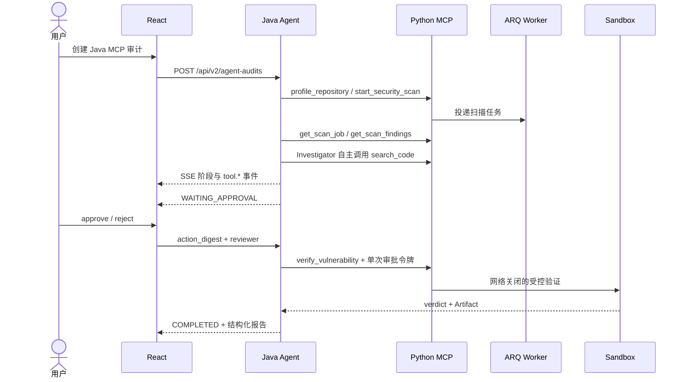

# Java + MCP Agent 架构（Day 7）

> 状态：MVP 已实现  
> 更新日期：2026-07-20

## 已实现架构

```mermaid
flowchart LR
    UI["React · Java MCP 审计实验台"] -->|"REST / SSE · /api/v2"| JAVA["Java 21 · Spring Boot / Spring AI"]
    UI -->|"原 /api/v1 保留"| PY["现有 FastAPI 审计"]
    JAVA -->|"JPA / Flyway · agent_java"]| PG[(PostgreSQL)]
    JAVA -->|"MCP Streamable HTTP"]| MCP["Python FastMCP Server"]
    MCP --> SEARCH["项目画像 / search_code"]
    MCP -->|"ARQ job"] REDIS[(Redis)]
    REDIS --> WORKER["MCP Scan Worker"]
    WORKER --> SCAN["Gitleaks / Semgrep / OSV / TruffleHog"]
    MCP -->|"审批签名二次校验"] BOX["Docker Sandbox"]
    JAVA -.->|"可选真实调用"] LLM["OpenAI-compatible LLM"]
```

Java 是工作流与 Agent 控制面：保存状态、执行确定性阶段、约束 Investigator 工具白名单、暂停 HITL、消费审批并生成报告。Python 是安全工具计算面：通过真实 MCP 协议提供 6 个粗粒度工具，扫描任务经 Redis/ARQ 解耦，动态验证只能进入隔离沙箱。Java 不直接读项目目录，也不获得宿主机 Shell。

## 已实现运行序列



工作流阶段为 `PREPARING → SCANNING → INVESTIGATING → TRIAGING → WAITING_APPROVAL → VERIFYING → REPORTING → COMPLETED`。固定阶段由代码驱动，只有 Investigator 的证据检索和已批准后的 Verification 属于 Agent 决策范围。

## 边界与回退

- `/api/v1`、原 Agent Runtime 和 Python 页面未删除；`java-agent` Compose profile 是增量能力。
- Java 表仅位于 PostgreSQL `agent_java` Schema，不修改 Python Alembic 表。
- Nginx 只把 `/api/v2/` 转发到 Java；未开启 profile 时原前端和 Python 审计仍可启动。
- LLM 默认关闭并采用确定性策略，方便离线演示；真实 Spring AI ChatClient 链路已实现，通过环境变量显式开启。

## 后续规划（未实现）

- OpenTelemetry Collector 与 Trace UI；
- Google ADK/A2A 或动态多 Agent 团队；
- MCP Marketplace、Resources 和 Prompts；
- 多租户生产鉴权、Kubernetes 高可用和自动 PDF 报告。

以上能力不属于本次一周 MVP，不能在演示或简历中表述为已完成。
