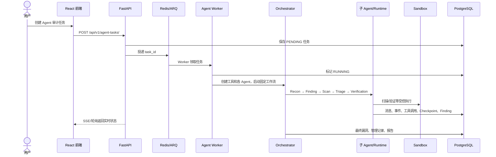
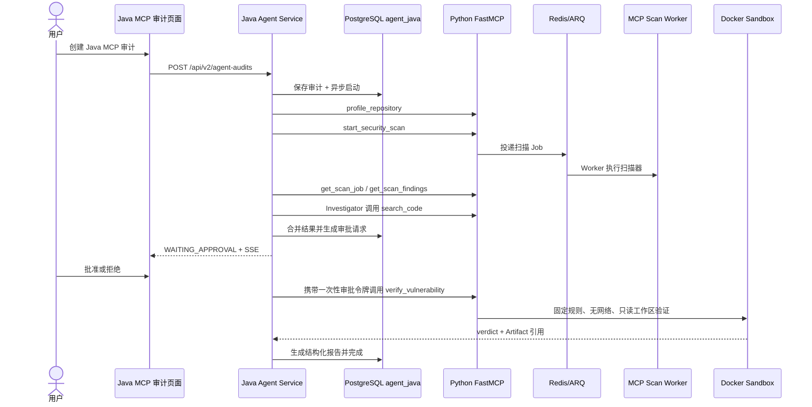

# AutoCVE 修改后项目详细分析（通俗版）

> 分析基线：当前工作区代码，2026-07-20  
> 目标读者：希望从“这个项目到底怎么工作”一路读到 Agent、MCP 和 Java 后端核心实现的开发者  
> 核验方式：以当前源代码、配置、数据库迁移、测试和验收脚本为准，不把规划文档中的未来能力当成已实现能力

---

## 0. 先用一句话说清楚这个项目

AutoCVE 是一个“让 AI Agent 帮助做源码安全审计，并把结果沉淀成漏洞和 CVE 报告”的平台。

它不是单纯把代码发给大模型问一句“有没有漏洞”，而是把审计拆成项目准备、仓库画像、工具扫描、源码调查、误报研判、沙箱验证、人工审批、报告生成等多个阶段，并保存每一步的消息、工具调用、事件和结果。

修改后的项目同时存在两条审计链路：

1. **原 Python 主链路**：FastAPI + Python Multi-Agent/Runtime，功能更完整，是项目当前的主要产品链路。
2. **新增 Java + MCP 实验链路**：Java 21 + Spring Boot/Spring AI 负责流程控制，Python FastMCP 负责安全工具，重点演示“Java Agent 控制面、跨语言 MCP、HITL 人工审批、沙箱验证和可恢复工作流”。

最重要的边界是：**Java 链路是增量实验能力，没有替换原 Python Agent，也没有把所有 Python 功能迁移到 Java。**

---

## 1. 阅读这份文档时先记住 5 个概念

### 1.1 项目（Project）

待审计的源码仓库。来源可以是 Git 仓库、ZIP、本地受管目录等。项目记录保存在 PostgreSQL，实际源码放在受管的 `projects/` 工作区。

### 1.2 审计任务（Audit Task / Agent Audit）

一次具体审计。它记录审计哪个项目、目标文件、漏洞类型、排除规则、验证级别、最大迭代次数等。

### 1.3 Agent

Agent 可以理解为“能根据上下文选择下一步动作，并能调用工具的模型执行单元”。原 Python 链路有 Recon、Finding、Triage、Verification 等多个角色；Java 实验链路主要有 Investigator 和 Verification Agent。

### 1.4 Tool

Agent 不能直接随意操作系统，而是通过有名字、有输入结构、有权限约束的工具工作，例如读文件、搜索代码、启动扫描、读取扫描结果、进入沙箱验证。

### 1.5 MCP

MCP（Model Context Protocol）在这里是 Java 与 Python 安全工具之间的标准协议。Java 不直接读仓库、不直接启动扫描器，而是调用 Python FastMCP 暴露的 6 个粗粒度工具。

---

## 2. 当前项目整体结构

```text
AutoCVE-main/
├── frontend/                 # React + TypeScript + Vite 前端
├── backend/                  # FastAPI 主后端、原 Python Agent、MCP 工具面
├── java-agent-service/       # 新增 Java 21 Agent 控制面
├── contracts/               # Java/Python 共享的 MCP JSON Schema
├── skill_library/           # Agent 可按需加载的安全审计 Skills
├── report_template_library/ # 报告模板
├── projects/                # 被导入项目的受管工作区
├── evaluation/              # Scanner 与 Scanner+Agent 评测集和结果
├── scripts/                 # 启动、冒烟、评测、交付脚本
├── docs/                    # 架构、API、实施记录、演示文档
├── docker/                  # 沙箱镜像等 Docker 资源
└── docker-compose.yml       # 新旧两条链路的服务编排
```

当前源代码规模大致为：

| 部分 | 当前代码文件数量 | 说明 |
| --- | ---: | --- |
| Python `backend/app` | 306 个 `.py` | 主业务、Agent Runtime、MCP、扫描、报告等 |
| Java 主代码 | 78 个 `.java` | API、工作流、Agent、MCP 网关、审批、持久化 |
| 前端 `frontend/src` | 230 个 `.ts/.tsx` | 页面、组件、API、状态和通用 UI |
| Python 测试 | 108 个测试文件 | 覆盖 Agent、Runtime、API、MCP 等 |
| Java 测试 | 15 个测试类 | 覆盖工作流、MCP、审批、安全与健康检查 |
| 前端测试 | 17 个测试文件 | 包括 Java 页面路由与 API 相关测试 |

这些数量用于帮助理解体量，不代表测试覆盖率。

---

## 3. 系统在运行时有哪些服务

`docker-compose.yml` 中的主要服务如下：

| 服务 | 是否默认启动 | 职责 |
| --- | --- | --- |
| `frontend` | 是 | Nginx 托管 React 页面，并反向代理 API/SSE |
| `backend` | 是 | FastAPI HTTP API，负责主业务控制面 |
| `agent-worker` | 是 | 从 Redis/ARQ 领取原 Python Agent 审计任务 |
| `one-click-cve-worker` | 是 | 执行一键 CVE 批次 |
| `db` | 是 | PostgreSQL 15 |
| `redis` | 是 | 异步队列、事件流、MCP 扫描状态、重放保护 |
| `sandbox` | 按需 | 构建受限执行镜像，不是常驻服务 |
| `adminer` | 是 | 数据库管理页面 |
| `java-agent-service` | `java-agent` profile | Java Agent 控制面 |
| `autocve-mcp-server` | `java-agent` profile | Python FastMCP 安全工具服务 |
| `mcp-scan-worker` | `java-agent` profile | 执行 Java 链路提交的长耗时扫描 |

Nginx 的路由边界很清楚：

- `/api/v1/**` 进入原 Python FastAPI。
- `/api/v2/**` 进入 Java Agent 服务。
- 前端 SPA 页面仍由同一个 Nginx 提供。

这也是为什么 Java 链路出问题时，可以关闭 `java-agent` profile，而原 `/audit-tasks` Python 审计入口仍能工作。

---

## 4. 从用户点击“开始审计”到得到报告，发生了什么

### 4.1 原 Python 主链路



入口代码是 `backend/app/api/v1/endpoints/agent_tasks.py`：

- `create_agent_task()` 校验项目归属并保存任务。
- `_schedule_agent_task()` 根据配置选择后台任务或 ARQ worker。
- `backend/app/worker/agent_worker.py` 从队列取出 `task_id`。
- `backend/app/services/agent/task_executor.py` 转入 `_execute_agent_task_impl()`。
- `_execute_agent_task_impl()` 准备项目、加载用户模型配置、初始化工具、创建所有 Agent，再启动 Orchestrator。

任务完成后，后端会：

- 保存 `agent_findings`；
- 计算安全分数；
- 汇总迭代次数、工具调用数和 Token；
- 同步到漏洞管理；
- 在适用时生成管理型漏洞报告；
- 写入最终活动事件。

### 4.2 新 Java + MCP 链路



Java 链路的主入口是 `java-agent-service/.../api/AgentAuditController.java`，核心流程是 `workflow/AuditWorkflow.java`。

---

## 5. 前端结构与职责

### 5.1 前端技术栈

- React 18
- TypeScript 5.7
- Vite 5
- React Router
- Tailwind CSS
- Radix UI
- `fetch`、Axios、Ky 等请求工具
- SSE 实时事件流

### 5.2 主要目录

```text
frontend/src/
├── app/                    # 应用入口、路由和受保护路由
├── pages/                  # 完整页面
├── components/             # 业务组件和通用 UI
├── features/               # 按功能封装的服务
├── hooks/                  # Agent 流等 Hooks
└── shared/                 # API、类型、配置、工具、认证上下文
```

`frontend/src/app/routes.tsx` 是阅读前端的最好起点。当前主要页面包括：

- `/projects`：项目导入和管理；
- `/audit-tasks`：Python Agent 审计任务；
- `/agent-audit/:taskId`：Python Agent 的实时过程；
- `/audit-sessions/:sessionId`：基于已有会话继续追问；
- `/one-click-cve`：自动筛项目并连续创建审计任务；
- `/vulnerabilities`：漏洞管理和报告编辑/导出；
- `/skills`：Skills 管理；
- `/java-mcp-audit`：新增 Java + MCP 实验页面。

### 5.3 Python Agent 审计页面怎么展示实时过程

`frontend/src/pages/AgentAudit/index.tsx` 会组合两类数据：

1. `agent_events` 中的阶段事件、派发事件、工具事件和错误；
2. `audit_session_*` 中的 Runtime 消息、工具调用和模型流记录。

页面一边订阅 SSE，一边定时刷新任务和 Agent Tree。这样即使 SSE 中断，历史事件和数据库状态仍可重新加载。

### 5.4 Java MCP 页面怎么工作

`frontend/src/pages/JavaMcpAudit.tsx` 是一个独立实验台，支持：

- 选择 Python 后端已经管理的项目；
- 选择目标漏洞类型；
- 选择 Semgrep、Gitleaks、TruffleHog、OSV；
- 选择是否执行沙箱验证；
- 查看 8 个流程阶段；
- 查看 MCP 工具事件；
- 对每个验证请求批准或拒绝；
- 查看验证 Evidence、执行环境、Artifact 引用和结构化报告；
- 取消或重试失败任务。

`frontend/src/shared/api/javaAgentAudits.ts` 对 `/api/v2/agent-audits` 做类型化封装。创建任务时前端生成 `Idempotency-Key`；建立 SSE 连接时可以携带 `Last-Event-ID`，并同时每 1.2 秒轮询状态作为补偿。当前页面没有自己编写持续自动重连循环，所以更准确的说法是“后端具备断点回放能力，前端已有游标参数和轮询兜底”，而不是保证 SSE 永远自动重连。

---

## 6. Python 主后端怎么分层

### 6.1 Web/API 层

入口是 `backend/app/main.py`，所有业务路由挂在 `/api/v1`。

`backend/app/api/v1/api.py` 注册的主要模块有：

- 认证、用户和成员；
- 项目与源码文件；
- 普通扫描和 Agent 审计任务；
- 审计会话和直接审计；
- 模型、Embedding、Prompt 和规则配置；
- Skills 和报告模板；
- 漏洞管理；
- Checkmarx；
- 一键 CVE。

### 6.2 数据模型层

Python 主链路的核心表可以按用途分为：

| 用途 | 代表表 |
| --- | --- |
| 身份与配置 | `users`、`user_configs` |
| 项目 | `projects`、`project_members` |
| Agent 任务 | `agent_tasks`、`agent_events`、`agent_findings`、`agent_tree_nodes` |
| Runtime 会话 | `audit_sessions`、`audit_session_messages`、`audit_session_turns` |
| 可恢复执行 | `audit_checkpoints`、`audit_model_stream_attempts` |
| 工具与扩展 | `audit_tool_calls`、`audit_skills`、`audit_skill_invocations` |
| 协作上下文 | `audit_memories`、`audit_handoffs`、`audit_artifacts` |
| 漏洞资产 | `managed_vulnerabilities`、`managed_vulnerability_reports` |
| 一键 CVE | `one_click_cve_batches`、`one_click_cve_batch_projects` |

这套表说明项目并不只保存“最后答案”，还保存了 Agent 如何得到答案的过程。

### 6.3 服务层

`backend/app/services/` 中的重要模块：

- `agent/`：传统 Agent 定义、Orchestrator、工具、事件；
- `finding_runtime/`：Finding 的新 ReAct Runtime；
- `runtime_core/`：工具注册、权限、Hook、Shell Guardrail、Skill、Memory；
- `scan_runtime/`：确定性扫描流水线；
- `triage_runtime/`：扫描候选的分批研判；
- `llm/`：多模型 Provider 适配；
- `rag/`：代码切分、Embedding、向量索引和检索；
- `one_click_cve/`：仓库发现和批量审计；
- `mcp_scan_runtime/`、`mcp_verification/`：新增 Java 链路的 Python 工具实现。

### 6.4 LLM 适配层

`backend/app/services/llm/` 把不同提供方统一到一个服务接口。当前包含 LiteLLM、OpenAI Responses、Anthropic、Gemini、百度、豆包、MiniMax 等适配逻辑，并支持：

- 每个 Agent 使用不同模型配置；
- 超时和首 Token 超时；
- 流式输出；
- Tool Message 格式转换；
- Token 估算；
- 上下文压缩和 Prompt Cache。

---

## 7. 原 Python Agent：它到底是怎么做的

## 7.1 Agent 不是一个，而是一组有职责边界的角色

| Agent | 通俗解释 | 主要产物 |
| --- | --- | --- |
| Orchestrator | 总导演，控制阶段和合并结果 | 最终工作流结果 |
| Recon | 先看项目地图，找语言、框架、入口和高风险区域 | 项目画像、审计优先级 |
| Scan | 调用确定性扫描器 | 原始候选 |
| Triage | 判断扫描结果哪些更可信 | 过滤后的候选和证据 |
| Finding | 直接读源码、追数据流，挖高价值漏洞 | 结构化漏洞 |
| Verification | 在沙箱中复核高风险候选 | confirmed/candidate/false_positive |

### 一个需要特别纠正的事实

已有架构图写的是 Scan/Triage 和 Finding 并行，但当前 `OrchestratorAgent.run()` 的真实执行顺序是：

```text
Recon
  ↓
Finding
  ↓
ScanPipeline
  ↓
Triage Runtime
  ↓
Merge
  ↓
Verification
```

代码中的事件元数据也明确写了 `execution_mode = finding_first_sequential`。因此，准确说法应是“设计上有两条分析分支，当前实现按 Finding 优先顺序执行”，不能声称当前一定并行。

## 7.2 Orchestrator 为什么采用固定流程

`backend/app/services/agent/agents/orchestrator.py` 的系统提示明确规定，LLM 不能自行决定主要阶段。

这是一个重要工程取舍：

- 如果让模型自由决定是否扫描、是否验证，流程不可预测，也难以测试；
- 固定状态机负责“必须做什么”；
- Agent 只负责阶段内部“具体怎么看、调用哪个允许的工具”。

Orchestrator 还会计算有效节点：

- Orchestrator 和 Recon 强制开启；
- Scan 关闭时 Triage 自动失效；
- Triage 和 Finding 都关闭时 Verification 没有输入，也自动失效。

## 7.3 Recon：先建立项目地图

Recon 的目的不是立刻报漏洞，而是减少后续盲目搜索。它会识别：

- 语言和框架；
- 入口文件；
- 路由、控制器、认证、文件处理等优先区域；
- 依赖清单；
- 推荐扫描器；
- 目标文件和排除范围。

Recon 输出通过 `TaskHandoff` 传给后续阶段，而不是只传一大段自然语言。

## 7.4 Scan：确定性工具先提供“候选”

Python 主链路当前 Orchestrator 直接使用 `ScanPipeline`，主要通过 Semgrep 形成可索引候选；工具库还包含：

- Bandit；
- Gitleaks；
- TruffleHog；
- npm audit；
- Safety；
- OSV Scanner。

扫描器结果只是 Candidate，不直接等于真实漏洞。工具擅长发现危险语法和已知模式，但对跨函数授权、业务状态机、租户边界等语义问题能力有限。

## 7.5 Triage：把扫描结果分批复核

当前 Triage 走 Runtime 队列：

1. 从确定性的 Triage Queue 每次领取 5 个候选；
2. 对每个 `finding_id` 读取完整候选；
3. 必要时用 Read/Grep/Glob 查看源码上下文；
4. 调用 `FinalizeTriageBatch`，必须对本批每个 ID 给出决定；
5. 所有批次完成后调用 `FinalizeTriage` 汇总。

这种设计解决两个问题：

- 不把几千条扫描结果一次性塞进模型上下文；
- 每批必须完整结算，方便统计覆盖率并防止漏处理。

## 7.6 Finding Agent：项目里最核心的源码挖掘 Agent

Finding 不依赖扫描器结论，它的目标是直接阅读源码并形成完整攻击链。

它重点寻找：

- 鉴权/越权；
- 注入；
- SSRF、路径穿越、反序列化等输入到危险操作的数据流；
- 业务逻辑和状态转换漏洞；
- 跨文件、跨层调用问题；
- 能够形成实际影响和复现路径的高价值漏洞。

Finding 当前可在 legacy/runtime 两种栈间选择。任务创建时 `finding_runtime_stack` 会被写入 `agent_config`，默认值来自配置；当前 Docker/配置可能选择 Runtime，也保留 legacy 兼容路径。

### 7.6.1 Finding Runtime 的 ReAct 循环

ReAct 可以通俗理解为：

```text
读取当前上下文
  → 模型判断下一步
  → 调用一个或多个工具
  → 把工具结果加入会话
  → 再判断
  → 直到调用 FinalizeFinding
```

`finding_runtime/query_loop.py` 的一个回合会：

1. 从数据库加载 Session、Runtime State 和 QueryLoop State；
2. 处理上轮未完成的工具摘要；
3. 对历史消息做预算裁剪、micro-compact、必要时自动压缩；
4. 拼接 System Context、Memory、Skill 等上下文；
5. 向模型发送当前可用工具 Schema；
6. 流式收集文本和结构化 Tool Call；
7. 执行工具并保存输入、输出、耗时和状态；
8. 判断继续、Nudge、终止或可恢复失败；
9. 写入 Checkpoint。

### 7.6.2 为什么必须有 FinalizeFinding

普通自然语言“我分析完了”很难被程序可靠消费。因此项目把结束也设计成一个工具：`FinalizeFinding`。

它要求模型提交结构化字段，例如：

- 漏洞标题和类型；
- 严重级别、置信度；
- 文件和行号；
- Evidence；
- Attack Path；
- 未覆盖区域；
- 汇总说明。

只有通过 Pydantic 校验的 Payload 才能成为最终结果。这样下游才能去重、入库、验证和生成报告。

### 7.6.3 Nudge 机制为什么存在

模型经常出现几种“看似完成、其实没有完成”的情况：

- 用文本写 `Tool Call:`，但没有发出原生结构化调用；
- 说“接下来继续查看”，却没有任何工具动作；
- 已经有足够结果，却没有调用终止工具；
- Token 预算仍允许继续，但模型过早停止；
- Finalize Payload 格式不合法。

Runtime 会插入合成用户消息提醒模型纠正，这就是 Nudge。它不是替模型做推理，而是把模型拉回协议要求。

主要类型包括：

- 原生 Tool Calling 提醒；
- 文本伪工具语法提醒；
- Continue Intent 提醒；
- Terminal Action 提醒；
- Token Budget Continuation；
- Stop Hook 阻断；
- Finalizer Recovery。

### 7.6.4 上下文为什么要压缩

源码审计很容易产生大量文件片段和工具输出。如果无限把历史塞回模型：

- Token 成本快速增长；
- 超出上下文窗口；
- 旧噪声会干扰新判断。

所以 QueryLoop 有工具结果预算、历史裁剪、micro-compact、自动 compact 和 compact boundary。压缩的是历史表达，不应丢失关键 Finding、待办和未覆盖区域。

### 7.6.5 模型流失败为什么还能恢复

每次模型流都有独立 `audit_model_stream_attempts` 记录。失败的尝试会被标为 superseded 或 tombstone；只有完整成功的尝试才提交。

对可重试的中断，Runtime 最多自动重试 5 次并指数退避。仍失败时保存 `resumable_failed` Checkpoint，用户可以从上一个完整边界继续，而不是重跑整个审计。

## 7.7 工具体系：给 Agent 能力，但不给无限权限

Runtime 核心位于 `backend/app/services/runtime_core/`。

### ToolRegistry

负责：

- 注册工具和别名；
- 只暴露当前 Agent 当前场景可用的工具；
- 支持 deferred tool；
- 必要时提供 ToolSearch。

### ToolOrchestrator

负责：

- 查找工具；
- 输入 Schema 校验；
- 权限判断；
- Guardrail；
- PreToolUse/PostToolUse Hook；
- 持久化工具调用；
- 返回统一 Tool Result。

### StreamingToolExecutor

只读且并发安全的工具可以并行；写入、Shell、沙箱等有副作用操作通常串行。工具还可以使用 `concurrency_key` 避免同一资源被并发修改。

### 常见 Runtime 工具

| 工具 | 作用 |
| --- | --- |
| `Read` | 读取源码 |
| `Glob` | 按路径模式找文件 |
| `Grep` | 搜索符号和危险调用 |
| `Write` | 写受控产物，需要 Guardrail |
| `Bash` / `PowerShell` | 执行受限命令，需要权限判断 |
| `Skill` | 加载 Skill 正文或资源 |
| `TodoWrite` | 保存执行计划/待办 |
| `AskUser` | 请求人工补充信息 |
| `FinalizeFinding` | 提交最终漏洞结果 |

## 7.8 Skills：把安全方法论按需注入

`skill_library/` 中有：

- `code-audit-finding`：多语言、框架、漏洞类型、数据流、反幻觉和验证方法；
- `code-security`；
- `cve-report-writer`；
- `secknowledge-skill`。

Skill 采用渐进式披露：模型先看到 Skill 的名称和描述，命中后再读取正文，需要时再读取 references。这样避免把几百个安全文档一次性塞入上下文。

`skill_library/agents/*/bindings.json` 决定哪些 Skill 默认或按条件绑定到 Recon、Finding、Verification 等角色。

## 7.9 Memory、Handoff、Checkpoint 各解决什么问题

| 机制 | 解决的问题 |
| --- | --- |
| Memory | 保存跨回合的重要事实、约束和已知结论 |
| Handoff | Agent 之间传递结构化结果和优先区域 |
| Checkpoint | 中断后从完整边界恢复 |
| Transcript | 复盘模型、用户和工具实际说了什么 |
| Event | 给前端实时展示阶段和活动 |

---

## 8. 新增 Java 后端：为什么这样拆

## 8.1 Java 后端的定位

Java 服务不是安全扫描器集合，而是 **Agent 控制面**：

- 接收任务；
- 控制阶段；
- 保存状态和 Checkpoint；
- 调用 Spring AI 模型；
- 通过 MCP 调用 Python 工具；
- 管理人工审批；
- 执行恢复、重试、取消；
- 输出 SSE 和指标。

Python FastMCP 是 **工具计算面**：

- 解析项目工作区；
- 建立仓库画像；
- 搜索代码；
- 投递扫描任务；
- 读取扫描结果；
- 校验审批令牌；
- 调用 Docker 沙箱。

这样拆的思考是：让 Java 展示企业后端擅长的强类型、状态机、事务和持久化；复用 Python 已有的安全工具生态，不重复实现扫描器。

## 8.2 Java 技术栈

- Java 21
- Spring Boot 4.1.0
- Spring AI 2.0.0
- Spring Web MVC
- Spring Data JPA
- Bean Validation
- Spring Actuator + Micrometer
- Spring AI MCP Client
- Spring AI OpenAI-compatible Chat Model
- Flyway
- PostgreSQL，开发环境可用 H2
- Resilience4j Retry
- Java Virtual Threads

## 8.3 Java 包结构

```text
com.autocve.agent/
├── api/             # REST Controller、请求对象、异常映射
├── application/     # Command/Query、审批、摘要和 Token 服务
├── domain/          # 状态枚举
├── workflow/        # 固定工作流、阶段生命周期、Checkpoint、恢复
├── agent/           # Investigator 和 Verification Agent
│   └── model/       # 模型决策、结构化结果、Router/Fallback
├── mcp/
│   ├── dto/         # 跨语言 DTO
│   └── gateway/     # Spring AI MCP Client、权限和调用记录
├── infrastructure/
│   ├── persistence/ # JPA Entity/Repository
│   └── event/       # SSE Event Broker
├── observability/   # 指标与敏感数据脱敏
└── health/          # 运行边界健康检查
```

这是典型的“接口层—应用层—领域/工作流—基础设施层”结构。

---

## 9. Java REST API 详细说明

基础路径：`/api/v2/agent-audits`

| 方法 | 路径 | 功能 |
| --- | --- | --- |
| POST | `/` | 创建异步审计，返回 202 |
| GET | `/{auditId}` | 查看当前状态和结果 |
| POST | `/{auditId}/cancel` | 请求取消 |
| POST | `/{auditId}/retry` | 从失败阶段的持久化边界重试 |
| GET | `/{auditId}/events` | SSE 事件流，支持 Last-Event-ID |
| GET | `/{auditId}/approvals` | 查看审批请求 |
| POST | `/{auditId}/approvals/{approvalId}/approve` | 批准验证 |
| POST | `/{auditId}/approvals/{approvalId}/reject` | 拒绝验证 |

创建请求可指定：

- `project_id`；
- `target_paths`；
- `target_vulnerabilities`；
- `verification_level = none | sandbox`；
- `model_profile`；
- `scanners`；
- 最大迭代、最大输入 Token、最大持续时间。

Controller 很薄，只做参数校验和转发。创建、取消、审批、重试由 `AuditCommandService` 处理；查询由 `AuditQueryService` 处理。

### 幂等创建

创建接口支持 `Idempotency-Key`：

- 同一个 Key 重复请求会返回已有任务；
- Key 已绑定另一个项目时返回冲突；
- 数据库唯一约束处理并发重复提交。

这避免用户双击或前端重试创建两份审计。

---

## 10. Java 工作流状态机

固定阶段：

```text
CREATED
  → PREPARING
  → SCANNING
  → INVESTIGATING
  → TRIAGING
  → WAITING_APPROVAL（有待验证 Finding 时）
  → VERIFYING（至少有一项批准时）
  → REPORTING
  → COMPLETED
```

异常终点：`FAILED`、`CANCELED`。

### 10.1 PREPARING

调用 `profile_repository` 获取：

- 语言统计；
- 框架；
- 入口文件；
- 敏感路径；
- 依赖清单；
- 推荐扫描器。

### 10.2 SCANNING

1. 根据请求或漏洞类型选择扫描器；
2. 调 `start_security_scan`；
3. 循环调 `get_scan_job`；
4. 到终态后分页调 `get_scan_findings`；
5. 保存完整阶段 Checkpoint。

如果用户没有显式指定扫描器，映射逻辑是：

- `secret` → Gitleaks；
- `dependency` → OSV；
- `authorization/injection/logic` → Semgrep；
- 都没有命中时默认 Gitleaks。

### 10.3 INVESTIGATING

交给 `InvestigatorAgent` 做有限 ReAct 循环。它能看到仓库画像、扫描结果、目标漏洞类型和之前的 Observation。

### 10.4 TRIAGING

当前 Java Triage 不是独立 LLM Agent，而是代码驱动的合并器：

- 合并 Scanner Finding 与 Investigator Finding；
- 以 `file_path + line_start + category + title` 去重；
- 没有 `finding_id` 时生成 SHA-256；
- critical/high 自动标记为需要验证；
- 汇总 Scanner 数、Agent 数、去重数、迭代和 Token。

### 10.5 WAITING_APPROVAL

如果 `verification_level=sandbox` 且存在 `needs_verification=true` 的 Finding，创建审批请求并暂停工作流。只有所有审批都有决定后才恢复。

### 10.6 VERIFYING

只对批准项执行验证。拒绝项进入报告，但 verdict 为 `unverified`。过期项为 `inconclusive`。

### 10.7 REPORTING

当前报告是结构化 JSON 汇总：Findings、Verifications、统计、审批汇总、生成时间。Java 链路没有自动 PDF。

---

## 11. Java Investigator Agent 是怎么做的

## 11.1 决策模型只有两种动作

`InvestigatorDecision` 是强类型对象：

1. `TOOL`：选择一个工具和 JSON 参数；
2. `FINALIZE`：提交 `InvestigationResult`。

模型不能返回任意代码让 Java 执行。

## 11.2 Agent 循环

`InvestigatorAgent.investigate()` 的循环逻辑：

1. 检查取消；
2. 检查总时长；
3. 检查 Token 预算；
4. 调用决策模型；
5. 若 FINALIZE，做 Bean Validation 和行号校验；
6. 若 TOOL，先做角色权限校验；
7. 防止连续重复同一个工具和参数；
8. 通过 MCP Gateway 调工具；
9. 把最多 12,000 字符的 Observation 加入下一轮；
10. 达到任一预算时进入受控 Fallback。

模型调用放在 Java 21 虚拟线程中，每 100ms 检查一次取消和 Deadline，避免一个阻塞模型调用让任务完全失控。

## 11.3 工具白名单

Investigator 只能使用：

- `profile_repository`；
- `search_code`；
- `get_scan_job`；
- `get_scan_findings`。

它不能：

- 启动扫描；
- 调验证；
- 执行 Shell；
- 写文件；
- 自行联网。

工作流本身才能启动扫描；Verification 角色才能验证。这是“按角色最小权限”。

## 11.4 真实模型和确定性 Fallback

默认 `AGENT_LLM_ENABLED=false`。

默认 Fallback 的行为是：

1. 第 1 轮根据目标漏洞类型调用一次 `search_code`；
2. 第 2 轮把 Scanner Finding 转成结构化 Investigation Finding；
3. 明确写明没有执行跨文件语义推理。

因此默认模式可以演示完整 Agent 工具决策、预算、事件、MCP 和审批流程，但**不能声称这些 Finding 是真实在线 LLM 新挖出来的**。

开启真实模型后，`InvestigatorDecisionModelRouter` 使用 Spring AI `ChatClient`，要求模型只返回 JSON Tool/Finalize 决策。模型输出还要经过：

- Markdown Fence 去除；
- JSON 解析；
- 工具枚举校验；
- Result Bean Validation；
- 文件、行号、Evidence、Attack Path 校验。

模型异常时 Agent 会回退到 Scanner Evidence，而不是让整个任务丢失已有结果。

---

## 12. Java Verification Agent 与 HITL 人工审批

## 12.1 为什么验证前必须人工批准

验证比读代码风险高，可能启动容器并执行检查。项目把它放在 HITL（Human in the Loop）门后：先展示将要验证的具体 Finding，再由人批准。

## 12.2 Action Digest 防止“批准 A，执行 B”

`ActionDigestService` 用 SHA-256 对以下字段做长度前缀编码后摘要：

- 版本；
- 动作类型；
- 验证模式；
- audit/project/finding ID；
- 标题、类别、文件、起始行；
- Evidence 数量和每条 Evidence。

用户批准时必须把页面中的 `action_digest` 原样传回。如果 Finding 被改动，摘要不匹配，审批失败。

## 12.3 一次性 HMAC 审批令牌

Java 在真正验证前签发 HMAC-SHA256 Token，绑定：

- approval ID；
- audit ID；
- project ID；
- finding ID；
- action digest；
- 过期时间。

Python MCP 会重新验签、逐字段比对并检查过期时间。Redis 使用 `SET NX + TTL` 做一次性消费，防止同一审批被重放。

## 12.4 Verification Planner 能决定什么

Planner 只能在策略已经选定的范围内解释验证计划。

代码先根据类别固定 Focus：

- secret → `credential_pattern`；
- injection → `injection_sink`；
- authorization → `access_control`；
- logic → `state_transition`；
- dependency → `dependency_declaration`；
- other → `security_marker`。

即使启用 LLM，模型也只能返回相同的 `sandbox` 模式和相同 Focus；试图改变策略会被拒绝。模型不能输出命令、URL 或代码。

## 12.5 当前沙箱验证真正做了什么

当前 `backend/app/services/mcp_verification/service.py` 的验证是：

1. 在只读 `/workspace` 打开 Finding 指向的文件；
2. 取目标行前后约 5 行；
3. 按漏洞类别运行固定正则；
4. 命中固定 Marker 返回 `likely`，否则返回 `inconclusive`；
5. 记录代码窗口和源文件 SHA-256、行数、Python 版本；
6. 记录网络为 `none`、工作区为 `read-only`、退出码和超时；
7. 生成 JSON Artifact。

这是一种安全、可复现的证据复核，但必须准确描述为：

> **固定类别规则的沙箱静态复核，不是完整动态利用，也不是模型自动生成并执行 PoC。**

它可以证明“目标位置存在某类危险标记”，不能单独证明漏洞一定可利用。

---

## 13. Java/Python 之间的 MCP 工具面

共享契约只有一份：`contracts/mcp/security-tools.schema.json`，版本 `1.0.0`。

## 13.1 6 个工具

| 工具 | 谁主要调用 | 功能 |
| --- | --- | --- |
| `profile_repository` | Workflow/Investigator | 只读仓库画像 |
| `search_code` | Investigator/Verification | 有界关键词和代码符号搜索 |
| `start_security_scan` | Workflow | 幂等投递异步扫描 |
| `get_scan_job` | Workflow/Investigator | 查询扫描状态 |
| `get_scan_findings` | Workflow/Investigator | 分页读取标准化结果 |
| `verify_vulnerability` | Verification | 审批绑定的沙箱复核 |

## 13.2 统一响应结构

每个工具统一返回：

```json
{
  "ok": true,
  "trace_id": "...",
  "request_id": "...",
  "data": {},
  "warnings": [],
  "artifacts": [],
  "error": null
}
```

错误码固定为：

- `INVALID_ARGUMENT`
- `PROJECT_NOT_FOUND`
- `PERMISSION_DENIED`
- `CONFLICT`
- `TOOL_TIMEOUT`
- `SANDBOX_ERROR`
- `DEPENDENCY_UNAVAILABLE`
- `INTERNAL_ERROR`

单次响应最多 256 KiB，超出后完整数据写 Artifact，响应只返回摘要和引用。

## 13.3 仓库读取的安全边界

`project_workspace.py` 会：

- 根据 PostgreSQL 项目记录解析已经物化的工作区；
- 要求项目处于 active；
- 要求路径位于受管项目根目录；
- 拒绝绝对路径和 `..`；
- resolve 后再次检查，防止符号链接逃逸；
- 不负责临时 Clone、解压或写入。

Compose 中 MCP Server 和 Scan Worker 对 `projects/` 都是只读挂载。

## 13.4 `search_code` 不是向量 RAG

当前 Java MCP 演示的 `search_code` 是有界关键词排序，可选 Tree-sitter 符号上下文；Compose 明确设置离线模式，因此实际是 `keyword_regex`，不启用 Tree-sitter，也不调用 Embedding。

安全限制包括：

- 最多发现 25,000 个文件；
- 最多搜索 5,000 个文件；
- 单文件最多 512 KiB；
- 总搜索内容最多 32 MiB；
- `top_k` 最大 20；
- 返回匹配行附近代码和符号信息。

原 Python 主链路另有完整 `backend/app/services/rag/`，不要把两者混为一谈。

## 13.5 为什么扫描必须异步

Semgrep、Gitleaks、OSV 等可能运行几分钟。如果占住 MCP HTTP 请求：

- 容易超时；
- Java 重试可能重复启动扫描；
- 无法独立扩容扫描 Worker。

所以流程是：

```text
start_security_scan 立即返回 job_id
  → Redis/ARQ Worker 执行
  → get_scan_job 轮询
  → get_scan_findings 分页读取
```

扫描 Job 使用 `project_id + audit_id + scanners + paths + timeout` 的指纹和 request ID 做幂等；状态和 Finding 在 Redis 保留 7 天。

---

## 14. Java 持久化、恢复和可观测性

## 14.1 独立 Schema

Java Flyway 只管理 PostgreSQL `agent_java` Schema，不修改 Python Alembic 表。

核心表：

| 表 | 作用 |
| --- | --- |
| `ai_audit_runs` | 整体任务状态、请求、结果、错误、失败阶段 |
| `ai_audit_steps` | 每个阶段的 Attempt、输入摘要和 Checkpoint |
| `ai_tool_call_records` | MCP 工具、Trace、耗时、状态和错误码 |
| `ai_approval_requests` | Finding、摘要、审批状态、结果和过期时间 |

Run 和 Approval Entity 使用 `@Version` 乐观锁，避免并发审批或状态更新静默覆盖。

## 14.2 Checkpoint

每个阶段开始时：

- 更新 Run 当前阶段；
- 计算输入 SHA-256；
- 新建 Attempt；
- 发 `stage.started`。

完成时：

- 保存输出摘要；
- 保存完整 JSON Checkpoint；
- 发 `stage.completed`。

再次执行时，如果该阶段已有 COMPLETED Checkpoint，直接读取，不重复调用 MCP。

## 14.3 重启恢复

`AuditRecoveryCoordinator` 在应用启动后处理：

- `CREATED`：重新调度；
- `RUNNING`：把遗留 RUNNING Step 标为 INTERRUPTED，从最近持久化阶段恢复；
- `WAITING_APPROVAL`：未完成审批继续暂停，全部决定后恢复。

手动 `/retry` 只允许 FAILED 任务，并从 `failure_stage` 对应的最新持久化边界继续。

## 14.4 取消

取消会把 Run 标为 CANCELED。每个阶段、扫描轮询、Agent 循环和工具调用前后都会调用 `activeRun()` 检查。

它是协作式取消：已经发出的底层网络调用未必立即物理终止，但工作流不会继续后续模型/MCP动作。

## 14.5 SSE

`InMemoryAuditEventBroker`：

- 全局递增 Sequence；
- 每个审计保留最近 N 条事件，默认 500；
- 支持 `Last-Event-ID` 回放；
- Summary 最多 1,000 字符。

限制是它在内存中：Java 进程重启后事件历史消失，多实例之间也不共享。持久化的任务、Step 和工具记录仍在，但完整 SSE 事件不是 durable event log。

## 14.6 指标和日志

Micrometer 指标包括：

- 审计创建、完成、失败、取消；
- 端到端耗时；
- Investigator Token、迭代和终止原因；
- 审批结果；
- 每个 MCP 工具的次数、结果和耗时。

日志只记录参数名而非完整参数。`SensitiveDataRedactor` 会脱敏私钥、Bearer、`sk-` Key、常见 secret/password 赋值和代码块。

---

## 15. 这次 Java + MCP 改造背后的主要思考

### 15.1 把确定性流程和模型推理解耦

阶段迁移、扫描投递、审批暂停、报告落库由代码决定；模型只在 Investigator 和受约束的 Verification Plan 中发挥作用。

好处是流程可测试、可恢复、可说明，模型失效时仍能保留扫描证据。

### 15.2 控制面和工具面分离

Java 不拿项目目录、不拿 Docker Socket、不直接执行 Shell；Python 工具面才接触只读仓库和沙箱。

这降低了模型或 Java 服务被 Prompt Injection 诱导后直接操作宿主环境的风险。

### 15.3 粗粒度工具优于暴露任意 Shell

只提供 6 个业务工具，让每个工具都有明确输入、输出、错误码、超时和权限。Agent 的自由度下降，但审计性和安全性提高。

### 15.4 扫描与推理互补

扫描器擅长已知模式，Agent 擅长语义和跨文件推理。评测的目标不是证明 Agent 取代扫描器，而是证明组合后能提高 Recall，并补充证据。

### 15.5 高风险动作需要双重绑定

人工审批不仅是一个布尔值，而是：

```text
具体 Finding
  + Action Digest
  + 审批人
  + 有效期
  + HMAC Token
  + Python 二次验签
  + Redis 一次性消费
```

这比“前端点一下同意，后端随便执行”更接近生产安全控制。

### 15.6 默认可复现，真实模型显式开启

默认确定性 Fallback 让离线测试、演示和 CI 不依赖模型账号。代价是默认模式不具备真正的 Agent 语义增量发现能力，因此必须在文档和演示中诚实标注。

### 15.7 先以独立 Profile 增量上线

Java 服务、MCP 服务和 Worker 都在 `java-agent` profile 中，原 Python API/页面保留。这是一种低风险 Strangler/Parallel Run 思路：先证明边界和价值，再决定是否迁移更多能力。

---

## 16. 已实现、默认关闭、未实现：准确边界表

| 能力 | 状态 | 准确说明 |
| --- | --- | --- |
| 原 Python Multi-Agent 审计 | 已实现 | 当前主产品链路 |
| Python Finding ReAct Runtime | 已实现 | 有工具、Nudge、Checkpoint、Memory、Skill |
| Java 固定工作流 | 已实现 | 8 阶段 + 异常终点 |
| Java→Python MCP | 已实现 | 官方 Streamable HTTP，6 个工具 |
| Java Investigator | 已实现 | 默认确定性；可选 Spring AI 真模型 |
| Java HITL 审批 | 已实现 | Digest、HMAC、TTL、一次性消费 |
| Java 沙箱验证 | 已实现 | 固定规则静态复核，不是利用 PoC |
| Java 失败恢复 | 已实现 | 阶段 Checkpoint、启动恢复、手动重试 |
| Java SSE | 已实现 | 进程内回放，不持久化 |
| Java 真 LLM | 代码已实现，默认关闭 | 需显式环境变量和模型凭据 |
| Java 多租户生产鉴权 | 未实现 | `/api/v2` 当前没有用户身份/项目归属鉴权 |
| 动态 Java 多 Agent 团队 | 未实现 | 当前是 Investigator + Verification，固定工作流 |
| OpenTelemetry Trace UI | 未实现 | 当前是 Micrometer + 日志 + SSE |
| MCP Marketplace/Resources/Prompts | 未实现 | 当前只实现 Tools |
| Java 自动 PDF 报告 | 未实现 | 当前结构化 JSON |
| Artifact 下载 API | 未实现 | 当前返回 Artifact 元数据引用，未发现读取端点 |

---

## 17. 测试和验收能证明什么

### 17.1 Day 7 端到端验收记录

现有验收记录显示一条 Compose 真实流程达到：

- 状态 `COMPLETED`；
- 观察到 `profile_repository`、`start_security_scan`、`get_scan_job`、`get_scan_findings`、`search_code`；
- 创建 2 个审批；
- 批准 1 个、拒绝 1 个；
- 执行 1 次沙箱验证；
- 生成 1 个验证 Artifact；
- 原 Python 页面和 Java 页面同时健康。

`scripts/day7_full_smoke_test.py` 会实际检查这些条件，而不是只检查接口返回 200。

### 17.2 Day 6 小型评测

数据集 10 个 Case 的记录：

| 模式 | Precision | Recall | FPR | Token | 工具成功率 |
| --- | ---: | ---: | ---: | ---: | ---: |
| Scanner-only | 0.7143 | 0.5556 | 0.2857 | 0 | 0.9677 |
| Scanner+Agent | 0.8000 | 0.8889 | 0.2000 | 7620 | 0.9592 |

这个结果支持“小样本内 Agent 补充了 SQL 注入、租户检查缺失、SSRF 等语义 Finding”。但只有 10 个 Case，不能直接外推为生产准确率，也不能替代真实项目盲测。

### 17.3 测试覆盖的重点

Java 测试覆盖：

- Workflow 集成；
- Investigator 预算和工具权限；
- MCP Contract 一致性；
- Java/Python MCP 集成；
- HITL 摘要；
- 恢复；
- 敏感数据脱敏；
- 指标；
- Actuator 健康。

Python 新增测试覆盖：

- MCP Server 和工具；
- Project Workspace 路径安全；
- Scan Runtime；
- Verification Token/Digest/Replay；
- Contract Schema；
- 日志安全；
- Day 6 评测器。

### 17.4 本次分析现场核验结果（2026-07-20）

为了避免只依据说明文档下结论，本次还在当前工作区做了以下核验：

- 在 `java-agent-service` 中执行 `./mvnw test`：**BUILD SUCCESS**，共运行 25 个测试，0 失败、0 错误、1 跳过；跳过项是需要外部 Python MCP 条件的集成测试。
- 前端用 Vite 5.4.21 执行生产构建：**成功**，转换 1929 个模块；存在动态/静态混合导入和 bundle 偏大的警告，但没有阻止构建。
- `backend/app` 全量 Python 文件执行字节码编译：**通过**。
- `contracts/mcp/security-tools.schema.json` 使用标准 JSON 解析器校验：**通过**。
- 当前环境没有安装 Python `pytest`，因此本次没有重新运行完整 Python 测试集；上文的 Python 测试覆盖描述来自现有测试源码和仓库验收材料，不把它写成“本次全部测试已通过”。

---

## 18. 当前代码中值得注意的风险和改进点

以下不是说项目“不能用”，而是帮助准确判断当前成熟度。

### 18.1 Java `/api/v2` 缺少生产鉴权

Java Controller 没有接入 Python JWT，也没有校验当前用户是否拥有 `project_id`。Python MCP 只检查项目存在且 active，没有用户维度。

如果面向多人部署，这是最高优先级问题：应在 Nginx/API Gateway 或 Java 中验证身份，并把 tenant/user 传播到 MCP，再由 Python 二次校验项目归属。

### 18.2 默认开发密钥和数据库口令不能用于生产

Compose 默认有 PostgreSQL `postgres/postgres` 和开发 HMAC Secret。生产环境必须通过 Secret Manager 或部署变量替换。

### 18.3 Java SSE 不是持久化事件总线

重启会丢事件历史，多实例会各自保存一份。可以改为 PostgreSQL Outbox、Redis Streams 或 Kafka，再把 SSE 作为投影。

### 18.4 Java 扫描轮询占用一个虚拟线程

当前 `AuditWorkflow.pollScan()` 用同步 MCP Client + `Thread.sleep()` 轮询。虚拟线程使成本可接受，但大量长任务时仍会产生持续轮询流量。后续可以改为事件通知、延迟队列或 Spring Scheduler。

### 18.5 默认 Investigator 不产生新的语义 Finding

确定性 Fallback 的 `search_code` Observation 没有被用于生成新 Finding，最终主要是保留 Scanner Finding。演示时必须区分“Agent 调用了搜索工具”和“Agent 通过模型发现了新漏洞”。

### 18.6 Java Triage 目前只是合并，不是语义误报过滤

Java `triage()` 主要做标准化、去重和 `needs_verification` 标记。真正的语义 Triage 目前在原 Python 链路更完整。

### 18.7 验证结论强度有限

固定正则命中只能给 `likely`，不能等价于 confirmed。后续若要做动态验证，应继续保持：模板化 Harness、无网络、只读源码、资源限制、人工批准、Artifact 和可复现输入。

### 18.8 Artifact 目前缺读取接口

MCP 会把大输出和验证证据写入 Artifact 目录，前端只展示 ID/媒体类型/摘要。若要让审计员下载，应新增带授权、审计日志和路径隔离的读取 API，不能直接暴露目录。

### 18.9 Python 主链路文档与代码顺序不一致

架构图描述两个分析分支并行，但当前代码是 Finding 优先串行。应更新旧架构文档，或恢复真正并发并明确并发资源与取消语义。

### 18.10 主后端开发安全默认值需要收紧

`backend/app/main.py` 当前 CORS 允许所有 Origin，并在根接口展示演示账号。生产部署应限制 Origin、关闭演示信息并替换 `SECRET_KEY`。

---

## 19. 推荐的代码阅读顺序

如果你准备自己继续研究或面试讲解，按下面顺序最容易：

### 第一遍：看全局

1. `README.md`
2. `docker-compose.yml`
3. `frontend/src/app/routes.tsx`
4. `backend/app/main.py`
5. `backend/app/api/v1/api.py`

### 第二遍：看 Python 主 Agent

1. `backend/app/api/v1/endpoints/agent_tasks.py`
2. `backend/app/services/agent/agents/orchestrator.py`
3. `backend/app/services/agent/agents/recon.py`
4. `backend/app/services/agent/agents/finding.py`
5. `backend/app/services/finding_runtime/query_loop.py`
6. `backend/app/services/runtime_core/tool_runtime.py`
7. `backend/app/services/finding_runtime/tools/finalize_finding.py`
8. `backend/app/services/agent/agents/verification.py`

### 第三遍：看 Java + MCP

1. `java-agent-service/.../api/AgentAuditController.java`
2. `java-agent-service/.../application/AuditCommandService.java`
3. `java-agent-service/.../workflow/AuditWorkflow.java`
4. `java-agent-service/.../agent/InvestigatorAgent.java`
5. `java-agent-service/.../mcp/gateway/SpringAiSecurityToolGateway.java`
6. `java-agent-service/.../application/ApprovalService.java`
7. `java-agent-service/.../agent/VerificationAgent.java`
8. `backend/app/mcp/server.py`
9. `backend/app/mcp/tools.py`
10. `backend/app/services/mcp_scan_runtime/runner.py`
11. `backend/app/services/mcp_verification/service.py`
12. `contracts/mcp/security-tools.schema.json`

---

## 20. 最后的通俗总结

这个项目的核心价值不是某一个扫描器，也不是某一个大模型，而是把“安全审计”做成了一条受控、可记录、可恢复的工程流程。

原 Python 链路更像完整产品：项目、用户、模型配置、Multi-Agent、Skills、Memory、会话续聊、漏洞管理和报告都已经串起来。

新增 Java 链路更像一个边界清晰的企业级 Agent MVP：

- Java 管流程和状态；
- Python 管安全工具；
- MCP 管跨语言契约；
- Redis 管异步扫描和一次性消费；
- PostgreSQL 管可恢复状态；
- 人工审批管高风险动作；
- Docker Sandbox 管执行隔离；
- SSE 和指标管可观测性。

它目前最值得讲的设计点是：**不是让模型拥有更大的自由，而是通过固定工作流、工具白名单、结构化输出、预算、Checkpoint、审批摘要和双端验签，把模型的自由限制在可控边界内。**

同时也要准确承认它当前的边界：Java API 尚无生产多租户鉴权，SSE 事件不持久化，默认 Agent 是确定性 Fallback，Java Triage 主要是合并，沙箱验证是固定规则复核而非完整 PoC。

把这些“实现了什么”和“还没有实现什么”一起说明，才是对当前修改后项目最准确的理解。
