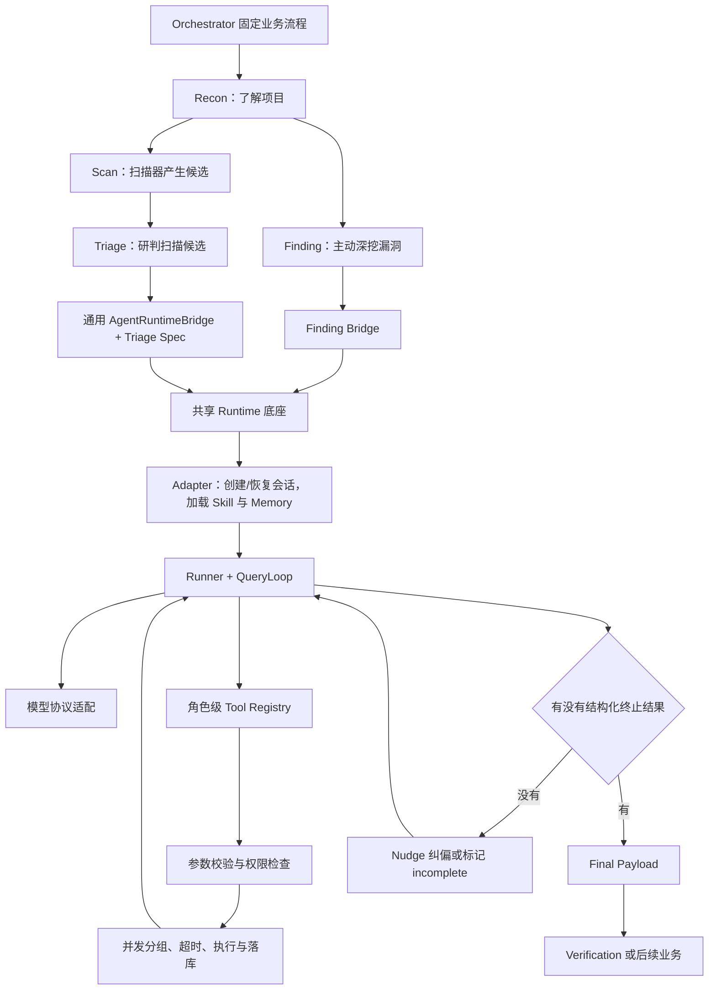
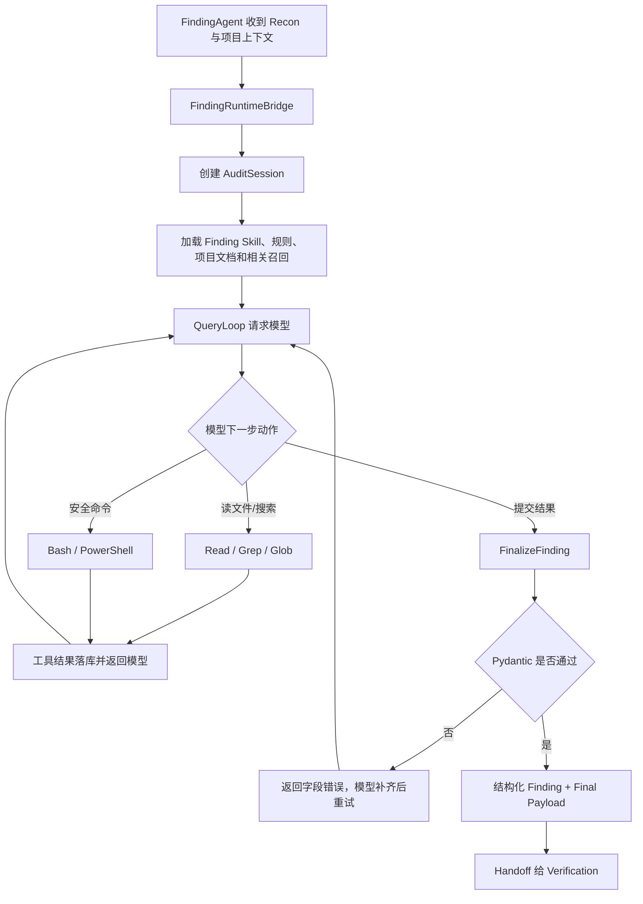
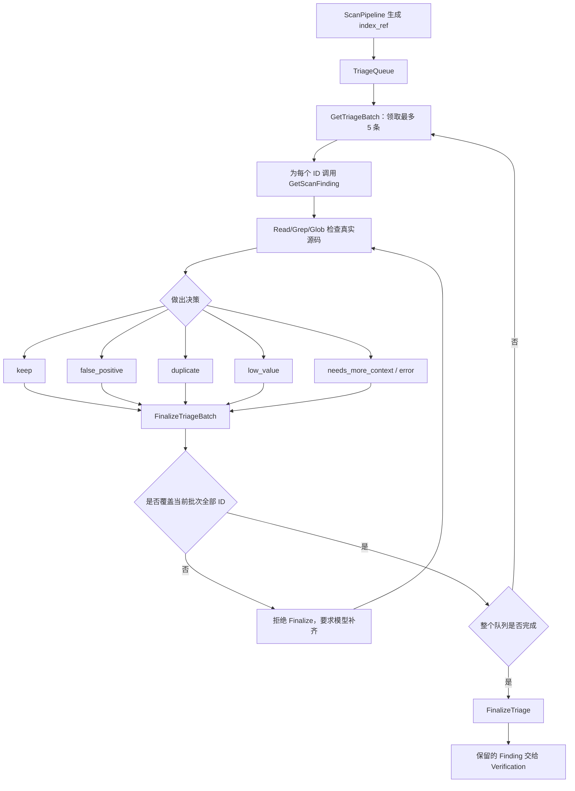

# AutoCVE Python Agent Runtime（Harness）逐句代码分析与面试手册

> 面向读者：第一次接触 Agent Runtime、Tool Calling、会话持久化的开发者  
> 核验范围：当前工作区中的 Finding Runtime、Triage Runtime、`agent_runtime`、`runtime_core`、会话存储与恢复链路  
> 核验日期：2026-07-23  
> 写作原则：先用通俗语言建立直觉，再结合真实代码解释；设计目标、当前实现和仍有缺口的地方分开说明

---

## 一、需要解释的完整项目介绍

> 抽象并实现面向 Finding、Triage 运行路径的 Python Agent Runtime（Harness），统一 Runtime 路径的模型与工具协议适配、角色级 Tool Registry、会话权限、规则及项目文档 Memory 预加载与结构化终止协议；通过 Pydantic 参数校验、并发安全分组、单工具超时、模型流整轮有界重试和持久化会话续跑，增强长任务的可观测性、可恢复性与可控性。

这段话看起来术语很多，但本质上只做了一件事：

> 给 Finding 和 Triage 两类 AI 安全工程师，建设一套统一的工作平台。模型负责思考，Runtime 负责发工具、查权限、保存过程、处理异常，并要求模型最终提交符合格式的结果。

可以先记住下面的对应关系：

| 项目术语 | 初学者可以怎样理解 |
| --- | --- |
| Model / LLM | AI 员工的大脑 |
| Agent Runtime / Harness | AI 员工的主管、工作制度和执行平台 |
| Finding | 主动阅读代码、深挖漏洞的安全研究员 |
| Triage | 判断扫描器告警是真漏洞还是误报的初审人员 |
| Tool | Read、Grep、Bash 等实际工作工具 |
| Tool Registry | 当前角色可以看到的工具柜 |
| Permission | 工具柜上的门禁和使用审批 |
| Memory | 上岗前加载的项目说明和安全规则 |
| Session | 一次审计工作的完整档案 |
| Checkpoint | 可以恢复的存档点 |
| Finalize Tool | 提交最终结果时必须填写的标准表单 |

---

## 二、先看整体结构



Runtime 内部的主要类可以理解为：

| 组件 | 主要职责 | 代码位置 |
| --- | --- | --- |
| `AgentRuntimeSpec` | 描述不同角色有哪些差异 | `backend/app/services/agent_runtime/specs.py:15` |
| `AgentRuntimeBridge` | 把模型、工具、Runner、Adapter 组装起来 | `backend/app/services/agent_runtime/bridge.py:30` |
| `AgentRuntimeAdapter` | 创建会话，预加载 Skill、Memory 和 Prompt | `backend/app/services/agent_runtime/adapter.py:16` |
| `FindingRuntimeRunner` | 驱动 QueryLoop 连续执行多个回合 | `backend/app/services/finding_runtime/runner.py:18` |
| `QueryLoop` | 完成一次“模型思考 → 工具执行 → 状态转换” | `backend/app/services/finding_runtime/query_loop.py:61` |
| `RuntimeLLMModelClient` | 把不同模型的消息和工具格式转换为统一格式 | `backend/app/services/finding_runtime/bridge.py:69` |
| `ToolOrchestrator` | 校验、授权、分组、执行和记录工具调用 | `backend/app/services/runtime_core/tool_runtime.py:410` |
| `AuditSessionStore` | 持久化会话、消息、回合、工具和检查点 | `backend/app/services/finding_runtime/session_store.py:55` |

---

# 第一部分：逐句拆解项目介绍

## 1. 原文片段：“抽象并实现面向 Finding、Triage 运行路径的 Python Agent Runtime（Harness）”

### 1.1 通俗解释

Finding 和 Triage 都需要重复执行下面的过程：

```text
把上下文发给模型
    ↓
模型决定调用哪个工具
    ↓
执行工具
    ↓
把结果发回模型
    ↓
直到任务完成
```

如果两条路径各写一套循环，就会出现：

- Finding 有超时，Triage 没有；
- Finding 能恢复，Triage 只能重来；
- 两边处理模型 Tool Call 的格式不一致；
- 修一个 Runtime Bug，需要在两处重复修改。

所以项目把公共机制抽成 Runtime，把角色差异抽成 `AgentRuntimeSpec`。

### 1.2 关键代码位置

- 角色规格：`backend/app/services/agent_runtime/specs.py:15-25`
- Finding 规格：`backend/app/services/agent_runtime/specs.py:38-54`
- Triage 规格：`backend/app/services/agent_runtime/specs.py:80-97`
- 通用装配入口：`backend/app/services/agent_runtime/bridge.py:50-102`
- Triage 实际接入：`backend/app/services/agent/agents/orchestrator.py:354-479`
- Finding 实际入口：`backend/app/services/agent/agents/finding.py:305-416`

### 1.3 `AgentRuntimeSpec` 代码分析

```python
@dataclass(slots=True)
class AgentRuntimeSpec:
    agent_type: str
    default_model_name: str
    default_user_message: str
    require_terminal_action: bool = False
    terminal_action_nudge_limit: int = 1
    payload_extractor: PayloadExtractor | None = None
    finalizer_prompts: PromptBuilder | None = None
    fallback_payload_builder: PayloadBuilder | None = None
    finalizer_tool_factory: ToolFactory | None = None
    tool_registry_builder: ToolRegistryBuilder | None = None
```

逐项解释：

- `agent_type`：当前是什么角色，例如 `finding` 或 `triage`。
- `default_model_name`：没有指定模型路由时使用哪个默认名称。
- `require_terminal_action`：模型能不能只说“完成”，还是必须调用终止工具。
- `terminal_action_nudge_limit`：模型没有真正结束时，最多提醒几次。
- `payload_extractor`：从 Runner 结果或历史消息中提取最终业务数据。
- `fallback_payload_builder`：始终没有正式结果时，生成一个明确的“不完整”结果。
- `finalizer_tool_factory`：构建 Finding 等角色的最终提交工具。
- `tool_registry_builder`：根据角色创建工具注册表。

这个设计的重点是：

> Runtime 的执行流程不变，Finding/Triage 的差异通过配置注入。

这是一种“配置驱动的运行时装配”，比在 QueryLoop 中到处写：

```python
if agent_type == "finding":
    ...
elif agent_type == "triage":
    ...
```

更容易扩展和测试。

### 1.4 Bridge 是怎样把组件组装起来的

`backend/app/services/agent_runtime/bridge.py:61-86`：

```python
model_client = self._build_model_client()
tool_registry = self._build_tool_registry()
tool_orchestrator = ToolOrchestrator(
    session_store=self._session_store,
    tool_registry=tool_registry,
    agent_type=self._spec.agent_type,
)
runner = FindingRuntimeRunner(
    session_store=self._session_store,
    model_client=model_client,
    tool_registry=tool_registry,
    tool_orchestrator=tool_orchestrator,
    max_turns=max_turns,
    require_terminal_action=self._spec.require_terminal_action,
    terminal_action_nudge_limit=self._spec.terminal_action_nudge_limit,
)
adapter = self._build_adapter(runner)
result = await adapter.run(...)
```

可以把这段理解成组装电脑：

```text
ModelClient      = CPU 和外部模型通信
ToolRegistry     = 安装哪些外设
ToolOrchestrator = 外设控制器
Runner           = 运行程序
Adapter          = 开机并加载用户配置
```

### 1.5 当前实现边界

这里不能在面试中说“Finding 和 Triage 的所有入口已经完全统一”。

当前真实情况是：

- Triage 已经直接使用 `AgentRuntimeBridge(build_triage_runtime_spec())`；
- `build_finding_runtime_spec()` 已经存在；
- 但 `FindingAgent._build_runtime_bridge()` 目前仍返回专用的 `FindingRuntimeBridge`；
- 专用 Finding Bridge 与通用 Bridge 已经共享 QueryLoop、Tool Runtime、Session Store、Memory 等核心底座。

准确说法是：

> 已统一 Runtime 核心执行底座，Triage 已接入通用 Spec/Bridge；Finding 仍保留兼容专用 Bridge，外层装配尚未完全收口。

### 1.6 本节面试追问

**问：为什么需要 Harness，直接在 Agent 类里写循环不行吗？**

答题要点：

1. 直接写当然能运行，但模型适配、工具执行、权限、持久化会重复。
2. 长任务需要统一的失败边界和恢复协议。
3. Harness 将业务角色和执行机制拆开，让新角色只提供 Spec 和角色工具。

---

## 2. 原文片段：“统一 Runtime 路径的模型与工具协议适配”

### 2.1 通俗解释

OpenAI、Claude、Gemini 的 Tool Calling 格式并不完全一样。

同一个“读取文件”动作，底层提供方可能分别使用：

- OpenAI `assistant.tool_calls`；
- Anthropic `tool_use` / `tool_result` Block；
- Gemini Parts；
- 不支持原生工具时的普通文本。

如果 QueryLoop 直接处理每家格式，它会充满 Provider 判断。项目选择先做一层“翻译”：

```text
OpenAI 格式 ─┐
Claude 格式 ─┼─> Runtime 内部统一格式
Gemini 格式 ─┘
```

### 2.2 关键代码位置

- 统一模型返回对象：`backend/app/services/finding_runtime/models.py:109-118`
- 模型适配客户端：`backend/app/services/finding_runtime/bridge.py:69-347`
- Tool Call 归一化：`backend/app/services/finding_runtime/bridge.py:478-490`
- Runtime 消息编码器：`backend/app/services/runtime_core/tool_message_codec.py:10-62`
- OpenAI 历史编码：`backend/app/services/runtime_core/tool_message_codec.py:133-195`
- Anthropic 历史编码：`backend/app/services/runtime_core/tool_message_codec.py:198-251`
- 协议选择：`backend/app/services/llm/protocols/registry.py:207-221`

### 2.3 统一模型返回对象

```python
@dataclass(slots=True)
class RuntimeModelResponse:
    content: str = ""
    reasoning_content: str = ""
    tool_calls: list[dict[str, Any]] = field(default_factory=list)
    stop_reason: str | None = None
    recoverable_error_kind: str | None = None
    recoverable_error_message: str | None = None
    usage: dict[str, Any] = field(default_factory=dict)
```

QueryLoop 不需要知道底层供应商，只处理：

- 模型正文；
- 推理内容；
- 工具调用；
- 停止原因；
- 可恢复错误；
- Token 使用信息。

这就是 Adapter（适配器）模式：把不同外部接口变成统一的内部接口。

### 2.4 Tool Call 是怎样被统一的

`backend/app/services/finding_runtime/bridge.py:478-490`：

```python
raw_arguments = function_payload.get("arguments")
parsed_arguments = (
    AgentJsonParser.parse_any(raw_arguments, default={})
    if isinstance(raw_arguments, str)
    else raw_arguments
)
if not isinstance(parsed_arguments, dict):
    parsed_arguments = {"raw_input": parsed_arguments}

return {
    "id": raw_tool_call.get("id") or "tool-call",
    "name": function_payload.get("name") or "",
    "input": parsed_arguments,
}
```

最终统一为：

```python
{
    "id": "call-123",
    "name": "Read",
    "input": {"file_path": "app/login.py"}
}
```

这里有两个工程细节：

1. Provider 经常把 `arguments` 返回成 JSON 字符串，因此需要解析。
2. 即使参数不是字典，也不会立即让程序崩溃，而是包装为 `raw_input`，再交给 Pydantic 给出正式校验错误。

### 2.5 工具定义怎样发给模型

`backend/app/services/finding_runtime/bridge.py:339-347`：

```python
return {
    "type": "function",
    "function": {
        "name": definition.get("name", ""),
        "description": definition.get("description", ""),
        "parameters": definition.get("input_schema", {"type": "object"}),
    },
}
```

Runtime Tool 先提供内部 `input_schema`，Model Client 再转为模型能理解的 Function Schema。

### 2.6 本节面试追问

**问：协议适配解决的核心问题是什么？**

答：

> 把 Provider 差异隔离在边界层，避免 QueryLoop、权限和工具执行逻辑绑定某一家模型，降低更换模型和测试 Mock 的成本。

**问：为什么不能全部转成普通文本？**

答：

> 文本容易解析失败，也会丢失 Tool Call ID 和调用结果的配对关系。原生工具协议能更稳定地维护“哪个调用对应哪个结果”。

---

## 3. 原文片段：“角色级 Tool Registry”

### 3.1 通俗解释

Tool Registry 是“工具注册表”，也可以理解成当前 Agent 的工具柜。

统一 Runtime 不代表所有角色拥有完全相同的工具：

- Finding 要主动审计源码，因此需要 `FinalizeFinding`；
- Triage 要领取扫描批次，因此需要 `GetTriageBatch`；
- 两者都可能需要 `Read`、`Grep`、`Glob`。

### 3.2 关键代码位置

- Tool 基类：`backend/app/services/runtime_core/tool_runtime.py:58-125`
- Registry 实现：`backend/app/services/runtime_core/tool_runtime.py:282-363`
- 角色工具构建：`backend/app/services/runtime_core/runtime_tool_registry.py:586-673`
- Finding 构建调用：`backend/app/services/finding_runtime/bridge.py:913-919`
- 通用 Bridge 构建调用：`backend/app/services/agent_runtime/bridge.py:408-416`

### 3.3 构建过程分析

`backend/app/services/runtime_core/runtime_tool_registry.py:586-673` 的逻辑可以简化为：

```python
def build_runtime_tool_registry(*, agent_type: str, ...):
    tools = []

    # 公共代码工具
    tools += [Read, Glob, Grep, Write, Bash, PowerShell, Skill]

    if agent_type == "finding":
        tools += [FinalizeFinding]

    if agent_type == "triage":
        tools += [
            GetTriageBatch,
            GetScanFinding,
            FinalizeTriageBatch,
            FinalizeTriage,
        ]

    tools += [TodoWrite, AskUser, EnterPlanMode, ExitPlanMode]
    return ToolRegistry(tools)
```

实际代码还有启用条件：

- 只有底层 `agent_tools` 提供了 `read_file`，才注册 `Read`；
- 只有提供了 `list_files`，才注册 `Glob`；
- 只有提供了 `search_code`，才注册 `Grep`；
- 检测到 Bash 或 PowerShell 可用时才注册 Shell；
- 有延迟工具时才增加 `ToolSearch`。

### 3.4 不同角色的工具差异

| 工具 | Finding | Triage | 说明 |
| --- | --- | --- | --- |
| `Read` | 是 | 是 | 阅读源码 |
| `Glob` | 是 | 是 | 找文件 |
| `Grep` | 是 | 是 | 搜索代码 |
| `Write` | 是 | 是 | 写受管产物，仍受权限限制 |
| `Bash` / `PowerShell` | 条件启用 | 条件启用 | 执行沙箱命令 |
| `Skill` | 是 | 是 | 加载角色 Skill |
| `FinalizeFinding` | 是 | 否 | 提交 Finding 结果 |
| `GetTriageBatch` | 否 | 是 | 领取扫描批次 |
| `GetScanFinding` | 否 | 是 | 读取原始扫描结果 |
| `FinalizeTriageBatch` | 否 | 是 | 提交当前批次判断 |
| `FinalizeTriage` | 否 | 是 | 汇总所有 Triage 结果 |

### 3.5 Registry 和 Permission 不是一回事

这是很常见的面试追问。

```text
Registry：这个工具是否被安装到当前角色的工具柜
Permission：工具已经在柜子里，但这一次是否允许使用
```

例如：

- Finding 的 Registry 中有 `Write`；
- 当前会话处于 Plan Mode；
- Permission Runtime 会拒绝这次 `Write`。

因此 Registry 解决“能力边界”，Permission 解决“当前执行授权”。

### 3.6 本节面试追问

**问：为什么不用一个全局工具列表，再在 Prompt 里告诉模型不要乱用？**

答：

> Prompt 只是软约束。角色级 Registry 会从模型可见 Schema 和执行入口两侧同时移除不属于该角色的工具，边界更明确，也能减少无关工具占用上下文。

---

## 4. 原文片段：“会话权限”

### 4.1 通俗解释

Registry 决定“有没有这个工具”，会话权限决定“本次能不能执行”。

权限不是只判断一次。当前实现有两层：

1. Runtime 会话级规则；
2. 工具自身的权限与 Guardrail。

### 4.2 关键代码位置

- 会话权限决策：`backend/app/services/runtime_core/permission_runtime.py:20-101`
- 执行前第一层检查：`backend/app/services/runtime_core/tool_runtime.py:628-665`
- 工具自身第二层检查：`backend/app/services/runtime_core/tool_runtime.py:667-705`
- 写入和 Shell Guardrail：`backend/app/services/runtime_core/runtime_guardrails.py`
- Bash/PowerShell 安全工具：`backend/app/services/runtime_core/shell_runtime_tools.py`

### 4.3 权限优先级

`RuntimePermissionRuntime.evaluate_tool_use()` 的流程是：

```text
系统交互工具
    ↓
显式 permission_rules
    ↓
Plan Mode 限制
    ↓
当前 Skill 的 allowed_tools
```

相关代码：

```python
explicit = resolve_permission_rule_decision(
    runtime_state.metadata.get("permission_rules"),
    agent_type=self._agent_type,
    tool_name=normalized_tool_name,
)

if permission_mode == "plan" and normalized_tool_name not in {
    "Read", "Glob", "Grep", "Skill"
}:
    return ToolPermissionDecision(allowed=False, ...)
```

Plan Mode 下只允许读操作，是为了让模型先调查和制定方案，不能直接修改项目。

### 4.4 Skill 也能收缩工具权限

Skill 激活后可以声明 `allowed_tools`。Runtime 会收集所有激活 Skill 的工具合同：

```python
for contract in active_skills.values():
    for item in contract.get("allowed_tools") or []:
        allowed_tools.append(item)
```

如果模型调用了合同外工具，就返回 `permission_denied`。

### 4.5 为什么权限拒绝也要落库

工具调用在权限检查之前就会创建 `AuditToolCall`：

```python
tool_call_id = self._session_store.start_tool_call(...)
```

权限拒绝后再把状态更新为 `denied`。

这样以后能回答：

- 模型尝试调用了什么？
- 为什么被拒绝？
- 是会话规则、Plan Mode、Skill 还是工具 Guardrail 拒绝？

这正是“可观测性”的一部分。

### 4.6 当前边界

`mode="ask"` 当前会转换为一条带 `permission_mode=ask` 的拒绝记录。它本身不会在 Runtime 内部阻塞并弹窗等待用户点击；外部交互层需要在用户批准后更新会话状态并续跑。

### 4.7 本节面试追问

**问：为什么权限检查要分两层？**

答：

> Runtime 层负责角色、会话和 Skill 的通用策略；工具层最了解具体风险，例如写入路径和 Shell 命令。两层组合既能统一治理，又保留工具级细节。

---

## 5. 原文片段：“规则及项目文档 Memory 预加载”

### 5.1 通俗解释

模型开始工作前，先给它发“工作手册”：

- 项目自己的开发说明；
- 当前审计规则；
- 与技术栈或漏洞类型相关的 Finding 参考资料。

这一步叫 Memory 预加载。

它与普通聊天历史不同：

- 聊天历史记录“这次任务已经发生了什么”；
- Memory 提供“开始工作前应该知道什么”。

### 5.2 关键代码位置

- Adapter 调用预加载：`backend/app/services/agent_runtime/adapter.py:69-100`
- Memory 管理器：`backend/app/services/runtime_core/memory_runtime.py:37-68`
- 数据库规则：`backend/app/services/runtime_core/memory_runtime.py:70-135`
- 项目文档：`backend/app/services/runtime_core/memory_runtime.py:137-184`
- Finding 相关召回：`backend/app/services/runtime_core/memory_runtime.py:186-233`
- 安全处理 `@include`：`backend/app/services/runtime_core/memory_runtime.py:272-317`
- 拼入 Prompt：`backend/app/services/runtime_core/memory_runtime.py:355-387`
- Memory 持久化：`backend/app/services/finding_runtime/session_store.py:272-299`

### 5.3 Adapter 中的执行顺序

```python
skill_context = await self._resolve_skill_context(...)
self._session_store.replace_skills(...)

memory_bundle = await self._memory_manager.preload(...)
self._session_store.replace_memories(
    session_id,
    memory_bundle.all_memories,
)

enriched_system_prompt = self._compose_system_prompt(
    base_system_prompt=system_prompt,
    skill_context=skill_context,
    memories=memory_bundle.all_memories,
)
self._session_store.update_system_prompt(
    session_id,
    enriched_system_prompt,
)
```

顺序是：

```text
解析 Skill
    ↓
根据角色、Skill Route、项目上下文加载 Memory
    ↓
把 Skill 和 Memory 持久化
    ↓
组合新的 System Prompt
    ↓
开始 QueryLoop
```

### 5.4 当前会加载什么

#### 数据库规则

当前只加载：

- 启用状态；
- 系统规则集或默认规则集；
- 名称位于 `{"owasp top 10"}` 白名单；
- 每个规则集最多取前 10 条规则。

#### 项目文档

当前自动发现：

```text
CLAUDE.md
CLAW.md
CLAUDE.local.md
CLAW.local.md
.claude/CLAUDE.md
.claw/CLAW.md
.claude/rules/**/*.md
.claw/rules/**/*.md
```

最多加载 8 个项目文档，每条最多 3200 个字符。

#### Finding 相关召回

只有 `agent_type == "finding"` 才会根据：

- 用户任务；
- Recon 摘要；
- 入口点；
- 高优先级路径；
- 项目画像；
- Finding Skill Route；

计算相关度，最多召回 5 条 `code-audit-finding` 参考资料。

Triage 当前只有规则和项目文档，没有这部分 Finding 知识召回。

### 5.5 为什么 Memory 也要落库

如果只把 Memory 临时拼进 Prompt，任务失败后很难知道当时模型究竟看到了什么。

保存到 `audit_memories` 后，可以复盘：

- 加载了哪条 OWASP 规则；
- 加载了哪个项目文档；
- 召回了哪篇漏洞参考；
- 相关度分数是多少。

### 5.6 安全细节：项目文档的 `@include`

项目文档可以通过 `@相对路径` 引入其他文件，但代码会拒绝：

- `~/...`；
- 包含 `..` 的相对路径；
- 解析后落在项目根目录之外的文件。

目的是防止恶意项目说明诱导 Runtime 读取仓库外的敏感文件。

### 5.7 当前边界和代码风险

1. 当前不会自动加载普通 `README.md` 或 `AGENTS.md`。
2. 数据库规则白名单目前只有 `OWASP Top 10`。
3. `memory_runtime.py:253` 使用：

   ```python
   path = root / normalized.replace("/", "\\")
   ```

   在 macOS/Linux 上，反斜杠通常不是路径分隔符，嵌套 Skill 参考文件可能无法找到。更稳妥的跨平台写法是：

   ```python
   path = root.joinpath(*PurePosixPath(normalized).parts)
   ```

### 5.8 本节面试追问

**问：Memory 和 RAG 有什么区别？**

答：

> Memory 是 Runtime 中持久化并注入上下文的统一概念；当前实现既包含确定性加载的规则和项目文档，也包含按关键词及 Route 打分的 Finding 参考召回。它有检索思想，但不是向量数据库式的完整 RAG。

---

## 6. 原文片段：“结构化终止协议”

### 6.1 通俗解释

模型停止输出，不代表业务真的完成。

模型可能只说：

> 我已经分析完成，后续建议继续检查权限模块。

但系统无法从这句话确定：

- 最终漏洞列表在哪里？
- 是否真的覆盖了所有 Triage 候选？
- 后续 Verification 应该接收什么？

因此项目规定：任务必须通过特定 Finalize Tool 提交机器可解析结果。

### 6.2 关键代码位置

- 终止动作枚举：`backend/app/services/finding_runtime/models.py:54-68`
- QueryLoop 识别 Final Payload：`backend/app/services/finding_runtime/query_loop.py:545-561`
- 无终止动作 Nudge：`backend/app/services/finding_runtime/query_loop.py:707-790`
- 终止状态持久化：`backend/app/services/finding_runtime/query_loop.py:957-1004`
- Finding Finalizer：`backend/app/services/finding_runtime/tools/finalize_finding.py:21-113`
- Triage Finalizer：`backend/app/services/triage_runtime/tools.py:158-286`
- Bridge 最终 Payload 保障：`backend/app/services/agent_runtime/bridge.py:294-363`

### 6.3 终止动作与完成模式

```python
class RuntimeTerminalAction(StrEnum):
    FINALIZE_FINDING = "finalize_finding"
    FINALIZE_TRIAGE_BATCH = "finalize_triage_batch"
    FINALIZE_TRIAGE = "finalize_triage"
    NATURAL_END_WITHOUT_TERMINAL_ACTION = (
        "natural_end_without_terminal_action"
    )
    MAX_TURNS = "max_turns"
```

完成方式还有：

```python
class RuntimeCompletionMode(StrEnum):
    FINALIZE_TOOL = "finalize_tool"
    LEGACY_FINAL_JSON = "legacy_final_json"
    FALLBACK_RECOVERED = "fallback_recovered"
    INCOMPLETE = "incomplete"
```

两者的区别：

- `terminal_action`：最后执行了什么动作；
- `completion_mode`：业务结果通过什么方式得到，是否可信地完成。

### 6.4 QueryLoop 怎样识别正式结束

工具执行结果中只要出现：

```python
{
    "final_payload": {...},
    "terminal_action": "finalize_finding",
    "completion_mode": "finalize_tool"
}
```

QueryLoop 就会进入 Terminal State，并把终止动作、完成模式和结果一起写入 Checkpoint。

### 6.5 模型不肯正式结束怎么办

如果模型没有调用工具，却表达“还要继续”或 Runtime 要求正式终止，QueryLoop 会追加一条合成用户消息：

```text
还需要审计就立即调用 Read/Grep/Glob 等工具；
已经完成就调用 FinalizeFinding；
不要只描述下一步计划。
```

这个动作叫 Nudge，即“运行时纠偏提醒”。

达到提醒上限后仍没有 Finalize Tool，会标记：

```text
terminal_action = natural_end_without_terminal_action
completion_mode = incomplete
```

Triage 的 Fallback 还会明确返回：

```python
{
    "findings": [],
    "is_partial": True,
    "requires_retry": True,
}
```

它不会把不完整结果伪装成成功。

### 6.6 Finding 为什么只有正式 Finalize 才 Handoff

`backend/app/services/agent/agents/finding.py:376-379`：

```python
handoff = (
    self._build_handoff(processed)
    if runtime_completion_mode
       is RuntimeCompletionMode.FINALIZE_TOOL
    else None
)
```

只有正式 Finalize 的 Finding 才交给 Verification。降级恢复或不完整结果不会污染后续阶段。

### 6.7 本节面试追问

**问：为什么不能依赖模型的 `finish_reason=stop`？**

答：

> `stop` 只表示模型这次停止生成，不表示业务合同完成。结构化终止工具把“生成结束”和“业务完成”分开。

---

## 7. 原文片段：“通过 Pydantic 参数校验”

### 7.1 通俗解释

模型调用工具时也会填错参数。

例如正确调用应该是：

```json
{
  "pattern": "execute(",
  "path": "backend/app"
}
```

模型可能返回：

```json
{
  "pattern": 123,
  "timeout_seconds": 99999
}
```

Runtime 不会直接把错误参数交给工具，而是先通过 Pydantic 转换和校验。

### 7.2 关键代码位置

- 通用入口：`backend/app/services/runtime_core/tool_runtime.py:67-70`
- 执行前捕获错误：`backend/app/services/runtime_core/tool_runtime.py:489-513`
- Read/Glob/Grep/Write 输入模型：`backend/app/services/runtime_core/runtime_tool_registry.py:54-84`
- Finding 最终 Schema：`backend/app/services/finding_runtime/final_finding_contract.py:18-134`
- Triage 决策模型：`backend/app/services/triage_runtime/tools.py:13-90`

### 7.3 通用校验流程

```python
def validate_input(self, raw_input: dict[str, Any]) -> Any:
    if self.input_model is None:
        return raw_input
    return self.input_model.model_validate(raw_input or {})
```

执行准备阶段：

```python
try:
    parsed_input = tool.validate_input(request.input)
except ValidationError as exc:
    return _PreparedToolCall(
        request=request,
        tool=tool,
        validation_error=_format_validation_error(
            tool.name,
            exc,
        ),
    )
```

校验失败以后：

1. 工具不会执行；
2. 调用记录保存为 `invalid`；
3. 错误信息返回模型；
4. 模型可以下一轮修正参数。

### 7.4 Pydantic 不只检查类型，还检查业务规则

Triage 决策中：

```python
if self.decision == "keep" and self.finding is None:
    raise ValueError("keep decision requires finding")

if self.decision == "duplicate" and not self.duplicate_of:
    raise ValueError("duplicate decision requires duplicate_of")
```

这不是普通的字符串类型检查，而是跨字段业务校验。

Finding 的 `FinalizedFinding` 还要求：

- 严重度只能是 `critical` 或 `high`；
- 行号必须大于等于 1；
- `line_end >= line_start`；
- 必须有 Source、Sink、攻击链和 PoC；
- 置信度必须位于 0 到 1；
- `extra="forbid"`，未声明字段也会被拒绝。

### 7.5 为什么 Finalizer 校验失败不直接终止整个 Agent

`FinalizeFindingTool` 会把校验失败包装为：

```python
{
    "finalization_rejected": True,
    "validation_errors": [...],
}
```

并作为模型可见结果返回。

这样模型可以补齐缺失字段后再次调用 Finalize，而不是因为第一次格式错误导致整个长任务失败。

### 7.6 本节面试追问

**问：为什么已经有 JSON Schema，还需要服务端 Pydantic？**

答：

> 给模型的 JSON Schema 只是调用提示，模型仍可能违反；Pydantic 是服务端真正的信任边界，还能执行跨字段业务校验。

---

## 8. 原文片段：“并发安全分组”

### 8.1 通俗解释

如果模型一次要求读取多个互不相关的文件，可以并发执行，提高速度。

但是两个写操作、两个领取同一队列的操作不能随便并发，否则可能发生数据冲突。

因此每个工具可以声明：

```python
is_concurrency_safe(parsed_input)
concurrency_key(parsed_input)
```

### 8.2 关键代码位置

- 工具默认并发属性：`backend/app/services/runtime_core/tool_runtime.py:75-79`
- 计算安全性和 Key：`backend/app/services/runtime_core/tool_runtime.py:489-513`
- 分组算法：`backend/app/services/runtime_core/tool_runtime.py:516-533`
- Streaming Executor：`backend/app/services/runtime_core/tool_runtime.py:963-1197`
- 冲突 Key 测试：`backend/tests/runtime_core/test_tool_runtime.py:225-249`

### 8.3 分组算法分析

```python
if prepared_call.is_concurrency_safe:
    key = prepared_call.concurrency_key
    can_join_batch = bool(
        batches
        and batches[-1][0]
        and (not key or key not in active_keys)
    )
    if can_join_batch:
        batches[-1][1].append(prepared_call)
    else:
        batches.append((True, [prepared_call]))
else:
    batches.append((False, [prepared_call]))
```

规则是：

- 安全工具可以加入当前并发批次；
- 相同 `concurrency_key` 不能出现在同一批；
- 非安全工具单独形成串行批次。

例如：

```text
Read(a.py)  key=a.py
Read(b.py)  key=b.py
Read(a.py)  key=a.py
Write(c.py) 非并发安全
```

会近似分为：

```text
批次 1：Read(a.py) + Read(b.py)
批次 2：Read(a.py)
批次 3：Write(c.py)
```

### 8.4 为什么还要有 `concurrency_key`

只有布尔值不够。

某类工具可能总体支持并发，但操作同一资源时不能并发。例如：

```text
更新 project-A 的状态
更新 project-B 的状态
```

可以并发；但两个调用同时更新 project-A 就应该串行。

`concurrency_key` 用于表达“冲突资源是谁”。

### 8.5 本节面试追问

**问：为什么不把所有 Read 都无条件并发？**

答：

> Read 的底层实现也可能访问共享缓存、同一会话上下文或受限后端；让工具自己声明安全性和 Key，比 Runtime 猜测更可靠。

---

## 9. 原文片段：“单工具超时”

### 9.1 通俗解释

一个 Grep 或 Shell 命令卡死，不应该拖死整个 Agent。

所以 Runtime 给每一次工具调用单独设置超时，而不是只设置一个整个任务的总超时。

### 9.2 关键代码位置

- 默认超时常量：`backend/app/services/runtime_core/tool_runtime.py:19-22`
- 工具自定义超时接口：`backend/app/services/runtime_core/tool_runtime.py:93-95`
- `asyncio.wait_for`：`backend/app/services/runtime_core/tool_runtime.py:707-736`
- 超时解析：`backend/app/services/runtime_core/tool_runtime.py:932-950`
- 搜索参数范围：`backend/app/services/runtime_core/runtime_tool_registry.py:63-78`
- 超时测试：`backend/tests/runtime_core/test_tool_runtime.py:86-113`

### 9.3 核心代码分析

```python
timeout_seconds = self._resolve_tool_timeout(
    prepared_call.tool,
    prepared_call.parsed_input,
    context,
)

result = await asyncio.wait_for(
    prepared_call.tool.execute(
        prepared_call.parsed_input,
        context,
    ),
    timeout=timeout_seconds,
)
```

超时来源有两级：

1. 工具实现通过 `execution_timeout_seconds()` 提供专属值；
2. 工具没有设置时，使用 Runtime 默认值。

当前常量：

```python
DEFAULT_RUNTIME_TOOL_TIMEOUT_SECONDS = 120
RUNTIME_SEARCH_TOOL_TIMEOUT_SECONDS = 45
RUNTIME_SEARCH_TOOL_MAX_TIMEOUT_SECONDS = 120
```

### 9.4 超时以后发生什么

Runtime 会：

- 把工具状态保存为 `failed`；
- 写入 `error_kind=timeout_error`；
- 保存使用的超时时间；
- 发出失败 Hook；
- 把“请缩小 path/glob/pattern 后重试”返回模型。

这不是直接终止整个 Agent。模型可以缩小搜索范围后继续。

### 9.5 单工具超时和任务总超时的区别

```text
单工具超时：防止一次工具调用卡死
任务总超时：防止整个续跑任务无限运行
```

后台 Resume Job 还使用：

```python
async with asyncio.timeout(
    settings.AUDIT_SESSION_RESUME_TIMEOUT_SECONDS
):
    ...
```

代码位置：`backend/app/services/finding_runtime/resume_job.py:390`。

### 9.6 本节面试追问

**问：为什么超时后不立即终止 Agent？**

答：

> 工具失败可能通过换路径、缩小查询或换工具恢复。把工具错误作为 Observation 返回模型，比直接杀死长任务更有恢复能力。

---

## 10. 原文片段：“模型流整轮有界重试”

### 10.1 通俗解释

模型正在流式输出时，网络可能中断。

如果把半截回答保存进正式历史，会出现：

- 半个 JSON；
- 不完整 Tool Call；
- 下一轮模型误以为上一步已经完成。

因此项目以“整个模型回合”为重试单位：

```text
上一个完整回合
    ↓
本轮开始生成
    ↓
流中断
    ↓
本轮作废
    ↓
从上一个完整回合重新请求
```

“有界”表示重试次数有限，不会无限重试。

### 10.2 关键代码位置

- 最大重试数：`backend/app/services/finding_runtime/query_loop.py:63`
- Attempt 循环：`backend/app/services/finding_runtime/query_loop.py:165-257`
- 耗尽后可恢复失败：`backend/app/services/finding_runtime/query_loop.py:288-321`
- 完整 `done` 后才提交消息：`backend/app/services/finding_runtime/query_loop.py:1167-1286`
- 禁用 LLMService 内层重试：`backend/app/services/finding_runtime/bridge.py:74-85`
- Attempt 数据表：`backend/app/models/audit_session.py:139-154`
- 重试测试：`backend/tests/finding_runtime/test_query_loop.py:2035-2048`

### 10.3 为什么最多是 6 次 Provider 尝试

```python
MODEL_STREAM_MAX_RETRIES = 5

for attempt_number in range(
    1,
    MODEL_STREAM_MAX_RETRIES + 2,
):
    ...
```

这里的含义是：

```text
1 次首次请求 + 5 次重试 = 最多 6 次尝试
```

### 10.4 Attempt 状态

```text
running     正在调用 Provider
committed   完整成功，正式提交
superseded  可重试失败，已被下一次尝试替代
tombstone   最终废弃或不可重试
```

失败时不仅记录日志，还会：

- 更新 `audit_model_stream_attempts`；
- 写 Checkpoint；
- 向前端发 `assistant_tombstone`；
- 向前端发 `llm_retry`；
- 指数退避后重试。

退避代码：

```python
await asyncio.sleep(
    min(4.0, float(2 ** (attempt_number - 1)))
)
```

近似等待：

```text
1 秒 → 2 秒 → 4 秒 → 4 秒 → 4 秒
```

### 10.5 为什么这是“整轮”重试

流式过程中，Token 先通过 Event Sink 发给前端；只有收到 `done`，才调用：

```python
self._append_streaming_assistant_message(...)
```

因此失败的半截内容只是前端临时显示，不会成为正式数据库 Transcript。

### 10.6 为什么要关闭 LLMService 自己的重试

Model Client 会尝试传：

```python
{"retry_enabled": False}
```

因为 QueryLoop 已经拥有完整的 Attempt、Checkpoint 和状态管理。如果下层再重试，可能变成：

```text
QueryLoop 6 次 × LLMService N 次
```

不但请求数不可控，而且每次 Provider 尝试也无法清晰观测。

### 10.7 本节面试追问

**问：为什么重试模型回合不会重复执行上一轮工具？**

答：

> 重试发生在当前模型回合尚未提交、也尚未进入工具执行阶段时。它从上一份已提交 Transcript 重新请求，不会重放上一个已经完成的工具批次。

---

## 11. 原文片段：“持久化会话续跑”

### 11.1 通俗解释

内存中的 Agent 一旦进程退出，所有进度都会消失。

项目把执行过程存进数据库：

- 会话；
- 消息；
- 模型回合；
- 模型尝试；
- 工具调用；
- Skill；
- Memory；
- Checkpoint；
- Handoff。

失败后可以加载原 Session，从上一个完整状态继续。

### 11.2 关键代码位置

- ORM 数据模型：`backend/app/models/audit_session.py:38-254`
- Session Store：`backend/app/services/finding_runtime/session_store.py:55-554`
- QueryLoop State 序列化：`backend/app/services/finding_runtime/query_state.py:10-87`
- Adapter 刷新上下文：`backend/app/services/agent_runtime/adapter.py:132-188`
- Bridge Continue：`backend/app/services/agent_runtime/bridge.py:166-284`
- Resume API：`backend/app/api/v1/endpoints/audit_sessions.py:460-543`
- Resume Endpoint：`backend/app/api/v1/endpoints/audit_sessions.py:738-751`
- 后台 Resume Job：`backend/app/services/finding_runtime/resume_job.py:356-460`

### 11.3 保存了哪些数据

| 数据表/对象 | 作用 |
| --- | --- |
| `AuditSession` | 项目、任务、Runtime 状态、System Prompt、Recon |
| `AuditSessionMessage` | 用户、模型和工具消息 |
| `AuditSessionTurn` | 第几个模型回合、使用什么模型、最终状态 |
| `AuditModelStreamAttempt` | 本回合第几次 Provider 尝试 |
| `AuditToolCall` | 工具名、参数、状态、结果和耗时 |
| `AuditCheckpoint` | 可恢复边界和错误原因 |
| `AuditSkill` | 当前会话加载了哪些 Skill |
| `AuditMemory` | 当时注入了哪些规则和项目文档 |
| `AuditHandoff` | 向 Verification 等阶段交接什么 |

### 11.4 QueryLoop State 怎样保存

```python
def save_query_loop_state(
    self,
    session_id: str,
    state: QueryLoopState,
) -> None:
    runtime_state = self.load_runtime_state(session_id)
    runtime_state.metadata["query_loop"] = state.to_payload()
    self.replace_runtime_state(session_id, runtime_state)
```

也就是把 QueryLoop 的可序列化状态放进：

```text
AuditSession.runtime_state_json.metadata["query_loop"]
```

### 11.5 Resume API 怎样防止重复续跑

`queue_runtime_session_resume()` 会：

1. 使用 `SELECT ... FOR UPDATE` 锁住 Session；
2. 检查任务所有者；
3. 只允许 `runtime_stack == "runtime"`；
4. 已经 Running 时不重复入队；
5. Completed 会话不允许续跑；
6. 生成唯一 `resume_token`；
7. 把状态设为 Running 后提交；
8. 再向 ARQ/Redis 队列发送后台任务；
9. 入队失败则回写 `can_resume=True`。

这解决了用户连续点击两次“继续”造成重复 Worker 的问题。

### 11.6 后台续跑的失败边界

Resume Job 会处理：

- 用户取消；
- 整体超时；
- 数据库持久化失败；
- 普通后台任务异常；
- 模型仍未调用 `FinalizeFinding`；
- 成功后的漏洞和报告同步。

失败时写入：

```python
{
    "checkpoint_kind": "resumable_failed",
    "resumable": True,
    "error_kind": error_kind,
    "error": message,
}
```

### 11.7 Triage 的恢复方式不同

当前 HTTP Resume Worker 明显偏 Finding，因为成功条件直接检查 `FinalizeFinding`。

Triage 主要通过 `TriageQueue` 恢复：

- 批次状态写入 Scan Index JSON；
- 每批默认租约 900 秒；
- 租约过期重新变成可领取状态；
- `needs_more_context` 和 `error` 可以重试；
- 默认最多尝试 3 次。

代码位置：`backend/app/services/triage_runtime/queue.py:39-233`。

因此准确说法是：

> Finding 支持数据库会话级后台续跑；Triage 主要通过持久化批次队列、租约和重试恢复。

### 11.8 本节面试追问

**问：续跑是不是把整个历史再执行一遍？**

答：

> 不是。Runtime 加载已持久化的 Transcript、QueryLoop State、Skill 和 Memory，从新的模型回合继续；历史工具结果作为上下文读取，不会默认重新执行。

---

## 12. 原文片段：“增强长任务的可观测性、可恢复性与可控性”

### 12.1 可观测性

可观测不是“多打几行日志”，而是能够回答：

- 当前是第几个回合？
- 模型本轮尝试了几次？
- 哪次请求被重试？
- 模型请求了哪些工具？
- 哪个工具参数无效、被拒绝或超时？
- 当时加载了哪些 Memory？
- 最终通过什么方式结束？

对应持久化对象：

```text
Session + Message + Turn + ModelAttempt
+ ToolCall + Checkpoint + Skill + Memory + Handoff
```

### 12.2 可恢复性

来自：

- QueryLoop State 序列化；
- 完整回合提交；
- 模型流 Attempt；
- Checkpoint；
- `resumable_failed`；
- Resume API 和后台队列；
- Triage 租约与批次重试。

### 12.3 可控性

来自：

- 角色级 Tool Registry；
- Session Permission；
- Skill `allowed_tools`；
- Pydantic；
- 单工具超时；
- 模型重试上限；
- 最大回合数；
- 结构化 Finalize Tool；
- Write/Shell Guardrail。

### 12.4 三者的区别

| 能力 | 回答的问题 | 项目机制 |
| --- | --- | --- |
| 可观测 | 任务刚才发生了什么？ | 消息、回合、Attempt、Tool Call、Checkpoint |
| 可恢复 | 失败后怎样继续？ | State 持久化、Resume Job、Triage Lease |
| 可控 | 怎样防止越权、卡死或假完成？ | Registry、Permission、Timeout、Finalize |

---

# 第二部分：Finding 与 Triage 的完整业务流程

## 13. Finding 运行路径



实际入口：

- `backend/app/services/agent/agents/finding.py:323-416`
- `backend/app/services/finding_runtime/bridge.py:532-586`

Finding 的重点不是“调用一次模型生成漏洞”，而是连续：

```text
搜索 → 阅读 → 跟踪数据流 → 补证据 → 提交结构化结果
```

---

## 14. Triage 运行路径



关键代码：

- Triage Prompt：`backend/app/services/agent/agents/orchestrator.py:27-35`
- 批次编排：`backend/app/services/agent/agents/orchestrator.py:397-449`
- 队列领取：`backend/app/services/triage_runtime/queue.py:55-86`
- 批次完整性：`backend/app/services/triage_runtime/queue.py:108-170`
- 最终汇总：`backend/app/services/triage_runtime/queue.py:172-191`

### 为什么要强制覆盖每个 ID

如果本批有：

```text
F-1、F-2、F-3、F-4、F-5
```

模型只返回 F-1 和 F-2，不能默认剩余三条是误报。必须给每条一个明确判断，避免静默丢失扫描结果。

---

# 第三部分：把整段介绍串成一个真实例子

## 15. SQL 注入 Finding 示例

假设项目中存在用户参数直接拼接 SQL。

完整执行过程：

1. Adapter 创建 `AuditSession`。
2. 加载 OWASP 规则和项目说明。
3. 模型调用 `Grep(pattern="execute(", path="backend")`。
4. Pydantic 检查 `pattern`、`path` 和超时范围。
5. Permission Runtime 检查当前会话是否允许 Grep。
6. ToolOrchestrator 执行 Grep，并保存参数、耗时和结果。
7. 模型根据结果调用 `Read` 查看 DAO 和 Controller。
8. 多个独立 Read 可以进入同一并发批次。
9. 某个搜索超过 45 秒时只标记该工具超时，模型可以缩小范围。
10. 模型流中途断开时，本模型回合作废，从上个完整回合重试。
11. 模型确认 `request.query → SQL execute` 数据流后调用 `FinalizeFinding`。
12. Pydantic 检查行号、Source、Sink、攻击链、PoC、影响和置信度。
13. 校验通过后 QueryLoop 写入 Terminal State 和 Final Payload。
14. FindingAgent 只有在 `completion_mode=finalize_tool` 时才生成 Handoff。
15. 如果进程在第 9 步退出，可以通过 Session、Transcript 和 Checkpoint 继续。

这 15 步刚好对应原介绍中的所有能力，不是互相独立的术语堆砌。

---

# 第四部分：高频面试追问与回答

## 16. 架构类问题

### Q1：Agent Runtime 和普通 LLM 调用有什么区别？

普通 LLM 调用通常是：

```text
Prompt → 模型 → 文本
```

Agent Runtime 是：

```text
会话状态 → 模型决策 → 工具执行 → Observation
→ 状态转换 → 多轮循环 → 结构化终止
```

它还负责权限、超时、持久化和恢复。

### Q2：为什么不把这些逻辑全部放在 Orchestrator 里？

Orchestrator 负责业务阶段，例如 Recon、Finding、Triage、Verification 的顺序；Runtime 负责单个角色内部怎样安全地连续调用模型和工具。

```text
Orchestrator = 业务流程编排
Runtime      = Agent 执行机制
```

### Q3：为什么使用 Spec，而不是继承很多子类？

当前角色差异主要是工具、终止方式、默认 Prompt 和 Payload 提取。使用数据化 Spec 可以减少子类重复；只有行为差异很大时才需要新 Runner。

### Q4：为什么 Runner 仍叫 `FindingRuntimeRunner`？

这是当前迁移留下的命名债务。它已经被 Triage 通用 Bridge 复用，更准确的名字应是 `AgentRuntimeRunner`。

---

## 17. 工具与权限类问题

### Q5：Tool Registry 和权限系统有什么区别？

Registry 决定工具是否属于当前角色；权限决定这个会话的这一次调用是否允许。

### Q6：为什么工具参数校验失败后不直接抛异常？

Agent 是纠错循环。把结构化校验错误作为 Observation 返回，模型可以补齐参数；直接让进程崩溃会浪费此前审计进度。

### Q7：如何防止模型调用不存在的工具？

Tool Registry 查找失败后，ToolOrchestrator 会把调用记录为 `missing`，不会执行任意名称；同时模型只会收到当前 Registry 导出的工具 Schema。

### Q8：`ask`、`deny` 有什么区别？

两者当前都阻止本次执行，但 `ask` 会记录“需要用户批准”的来源和模式，方便外部 UI 引导授权后续跑；`deny` 表示策略明确禁止。

### Q9：怎样控制 Write 和 Shell 的风险？

先经过 Runtime Permission，再经过工具自身 `check_permission()`；工具层还检查项目根路径、受管输出目录、Guardrail 和沙箱条件。

---

## 18. 并发、超时与一致性问题

### Q10：并发安全如何判断？

由每个 Tool 实现 `is_concurrency_safe()`，必要时返回 `concurrency_key()` 描述冲突资源。Runtime 根据两者分批。

### Q11：相同 `concurrency_key` 为什么要串行？

因为它们可能操作同一个文件、队列或业务实体，并发会产生覆盖、重复领取或状态丢失。

### Q12：单工具超时会不会导致整个回合失败？

通常不会。超时会转换为一个失败 Tool Result，模型仍可继续决策。只有 Shell 等具有中断传播规则的工具可能影响同批兄弟任务。

### Q13：超时后底层任务一定完全停止吗？

`asyncio.wait_for` 会取消协程，但如果底层工具把工作交给不可取消的外部进程，还需要工具实现负责进程清理。因此 Runtime 超时和底层资源终止要同时设计。

### Q14：TriageQueue 是否支持多进程强一致并发？

当前队列通过非并发安全 Tool、串行 Orchestrator 和租约减少冲突，但 JSON 文件写入没有跨进程文件锁或原子替换。多个 Worker 同时操作同一 `index_ref` 仍有竞态，这是可改进点。

---

## 19. 重试与恢复类问题

### Q15：为什么模型重试以整个回合为单位？

为了避免半截正文或半个 Tool Call 污染正式历史。只有完整 `done` 的模型回合才提交。

### Q16：为什么重试次数是有限的？

无限重试会造成成本、延迟和故障风暴不可控。当前最多 1 次首次调用加 5 次重试，耗尽后转为可恢复失败。

### Q17：为什么不让 LLM SDK 自己重试？

SDK 重试通常看不到业务 Turn、Checkpoint 和前端事件。QueryLoop 统一重试后，每次 Provider Attempt 都能被持久化和观测，并避免嵌套重试。

### Q18：如何避免续跑重复执行？

Resume API 使用数据库行锁和 Resume Token 防止重复入队；QueryLoop 加载已提交 Transcript，从新的回合继续，不默认重放历史工具。

### Q19：Finding 和 Triage 的恢复方式为什么不同？

Finding 是单个长调查会话，适合数据库会话级恢复；Triage 面对大量独立扫描候选，拆成批次并使用租约恢复更简单。当前两套恢复还没有完全统一。

---

## 20. 终止协议与结果质量问题

### Q20：为什么需要 Finalize Tool？

模型停止生成不等于业务完成。Finalize Tool 同时完成结果校验、完成信号和后续 Handoff 数据准备。

### Q21：如果模型一直不调用 Finalize 怎么办？

QueryLoop 进行有限次 Nudge；仍不调用则标记 `incomplete`，Bridge 可以生成带 `requires_retry` 的降级结果，但不会把它当正式成功。

### Q22：为什么 FinalizedFinding 只允许 high/critical？

当前 Finding 路径目标是输出高价值 CVE 候选，因此 Schema 将低价值结果挡在正式 Final Payload 之外。普通告警可以在 Scan/Triage 层处理。

### Q23：怎样保证 Triage 不遗漏告警？

`FinalizeTriageBatch` 必须一次覆盖当前 Batch 的所有 Finding ID；缺失、重复或多余都会被 Queue 拒绝。

---

## 21. Memory 与可观测性问题

### Q24：为什么预加载 Memory，而不是让模型自己搜索规则？

项目范围、规则和角色方法论属于开始工作前就应该知道的上下文。预加载能减少重复 Tool Call，也能把“当时使用了什么规则”持久化下来。

### Q25：Memory 会不会让模型把规则当成项目证据？

Prompt 明确要求 Memory 只是“范围化指南和证据辅助，不能替代项目自身证据”。最终 Finding 仍必须包含真实文件、行号、代码片段和数据流。

### Q26：如何衡量可观测性做得好不好？

可以检查一次失败后是否能回答：

1. 失败发生在哪个 Turn？
2. 是哪次 Model Attempt？
3. 调用了哪个 Tool？
4. 输入、耗时、权限来源和错误类型是什么？
5. 当时的 Memory、Checkpoint 和终止状态是什么？

如果这些问题都能从持久化数据回答，可观测性才真正有用。

---

# 第五部分：面试表达模板

## 22. 30 秒通俗版

> 我们给 Finding 和 Triage 两条审计路径做了一套统一的 Python Agent Runtime。大模型只负责决定下一步，Runtime 负责模型协议转换、按角色发放工具、参数校验、权限检查、并发和超时，并把消息、工具调用、模型尝试和检查点存进数据库。模型必须通过 Finalize 工具提交结构化结果；中途流式调用失败时按完整回合有限重试，长任务失败后可以从原会话或 Triage 批次继续。

## 23. 1 分钟技术版

> Runtime 采用 Spec、Bridge、Adapter、Runner 和 QueryLoop 分层。Spec 描述 Finding/Triage 的角色差异，Bridge 装配模型客户端和角色 Tool Registry，Adapter 创建会话并预加载 Skill、审计规则及项目文档，QueryLoop 负责模型与工具之间的状态转换。工具统一经过 Pydantic、会话权限和工具 Guardrail，再按并发安全性与 Resource Key 分组，用 `asyncio.wait_for` 控制单调用超时。模型流由 QueryLoop 以 Turn 为原子边界管理，最多 1+5 次尝试，失败 Attempt 标记为 superseded 或 tombstone，耗尽后保存 resumable checkpoint。最终只有 FinalizeFinding、FinalizeTriageBatch 等终止工具产生的 Final Payload 才进入后续业务。

## 24. 面试中不要过度表述

不要说：

- Finding 和 Triage 的所有入口已经完全统一；
- `ask` 权限会在 Runtime 内自动等待用户审批；
- Triage 使用与 Finding 完全相同的 HTTP Session Resume；
- Triage JSON Queue 已支持多进程强一致；
- Memory 会自动读取仓库所有文档；
- 模型失败后可以无上限重试；
- 模型自然停止就等于任务成功。

更准确的说法：

- 核心 Runtime 底座已经共享，Finding 外层仍保留兼容 Bridge；
- `ask` 会形成可观测的待批准拒绝结果，需要外部交互层完成批准和续跑；
- Finding 主要使用会话级恢复，Triage 主要使用批次租约恢复；
- 重试、超时和最大回合数均有明确边界；
- 只有结构化 Finalize 结果才被视为正式完成。

---

# 第六部分：代码导航

## 25. 建议阅读顺序

### 第一步：看角色差异和组装

1. `backend/app/services/agent_runtime/specs.py:15`
2. `backend/app/services/agent_runtime/bridge.py:50`
3. `backend/app/services/agent_runtime/adapter.py:40`

### 第二步：看一次模型回合怎样运行

1. `backend/app/services/finding_runtime/runner.py:18`
2. `backend/app/services/finding_runtime/query_loop.py:61`
3. `backend/app/services/finding_runtime/models.py:54`

### 第三步：看模型和工具协议

1. `backend/app/services/finding_runtime/bridge.py:69`
2. `backend/app/services/runtime_core/tool_message_codec.py:10`
3. `backend/app/services/llm/protocols/registry.py:207`

### 第四步：看工具治理

1. `backend/app/services/runtime_core/tool_runtime.py:58`
2. `backend/app/services/runtime_core/runtime_tool_registry.py:586`
3. `backend/app/services/runtime_core/permission_runtime.py:58`
4. `backend/app/services/runtime_core/runtime_guardrails.py`

### 第五步：看 Memory 和终止协议

1. `backend/app/services/runtime_core/memory_runtime.py:37`
2. `backend/app/services/finding_runtime/final_finding_contract.py:68`
3. `backend/app/services/finding_runtime/tools/finalize_finding.py:21`
4. `backend/app/services/triage_runtime/tools.py:158`

### 第六步：看持久化和恢复

1. `backend/app/models/audit_session.py:38`
2. `backend/app/services/finding_runtime/session_store.py:55`
3. `backend/app/api/v1/endpoints/audit_sessions.py:460`
4. `backend/app/services/finding_runtime/resume_job.py:356`
5. `backend/app/services/triage_runtime/queue.py:39`

---

## 26. 最终总结

这段项目介绍真正表达的不是“调用了很多大模型 API”，而是：

> 项目把 AI 安全审计从一次不稳定的模型问答，改造成了一套有角色边界、有工具合同、有权限、有失败边界、有持久化状态，并要求正式提交业务结果的长任务执行系统。

其中：

- Spec 和 Registry 解决不同角色做什么；
- Model Adapter 解决不同模型怎样接入；
- Pydantic 和 Permission 解决调用是否合法；
- 并发和 Timeout 解决工具怎样稳定执行；
- QueryLoop Retry 解决模型流怎样安全恢复；
- Session、Checkpoint 和 Resume 解决任务中断后怎样继续；
- Finalize Tool 解决系统如何判断“业务真正完成”。

这才是 Agent Runtime 相比普通 Prompt 调用最核心的工程价值。
