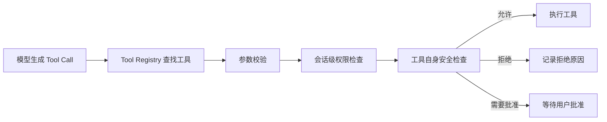
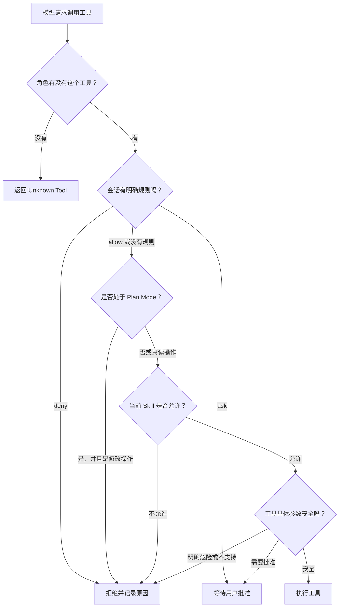
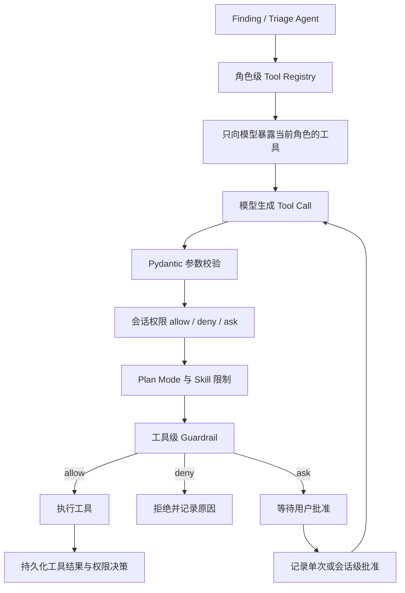

# 角色级 Tool Registry 与会话权限：通俗讲解及面试问答

## 文档说明

本文集中解释 Agent Runtime 中两个容易混淆的概念：

1. 角色级 Tool Registry：当前角色拥有哪些工具；
2. 会话权限：当前会话、当前阶段下，工具能否执行。

两者共同解决的问题是：

> 不仅要让 Agent 有能力完成任务，还要限制它只能在正确的角色、会话和资源范围内使用这些能力。

---

# 第一部分：角色级 Tool Registry

## 一、只有 Finding 和 Triage 两个角色，有必要区分工具吗？

这个质疑是成立的：

> 角色级 Tool Registry 确实会增加一点代码复杂度。

关键问题不是“现在有几个角色”，而是：

> Finding 和 Triage 是否存在真实的工具能力、权限边界和业务流程差异？

在当前项目中答案是“存在”，所以这点复杂度有实际价值。但如果两个角色的工具完全相同，强行拆分就属于过度设计。

## 二、为什么只有两个角色也要区分？

可以把它理解成公司只有两种员工：

- 开发人员可以修改代码；
- 财务人员可以审批付款。

不能因为公司目前只有两种岗位，就给他们相同的工具和权限。

Finding 和 Triage 也类似：

| 角色 | 主要任务 | 特有工具 |
|---|---|---|
| Finding | 阅读源码、寻找漏洞、提交单个漏洞结论 | `FinalizeFinding` |
| Triage | 领取扫描批次、判断漏洞结果、完成批次审核 | `GetTriageBatch`、`FinalizeTriageBatch`、`FinalizeTriage` |
| 两者共有 | 搜索和阅读项目代码 | `Read`、`Grep`、`Glob` |

它们虽然都属于安全分析 Agent，但业务职责并不相同。

例如：

- 让 Finding 调用 `FinalizeTriageBatch` 没有业务意义；
- 让 Triage 调用 `FinalizeFinding`，可能产生错误的数据状态。

所以判断是否需要角色级 Registry，不应该只看角色数量，而应该看：

- 角色的业务目标是否不同；
- 角色能执行的操作是否不同；
- 结构化结束方式是否不同；
- 错误调用是否会影响业务数据；
- 后续是否可能增加新的角色。

## 三、它增加了多少复杂度？

如果设计合理，增加的复杂度比较有限。

系统不是给每个角色重新实现一套工具，而是：

```text
公共工具
+ Finding 专属工具
+ Triage 专属工具
```

可以简单理解为：

```python
公共工具 = [Read, Grep, Glob]

Finding工具 = 公共工具 + [FinalizeFinding]

Triage工具 = 公共工具 + [
    GetTriageBatch,
    FinalizeTriageBatch,
    FinalizeTriage,
]
```

`Read`、`Grep`、`Glob` 的执行代码只有一份，不会因为存在两个角色而复制两次。

真正增加的代码主要是：

```text
如果是 Finding，注册 Finding 专属工具
如果是 Triage，注册 Triage 专属工具
```

因此，它增加的是“工具组合代码”，而不是“工具实现代码”。

## 四、为什么不注册所有工具，然后只依靠权限判断？

确实可以设计成：

```text
所有角色都能看到所有工具
        ↓
真正执行前再检查权限
```

但这样会产生几个问题。

### 4.1 模型可能选择错误工具

如果把所有工具都发给 Finding，模型会同时看到：

```text
FinalizeFinding
GetTriageBatch
FinalizeTriageBatch
FinalizeTriage
```

模型可能因为工具名称或描述相似而选择错误。

即使权限层最后可以拒绝，也已经浪费了一轮模型调用，还可能触发额外重试。

角色级 Registry 会直接让模型只看到与当前任务有关的工具。

### 4.2 增加模型选择工具的难度

工具越多，模型越容易：

- 选错工具；
- 填错参数；
- 混淆相似工具；
- 消耗更多上下文 Token。

所以角色级 Registry 还承担了“减少模型认知负担”的作用。

### 4.3 权限和 Registry 解决的问题不同

| 机制 | 解决的问题 |
|---|---|
| Tool Registry | 当前角色拥有哪些工具，模型能看到什么工具 |
| Permission | 当前会话、当前模式下，这次工具调用是否允许执行 |

例如：

```text
Finding 角色拥有 Read 工具
```

这是 Registry 决定的。

但是某个特殊会话中，可能只允许读取指定目录：

```text
Finding 可以调用 Read
但不能读取项目目录以外的文件
```

这是 Permission 决定的。

可以概括为：

> Registry 控制“有没有这个能力”，Permission 控制“这一次能不能使用这个能力”。

两层同时存在属于纵深防御。

## 五、角色级 Registry 的主要价值

### 5.1 防止跨角色误操作

Finding 不会误操作 Triage 批次，Triage 也不会错误提交 Finding 结果。

### 5.2 减少模型幻觉和工具误选

只把当前任务需要的工具告诉模型，模型更容易做出正确选择。

### 5.3 保证不同角色正确结束任务

Finding 的正式结束条件是：

```text
FinalizeFinding
```

Triage 的正式结束条件是：

```text
FinalizeTriageBatch / FinalizeTriage
```

它们提交的数据结构和业务意义不同，因此不适合共用一个模糊的 `Finalize` 工具。

### 5.4 方便测试

可以分别验证：

```text
Finding 是否只能拿到 Finding 工具
Triage 是否只能拿到 Triage 工具
```

如果某次修改意外把批次管理工具暴露给 Finding，测试可以及时发现。

## 六、什么时候属于过度设计？

如果项目符合下面这些条件，角色级 Registry 的确可能没有必要：

- 永远只有一个 Agent；
- 不同角色使用的工具完全相同；
- 工具不会修改业务数据；
- 不需要区分结构化终止协议；
- 项目只是一次性 Demo；
- 工具数量非常少，选错工具也没有明显影响。

这种情况下，可以先使用一个简单的全局工具列表。

但是当前项目中：

- Finding 和 Triage 的业务目标不同；
- 两者的终止工具不同；
- Triage 涉及批次领取和状态更新；
- 工具调用会影响持久化业务状态；
- 模型可能长时间循环调用工具。

因此，这里的角色级 Tool Registry 不只是为了“以后可能增加角色”，更重要的是解决现在已经存在的业务隔离问题。

## 七、更准确的项目表述

面试中可以这样说：

> 项目目前主要有 Finding 和 Triage 两个 Agent 角色。我没有为两个角色分别实现两套工具系统，而是复用统一的 Tool Registry 和公共工具实现，在构建 Registry 时，根据角色组合公共工具和少量角色专属工具。这样只增加了很薄的一层工具装配逻辑，却可以避免模型看到无关工具，并隔离 Finding 提交和 Triage 批次处理等不同业务能力。

这段表述既承认了复杂度，也说明了为什么值得。

## 八、角色级 Tool Registry 高频面试追问

### 8.1 只有两个角色，为什么不直接写两个工具列表？

参考回答：

> 当前实现本质上就是公共工具加角色专属工具的组合，并没有构建复杂的动态插件体系。统一 Registry 主要负责工具查找、别名解析和 Schema 输出，角色层只负责决定注册哪些工具。这样可以复用工具实现，同时保留角色隔离。

### 8.2 角色增加以后会不会出现大量 `if/else`？

参考回答：

> 如果角色继续增加，我会把角色与工具集合的关系改成声明式配置或工厂映射，例如每个角色声明自己的专属工具集合，而不是不断向核心逻辑添加条件判断。Registry 和工具执行器本身不需要变化。

### 8.3 权限控制已经存在，角色 Registry 是否重复？

参考回答：

> 两者不是完全重复。Registry 决定模型能看到和拥有哪些工具，权限层决定具体一次调用能否执行。只使用权限层虽然也能阻止非法执行，但模型仍然会看到无关工具，可能产生误调用和额外重试。因此 Registry 负责能力暴露，Permission 负责动态授权。

### 8.4 这个设计最大的缺点是什么？

参考回答：

> 缺点是增加了角色与工具的装配和测试成本。如果角色之间没有真实差异，这一层会变成不必要的抽象。因此我会根据业务边界决定是否拆分，而不是为了使用设计模式强行拆分。

## 九、角色级 Tool Registry 一句话总结

> 角色级 Tool Registry 确实增加了一点复杂度，但它增加的主要是很薄的“工具组合逻辑”，换来的是更小的工具暴露范围、更少的模型误调用以及 Finding 和 Triage 之间明确的业务隔离；即使目前只有两个角色，只要它们的职责和数据操作不同，这种隔离就是有价值的。

---

# 第二部分：会话权限

## 十、先用一句话说明

这里的“会话权限”不是登录权限，也不是“这个用户是不是管理员”。

它解决的是：

> 在一次 Agent 任务会话中，模型当前能不能调用某个工具，以及这一次具体操作是否需要用户批准。

例如模型想：

- 读取源码；
- 修改源码；
- 执行 Shell 命令；
- 删除文件；
- 调用某个 Skill。

系统不能因为模型生成了一个 Tool Call，就立刻执行，而是要先经过权限判断。

## 十一、通俗理解

可以把 Agent 想象成一名临时员工。

Tool Registry 相当于给它发了一个工具箱，而会话权限相当于使用工具的规定：

- 可以直接查看文件；
- 可以搜索代码；
- 写审计报告可以直接进行；
- 修改源代码需要主管批准；
- 删除文件需要单独批准；
- 进入“只做方案”模式后，不能修改任何内容；
- 某个批准只允许使用一次，不能无限复用。

所以：

> Tool Registry 决定 Agent 有什么工具，会话权限决定它在当前任务、当前状态下能不能使用这个工具。

## 十二、为什么要做会话级权限？

Agent 和普通后端程序有一个明显区别：

> 普通程序执行的是开发人员预先写好的固定流程，Agent 的下一步操作是模型动态生成的。

模型可能正确调用：

```text
Read：读取登录逻辑
```

也可能错误调用：

```text
Write：覆盖登录代码
Bash：删除项目目录
```

即使 Prompt 告诉模型“不要进行危险操作”，也不能完全依赖模型自觉。

因此，系统把权限控制放在真正执行工具之前：



无论模型说什么，最终都必须经过 Runtime 才能真正执行。

## 十三、权限判断的整体思路

项目不是只做一个简单的：

```text
允许 / 不允许
```

而是分成多个层次判断。

### 13.1 第一层：角色是否拥有这个工具

这部分由角色级 Tool Registry 控制。

例如：

- Finding 可以使用 `FinalizeFinding`；
- Triage 可以使用 `GetTriageBatch`；
- 两者都可以使用 `Read`、`Grep`、`Glob`。

如果一个工具根本没有注册给当前角色，模型就不能正常调用它。

这解决的是：

> 当前角色是否拥有这种能力？

### 13.2 第二层：会话有没有明确规则

每个会话可以配置自己的工具规则，规则有三种结果：

| 结果 | 含义 |
|---|---|
| `allow` | 可以直接执行 |
| `deny` | 明确禁止 |
| `ask` | 需要用户批准后才能执行 |

例如某次审计任务可以规定：

```text
Read  → allow
Grep  → allow
Write → ask
Bash  → deny
```

这些规则只属于当前会话，不会影响其他会话。

这解决的是：

> 当前这一次任务对工具有没有特殊要求？

### 13.3 第三层：判断当前会话模式

项目中有普通模式和 Plan Mode。

Plan Mode 可以理解成：

> 现在只允许 Agent 分析问题、阅读代码和制定方案，不允许真正修改项目。

进入 Plan Mode 后，通常只保留：

- `Read`；
- `Grep`；
- `Glob`；
- `Skill`；
- 必要的交互类系统工具。

下面这些修改类操作会被阻止：

- `Write`；
- 修改型 Shell 命令；
- 可能改变业务状态的工具。

这解决的是：

> 当前会话处于“只分析”还是“允许执行”状态？

### 13.4 第四层：当前 Skill 是否限制了工具范围

某些 Skill 只应该使用一部分工具。

例如一个“代码审查 Skill”可能只允许：

```text
Read、Grep、Glob
```

那么即使 Finding 角色本身拥有 `Write`，在这个 Skill 生效期间，也不能随意调用 `Write`。

这解决的是：

> 当前正在执行的具体能力，允许使用哪些工具？

### 13.5 第五层：检查这一次具体操作是否危险

前面几层主要看的是“工具名称”，但只看名称还不够。

例如同样是 `Bash`：

```text
git status
```

通常只是读取信息。

而：

```text
rm -rf ...
```

属于高风险操作。

同样是 `Write`：

```text
写入 .auditai/report.md
```

通常只是生成审计产物。

而：

```text
覆盖 backend/app/login.py
```

会直接修改源代码。

所以每个高风险工具还会根据具体参数做第二次判断：

- 写入路径在哪里；
- 是否覆盖已有文件；
- 是否写到项目目录外；
- Shell 命令是否修改数据；
- Shell 命令是否具有破坏性；
- 是否尝试关闭沙箱；
- 是否尝试后台执行。

这解决的是：

> 即使有权使用这个工具，这一次具体操作是否安全？

## 十四、一次工具调用如何完成权限判断？



项目采用的是“分层权限检查”：

```text
角色能力
→ 会话规则
→ 会话模式
→ Skill 范围
→ 工具具体操作
```

只要其中某一层不通过，工具就不会执行。

## 十五、用一个完整例子理解

假设 Finding Agent 正在审计登录代码。

### 15.1 读取代码

模型调用：

```text
Read：读取 login.py
```

系统判断：

1. Finding 有 `Read` 工具；
2. 当前会话没有禁止 `Read`；
3. `Read` 是只读操作；
4. 当前 Skill 允许 `Read`；
5. 没有危险参数。

结果：

```text
allow：直接执行
```

### 15.2 生成审计报告

模型调用：

```text
Write：写入 .auditai/finding-report.md
```

`.auditai` 是项目约定的审计产物目录，没有修改业务源码。

结果通常是：

```text
allow：允许生成审计产物
```

### 15.3 尝试修改源代码

模型调用：

```text
Write：覆盖 backend/app/login.py
```

虽然 Finding 拥有 `Write`，但这次操作会修改源代码。

权限系统返回：

```text
ask：需要用户明确批准
```

注意，这不是直接执行，也不是永久禁止，而是暂停这次操作。

### 15.4 用户批准

用户可以选择：

- 只批准这一次；
- 在当前会话中批准相同操作。

如果是“单次批准”，Agent 完成这次写入后，批准记录立即失效。

如果模型下一次还想修改另一个文件，仍然需要重新批准。

这叫：

> 最小范围授权。

## 十六、批准为什么要区分“单次”和“会话级”？

如果用户只说一次“允许”，系统不能默认模型以后做什么都允许。

### 16.1 单次批准

```text
只允许下一次完全匹配的操作
执行完成后立即失效
```

适合：

- 覆盖一个指定文件；
- 执行一条指定命令；
- 一次性的高风险操作。

### 16.2 会话级批准

```text
在当前会话剩余时间内允许匹配的操作
其他会话不受影响
```

适合用户已经确认某类操作可以持续执行的情况。

批准通常会绑定具体信息：

- 工具名称；
- 文件路径；
- Shell 命令；
- 风险类型；
- 所属会话。

例如用户批准：

```text
覆盖 .auditai/report.md
```

不代表同时批准：

```text
覆盖 backend/app/login.py
```

用户批准：

```text
git status
```

也不代表批准：

```text
git reset --hard
```

## 十七、这里使用了哪些设计方法？

### 17.1 Least Privilege：最小权限原则

Agent 只获得完成当前任务所需的最小能力。

例如：

- Finding 不需要 Triage 的批次工具；
- Plan Mode 不需要修改能力；
- 一个只读 Skill 不需要 `Write`；
- 单次批准不应该变成永久批准。

面试时可以说：

> 我按照最小权限原则控制 Agent 的工具能力，避免模型拥有与当前角色、会话模式和任务无关的操作权限。

### 17.2 Defense in Depth：纵深防御

系统没有把安全性全部压在一层上。

它至少有：

```text
Tool Registry
+ 会话规则
+ Plan Mode
+ Skill allowed_tools
+ 工具自身 Guardrail
```

即使某一层配置得比较宽松，后面仍然有安全检查。

面试时可以说：

> 权限控制采用分层校验。角色 Registry 控制能力暴露，会话规则控制动态授权，工具 Guardrail 再根据路径和命令参数判断具体风险。

### 17.3 RBAC 和 ABAC 的组合思路

项目不是完整的企业级 RBAC 系统，但使用了类似思想。

#### RBAC：基于角色控制

根据 Finding、Triage 角色决定可以拥有的工具：

```text
角色 → 工具集合
```

#### ABAC：基于属性控制

根据当前操作的属性决定是否允许：

- 当前是不是 Plan Mode；
- 路径是否在项目内；
- 是否修改源代码；
- Shell 命令是否具有破坏性；
- 当前 Skill 允许哪些工具；
- 是否存在用户批准。

```text
会话状态 + 工具参数 + 资源范围 → 权限结果
```

面试时可以说：

> 整体上采用了 RBAC 与 ABAC 相结合的思路。角色决定基础能力，具体会话状态和工具参数决定本次调用能否执行。

### 17.4 Policy Enforcement Point：统一执行入口

权限判断必须放在真正的工具执行入口，而不能只放在 Prompt 或前端。

原因是：

- 模型可能不遵守 Prompt；
- 前端请求可能被绕过；
- 不同 Agent 都可能调用同一个工具；
- 会话恢复后仍然要执行同一套规则。

所有工具在执行前统一经过 Runtime，因此这里相当于权限执行点。

面试时可以说：

> 我把权限检查放在统一的工具执行入口，确保无论 Tool Call 来自哪个模型、哪个角色或恢复后的哪一轮，都不能绕过权限判断。

### 17.5 三态权限决策

权限结果不是简单的布尔值，而是：

```text
allow / deny / ask
```

其中：

- `allow`：执行；
- `deny`：禁止；
- `ask`：操作本身可以执行，但必须先得到用户授权。

`ask` 很重要，因为很多操作不是绝对危险，而是需要人确认。

例如修改源代码，不应该永远禁止，也不应该默认允许。

### 17.6 Auditable Authorization：可审计授权

每次权限判断都会记录：

- 调用了什么工具；
- 是否允许；
- 是哪一层拒绝的；
- 拒绝原因；
- 是否需要批准；
- 对应的风险类型；
- 工具最终状态；
- 执行耗时。

所以出现问题时，可以回答：

```text
模型想做什么？
为什么没有执行？
是哪条规则阻止的？
用户是否批准过？
批准是单次还是会话级？
```

这对安全审计和线上排错都很重要。

## 十八、为什么叫“会话权限”？

因为权限状态会保存在当前 Session 中。

保存的内容可能包括：

- 当前权限模式；
- 是否处于 Plan Mode；
- 会话工具规则；
- 已批准的写入路径；
- 已批准的 Shell 命令；
- 单次批准是否已经使用；
- 当前激活 Skill 的工具范围。

当长任务中断并恢复时，这些状态也会跟着恢复。

这样不会出现：

```text
任务恢复后忘记之前处于 Plan Mode
任务恢复后错误地扩大权限
单次批准被重复使用
```

所以，会话权限不仅是安全控制，也为长任务续跑提供了状态基础。

## 十九、Registry、Permission 与 Guardrail 的区别

| 机制 | 主要问题 | 示例 |
|---|---|---|
| Tool Registry | 角色拥有什么工具 | Triage 有 `GetTriageBatch` |
| 会话权限 | 当前会话能不能使用 | 当前会话禁止 `Bash` |
| Plan Mode | 当前阶段是否允许修改 | 只读分析阶段禁止 `Write` |
| Skill 限制 | 当前能力允许什么工具 | 审查 Skill 只允许 Read/Grep |
| Tool Guardrail | 这一次具体操作安全吗 | 覆盖源码需要批准 |

一句话概括：

> Registry 决定“有没有工具”，会话权限决定“现在能不能用”，Guardrail 决定“这一次具体用法是否安全”。

## 二十、面试时可以这样完整介绍

> Agent 的工具调用是模型动态生成的，所以不能把模型生成 Tool Call 直接等同于允许执行。我在 Runtime 的统一工具执行入口增加了会话权限控制。
>
> 整体采用分层校验：首先由角色级 Tool Registry 限制 Agent 能看到和拥有的工具；然后读取当前 Session 的 allow、deny、ask 规则；如果会话处于 Plan Mode，就只允许读取和分析类操作；激活 Skill 时还会进一步限制可用工具；最后由 Write、Bash 等高风险工具根据具体路径和命令参数进行 Guardrail 判断。
>
> 对于修改源码、覆盖文件、执行破坏性命令等操作，系统不会直接执行，而是返回 ask，要求用户进行单次或会话级批准。批准会绑定具体路径或命令，避免一次授权被扩大使用。
>
> 每次权限决策都会记录来源、模式和拒绝原因，并持久化到会话状态中。因此长任务中断后恢复时，权限模式和授权范围仍然保持一致。
>
> 这套设计本质上结合了最小权限、纵深防御以及 RBAC 和 ABAC 的思路，目的是让 Agent 的工具调用可控制、可解释、可审计。

## 二十一、会话权限高频面试追问

### 21.1 为什么不能只靠 Prompt 告诉模型不要执行危险操作？

参考回答：

> Prompt 属于软约束，模型可能误解、忽略或者受到上下文干扰。权限检查属于执行层硬约束，即使模型生成了危险 Tool Call，只要权限不通过，工具就不会执行。安全边界必须放在确定性的程序逻辑中。

### 21.2 为什么不把危险工具直接删除？

参考回答：

> 有些工具并不是永远危险。例如 Write 可以生成审计报告，也可以修改源代码；Bash 可以执行只读查询，也可以执行破坏性命令。直接删除会损失正常能力，所以需要根据具体参数区分直接允许、拒绝和请求批准。

### 21.3 为什么需要 `ask`，只用 allow 和 deny 不行吗？

参考回答：

> 一些操作具有合理业务需求，但风险较高，例如覆盖源码。永久禁止会限制 Agent 能力，默认允许又不安全。因此增加 ask 状态，把最终决定交给用户，在安全性和可用性之间取得平衡。

### 21.4 如何防止一次批准被滥用？

参考回答：

> 批准会绑定当前 Session、具体工具、目标路径或命令以及风险类型，并区分单次和会话级范围。单次批准使用后立即标记为已消费，不能再次复用。

### 21.5 为什么 Registry 和 Permission 要同时存在？

参考回答：

> Registry 控制能力暴露，避免模型看到无关工具；Permission 控制当前会话下的动态授权。只使用 Permission 虽然可以阻止执行，但模型仍可能不断选择无关工具，造成额外调用和重试。两者职责不同。

### 21.6 Plan Mode 是怎么保证只读的？

参考回答：

> Plan Mode 状态保存在 Session 中。每次工具执行前，Runtime 都会读取这个状态；如果工具不属于只读范围，就在执行入口直接拒绝。因此不能只通过 Prompt 退出只读限制。

### 21.7 为什么还需要工具自己的权限检查？

参考回答：

> 会话权限主要根据工具名称和会话状态判断，但不了解工具参数的业务含义。工具自身最清楚什么参数危险，例如 Write 知道目标路径，Bash 知道命令是否修改数据，所以需要第二层参数级 Guardrail。

### 21.8 权限状态为什么要持久化？

参考回答：

> Finding 和 Triage 可能是长任务，会遇到进程重启、超时或人工暂停。如果权限状态只保存在内存中，任务恢复后可能丢失 Plan Mode、用户批准或者单次批准的消费状态。持久化可以保证恢复前后的权限语义一致。

### 21.9 权限拒绝后会发生什么？

参考回答：

> Runtime 不执行工具，而是记录 denied 状态、权限来源和拒绝原因，并将结果反馈给上层。模型可以根据错误选择其他工具；如果结果是 ask，则用户批准后可以重新尝试原操作。

### 21.10 这套设计有什么缺点？

参考回答：

> 分层权限会增加规则优先级、状态持久化和测试成本。如果规则定义不清晰，可能出现某一层允许、另一层拒绝的问题。因此需要明确判断顺序，并在日志中记录最终决策来源。同时，高风险工具还需要针对路径和命令设计精确匹配规则。

### 21.11 这是完整的 RBAC 系统吗？

参考回答：

> 不是传统意义上的完整 RBAC 平台，而是在 Agent Runtime 中借鉴 RBAC 和 ABAC 思想。角色决定基础工具集合，会话状态、Skill、路径和命令等属性决定具体调用权限。它更接近面向 Agent Tool Call 的轻量策略执行系统。

### 21.12 如果权限规则冲突怎么办？

参考回答：

> 系统需要采用固定且可解释的优先级。当前实现会先处理系统交互工具和明确的会话规则，再判断 Plan Mode、Skill 范围，最后执行工具级 Guardrail。每次决策都会记录来源，方便解释为什么最终允许或拒绝。

## 二十二、当前实现需要诚实说明的边界

当前权限体系不是一个“所有操作默认拒绝”的零信任权限平台。

当没有额外规则时，已注册工具通常可以继续执行，但高风险工具还会经过自身 Guardrail。

另外，当前实现中：

- 部分 Runtime 系统交互工具默认允许；
- 明确的会话规则优先于普通模式判断；
- 用户批准主要覆盖 Write、Bash、PowerShell 等重点工具；
- 不是所有工具都已经实现人工审批流程。

面试时可以这样说：

> 当前方案重点保护 Agent 最容易产生副作用的文件写入和 Shell 操作，并建立了统一权限决策接口。后续如果安全要求提高，可以继续扩展成默认拒绝策略、策略版本管理以及更细粒度的资源级授权。

## 二十三、会话权限一句话总结

> 会话权限就是在 Agent 真正执行工具之前，根据角色、当前 Session、Plan Mode、Skill 范围和具体操作参数进行分层判断，最终返回 allow、deny 或 ask；用户批准会限制在具体路径、命令和会话范围内，并随会话持久化，从而保证长任务中的工具调用可控制、可恢复、可解释、可审计。

---

# 第三部分：两个概念放在一起理解

## 二十四、完整业务链路



## 二十五、最终面试总结

> 在工具治理方面，我将“能力暴露”和“执行授权”分开处理。角色级 Tool Registry 根据 Finding、Triage 的业务职责组合公共工具和角色专属工具，避免模型看到无关能力；会话权限则在统一工具执行入口，根据当前 Session 规则、Plan Mode、Skill 范围以及具体路径和命令进行二次授权。高风险操作返回 ask，由用户进行单次或会话级批准，权限决策和批准状态都会持久化。这样既控制了模型误调用，也保证长任务中断恢复后的权限语义一致。
