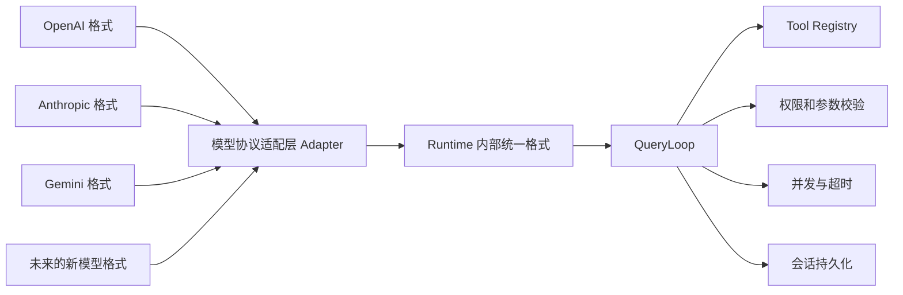

# Runtime 模型与工具协议适配：通俗讲解与面试问答

## 一、面试时可以这样介绍

> 不同模型厂商调用工具的格式并不统一。例如 OpenAI、Anthropic 和 Gemini，在工具定义、工具调用结果以及流式响应事件方面都有差异。
>
> 为了避免业务运行流程直接依赖某一家模型，我在 Runtime 和模型服务之间增加了一层协议适配层。它负责把不同厂商返回的数据，统一转换成 Runtime 内部的标准格式。
>
> Runtime 后面的 QueryLoop、工具权限、参数校验、并发控制、超时和会话持久化，只处理这一套内部格式，不需要关心当前使用的是 OpenAI、Claude 还是 Gemini。
>
> 在切换模型时，如果新模型继续兼容项目已经支持的协议，例如 OpenAI-Compatible 协议，那么通常只需要修改模型名称、接口地址和协议配置，不需要修改核心运行逻辑。
>
> 如果新模型使用的是一种完全不同的协议，就新增对应的 Adapter，负责请求转换、响应解析、流事件解析和 Tool Call 格式转换。核心 QueryLoop 仍然不用修改。
>
> 所以这里所说的“动态适配”，并不是系统可以自动猜出任何未知格式，而是通过“配置选择已有协议、Adapter 扩展新协议”的方式，把模型变化限制在系统边界，降低更换模型对业务逻辑的影响。

这段话已经足够用于大部分技术面试。

---

## 二、用一张图理解



核心思想是：

```text
外部格式可以变化
        ↓
适配层负责翻译
        ↓
Runtime 内部格式保持稳定
```

可以把它理解成公司招聘了不同国家的员工：

- OpenAI 说“英语”；
- Anthropic 说“法语”；
- Gemini 说“德语”；
- Runtime 内部统一说“中文”；
- Adapter 就是翻译人员。

公司内部的审批、工作流和管理制度，不需要因为换了一个外国员工就全部重写。

---

## 三、这里主要使用了哪些设计方法？

### 3.1 Adapter Pattern：适配器模式

这是这部分最核心的设计方法。

不同模型可能用不同方式表达“调用 Read 工具”：

```text
OpenAI：tool_calls + function.arguments
Anthropic：tool_use + input
Gemini：functionCall + args
```

适配层最终统一转换成类似这样的内部含义：

```text
调用编号：call-123
工具名称：Read
工具参数：file_path = app.py
```

QueryLoop 只处理转换后的结果。

面试时可以说：

> 我使用 Adapter Pattern 隔离模型厂商协议差异，将不同 Provider 的请求、响应和工具调用格式转换成 Runtime 内部统一的数据结构。

### 3.2 Anti-Corruption Layer：防腐层

“防腐层”听起来比较抽象，它实际表达的是：

> 不让外部系统的数据结构直接进入内部核心业务。

如果 QueryLoop 直接处理各厂商格式，代码可能变成：

```text
如果是 OpenAI，就读取 tool_calls
如果是 Anthropic，就读取 tool_use
如果是 Gemini，就读取 functionCall
```

以后每增加一个模型，QueryLoop 都要修改。

现在通过适配层以后，Provider 的变化被挡在边界外面，因此它也可以被称为防腐层。

面试时可以说：

> 协议适配层同时承担了防腐层的作用，避免外部模型协议侵入 QueryLoop、权限控制和会话持久化等核心模块。

### 3.3 Canonical Model：内部统一模型

Runtime 内部定义了一套自己的标准格式，可以称为 Canonical Model，也就是“内部标准模型”。

它主要统一了：

- 模型生成的文本；
- 推理内容；
- Tool Call；
- 停止原因；
- Token 使用量；
- Tool Result；
- 会话历史。

这样，上层逻辑面对的永远是同一种结构。

它解决的问题不是“让所有模型返回完全一样的数据”，而是：

> 不管外部模型怎么返回，进入 Runtime 以后都转换成相同含义。

### 3.4 Configuration-Driven：配置驱动

项目会根据配置判断使用哪一种协议，例如：

```text
openai_chat
anthropic_messages
gemini_native
```

然后选择对应的工具消息格式：

```text
OpenAI 协议 → OpenAI Tool 格式
Anthropic 协议 → Anthropic Block 格式
Gemini 协议 → Gemini Parts 格式
```

因此，接入一个兼容已有协议的新模型时，通常不需要写代码，只需要修改配置。

面试时可以说：

> 对于已经支持的协议，通过配置完成模型切换；只有出现新协议时才新增 Adapter，尽量做到对扩展开放、对核心逻辑修改关闭。

这也体现了开闭原则。

### 3.5 Tolerant Reader：宽容读取

模型返回格式有时会有一些小差异。例如：

- 工具参数有时是 JSON 字符串；
- 有时已经是 JSON 对象；
- 有时工具信息放在 `function` 里面；
- 有时直接放在外层。

项目的归一化逻辑会兼容这些常见差异。

这种设计可以称为 Tolerant Reader，即“宽容读取”：

> 对已经预料到的小范围格式差异进行兼容，但不会随意猜测完全未知的数据结构。

这句话很重要，因为它说明系统有兼容性，但不是无限兼容。

---

## 四、什么情况可以动态切换？

| 变化场景 | 是否需要修改核心代码 | 处理方式 |
|---|---:|---|
| 更换模型名称，协议不变 | 不需要 | 修改配置 |
| 更换 Provider，但仍兼容 OpenAI 协议 | 通常不需要 | 修改地址、密钥和协议配置 |
| 切换到已支持的 Anthropic/Gemini 协议 | 不需要修改 QueryLoop | 选择对应协议 |
| Tool Call 参数由字符串变成对象 | 通常不需要 | 归一化逻辑兼容 |
| 新增一个业务工具 | 不需要修改 QueryLoop | 定义并注册工具 |
| 出现完全未知的模型协议 | 需要开发 | 新增协议 Adapter |
| 模型调用不存在的工具 | 不会执行 | 返回明确错误，让模型纠正 |

所以，“动态”的准确含义是：

> 已支持协议范围内，可以配置化切换；超出支持范围，需要扩展适配层，但不需要修改核心运行流程。

---

## 五、接入一个新模型时怎么处理？

### 5.1 新模型兼容 OpenAI 协议

这是最简单的情况。

只需要配置：

- 模型名称；
- Base URL；
- API Key；
- Endpoint Protocol；
- 模型能力。

核心 Runtime 不需要变化。

面试时可以说：

> 如果新模型兼容 OpenAI Chat Completions 和 Tool Calling，我会优先复用现有协议适配器，通过配置接入。

### 5.2 新模型使用项目已有的其他协议

例如新供应商使用 Anthropic Messages 格式。

这种情况主要是：

- 增加 Provider 配置；
- 指定已有协议；
- 验证流式响应；
- 验证 Tool Call；
- 验证是否支持并行工具调用。

核心 QueryLoop 仍然不变。

### 5.3 模型使用全新的协议

需要增加一个新的 Adapter，主要完成五件事情：

1. 把 Runtime 消息转换成新模型的请求格式；
2. 把工具定义转换成模型认识的格式；
3. 解析模型的普通响应；
4. 解析流式响应事件；
5. 把新模型的 Tool Call 转成 Runtime 内部格式。

完成后还需要测试：

- 普通对话；
- 单工具调用；
- 多工具调用；
- 工具失败；
- 流式响应中断；
- 超时和重试；
- 历史消息续跑。

面试时不需要展开具体代码，只要说清楚“扩展位置”和“验证内容”即可。

---

## 六、这套设计带来的业务价值

不要只说“用了适配器模式”，还应该说它解决了什么业务问题。

### 6.1 降低模型绑定

系统不会和某一家模型强绑定。

当出现以下情况时，更换模型的成本更低：

- 模型价格上涨；
- 模型服务不稳定；
- 某个模型停止维护；
- 不同客户需要不同模型；
- 私有化部署需要使用本地模型。

### 6.2 降低修改风险

更换模型时，通常只修改配置或协议适配层，不需要修改：

- QueryLoop；
- 工具执行；
- 权限控制；
- 并发逻辑；
- 会话持久化；
- Finding/Triage 业务规则。

修改范围越小，引入回归问题的概率越低。

### 6.3 提高长任务稳定性

即使模型层发生变化，后面的：

- 工具执行记录；
- 会话状态；
- 重试记录；
- 权限判断；
- 终止状态；

仍然使用统一结构，便于恢复和排查问题。

---

## 七、需要主动说明的技术边界

面试中不要把它描述成“可以随意切换所有模型”。

更准确的说法是：

> 当前支持协议级别的动态切换。只要模型使用项目已经支持的协议，就可以通过配置完成切换；如果出现全新协议，仍然需要开发新的适配器。

另外，当前项目里的模型选择主要由：

```text
LLMService 配置 + Agent 类型
```

决定。

它支持的是：

> 修改配置后，让 Finding 或 Triage 使用另一个模型。

目前还不能完整支持：

> 同一个会话中，每一轮随意传入不同模型名称并立即切换。

如果面试官问到，可以诚实回答：

> 当前主要支持会话或 Agent 级别的模型配置切换。如果要实现每回合动态切换，还需要增加 Model Router，根据模型名称选择 Provider Client，同时保证历史消息可以重新编码成目标 Provider 的格式。现有的统一 Transcript 已经为这个扩展提供了基础。

这个回答比直接说“完全支持动态切换”更加专业。

---

## 八、高频面试追问与参考回答

### 8.1 为什么不让 QueryLoop 直接处理不同模型格式？

参考回答：

> 如果 QueryLoop 直接处理 Provider 格式，它会出现大量针对 OpenAI、Anthropic、Gemini 的条件判断。每接入一个模型都要修改核心循环，容易影响权限、重试和会话状态。通过 Adapter 统一格式以后，QueryLoop 只依赖内部接口，模型变化被限制在边界层。

### 8.2 这里的“协议”具体指什么？

参考回答：

> 这里不是指 HTTP 或 TCP，而是模型接口在应用层定义的数据格式，包括消息结构、工具定义、Tool Call、Tool Result、流式事件和错误格式。例如 OpenAI 使用 `tool_calls`，Anthropic 使用 `tool_use` Block，Gemini 使用 `functionCall` Part。

还可以补充：

> 协议和模型品牌不是一回事。Claude 如果通过 OpenAI-Compatible 网关调用，也可能使用 OpenAI 协议。

### 8.3 如果 Tool Call 字段发生变化怎么办？

参考回答：

> 我会先判断是小范围兼容变化，还是全新协议。如果只是参数从 JSON 字符串变成对象，或者字段嵌套位置发生了已知变化，可以在归一化层兼容。如果数据结构完全改变，则新增或升级对应协议 Adapter，不修改 QueryLoop。

### 8.4 为什么不能自动识别所有新格式？

参考回答：

> 因为未知格式的字段语义无法可靠推断。例如一个字段叫 `action`，系统不能确定它代表工具名称、执行状态还是普通文本。自动猜测可能导致调用错误工具，甚至带来安全风险。因此系统只兼容明确支持的协议，未知格式采用显式适配和失败保护。

### 8.5 接入一个全新模型需要修改哪些地方？

参考回答：

> 主要修改协议边界，包括请求构造、响应解析、流事件解析、Tool Call 归一化和 Tool Result 编码。完成后增加协议合同测试和真实模型的端到端工具调用测试。QueryLoop、权限、并发、超时和持久化逻辑原则上不需要修改。

### 8.6 怎么保证新的 Adapter 没有解析错误？

参考回答：

> 我会使用协议合同测试覆盖普通文本、单工具调用、多工具调用、参数异常、流式中断和 Tool Result 回传。同时使用真实模型做端到端验证，确保模型发起工具调用后，Runtime 能执行并正确把结果送回模型。

### 8.7 Adapter 和 MCP 有什么区别？

参考回答：

> Adapter 主要解决“Runtime 怎么和不同模型沟通”的问题；MCP 主要解决“Agent 怎么以统一方式连接外部工具服务”的问题。它们位于不同边界，可以同时使用。模型 Tool Call 先经过模型协议 Adapter 转成内部格式，再由 Runtime 通过 MCP 调用外部工具。

流程是：

```text
模型响应
→ 模型协议 Adapter
→ Runtime Tool Call
→ 权限检查
→ MCP Tool Server
→ 工具执行结果
→ Adapter 转回模型格式
```

### 8.8 模型调用了不存在的工具怎么办？

参考回答：

> Runtime 不会根据模型生成的名字任意执行代码，而是先到 Tool Registry 中查找。找不到就记录为 missing，并把“未知工具”作为 Tool Result 返回模型，让模型重新选择。这样可以避免模型幻觉出危险工具后被直接执行。

### 8.9 为什么还需要 Pydantic 校验？

参考回答：

> Adapter 只负责统一协议格式，不能保证模型生成的业务参数一定合法。Tool Call 转成内部格式后，还要使用 Pydantic 校验字段类型、必填项和取值范围。只有校验通过，工具才会执行。

两者职责不同：

```text
Adapter：把不同语言翻译成统一语言
Pydantic：检查翻译后的内容是否符合业务要求
```

### 8.10 这套设计有什么缺点？

参考回答：

> 首先，增加了一个适配层，代码结构更复杂；其次，每出现一种全新协议，都要维护对应的解析和测试；另外，不同模型的能力并不完全一致，例如并行工具调用和流式事件可能不同，统一接口只能抽象公共能力，特殊能力仍然需要显式声明。

这样的回答能够体现你不仅了解优点，也理解设计成本。

---

## 九、适合简历或项目介绍的最终版本

### 9.1 正式版本

> 针对不同模型厂商在消息结构、流式响应和 Tool Calling 格式上的差异，设计模型协议适配层，将 OpenAI、Anthropic、Gemini 等外部协议统一转换为 Runtime 内部标准模型，使 QueryLoop、工具权限、并发控制和会话持久化与具体 Provider 解耦。对于兼容已有协议的模型支持配置化切换；对于全新协议，通过新增 Adapter 扩展请求编码、响应解析和 Tool Call 归一化逻辑，控制模型升级或替换对核心运行链路的影响。

### 9.2 口语版本

> 简单来说，我把不同模型的接口差异集中放到一个翻译层里。换模型但协议不变时，只需要改配置；协议完全变了，就增加一个新的翻译器。后面的任务循环、工具权限、超时重试和会话恢复都不用跟着改。这样做的主要价值，是降低系统对单一模型厂商的依赖，同时控制更换模型带来的修改范围和回归风险。
